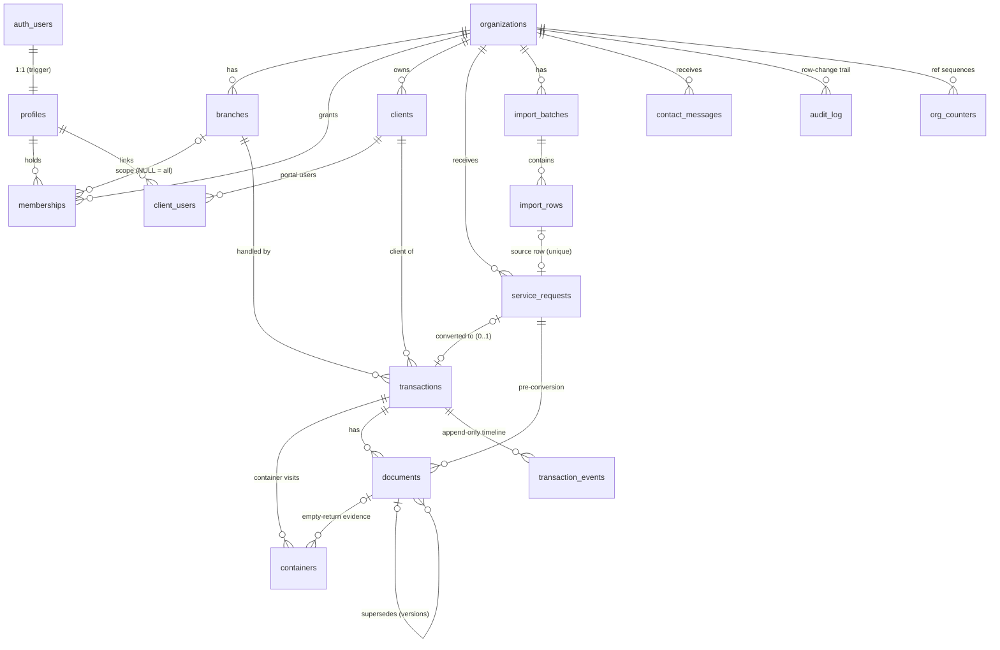
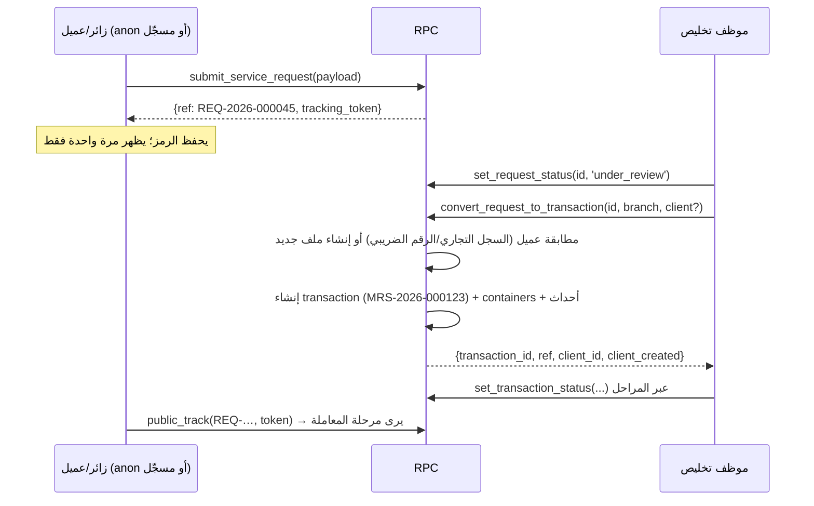

# مرسى أونلاين — المعمارية (بيئة تجريبية Staging)

> **الحالة:** نموذج أولي (Prototype) على بيئة **Staging** ببيانات اختبار فقط. ليس بيئة إنتاج، ولا يُعد إغلاقًا لـ G0 ولا اعتمادًا لتصميم G1. كل ما هنا قابل للتغيير بقرار المالك.
> **المراجع الحاكمة:** وثيقة الرؤية v1.0 (المرجع الأعلى)، مرجع G0 v0.1، خطة G0–G7، مراجعات التكامل ودفترة والأدلة، وتقرير المراجعة `Marsa_G0_Review_2026-10-31.md` (القسمان 5 و8).
> **الفرع:** `online-staging`.

---

## 1. الصورة العامة (Components)

```
المتصفح (HTML/CSS/JS ثابت، بلا Build)
  ├─ assets/js/config.js   ← window.MARSA_CONFIG (فارغ = وضع العرض المحلي)
  ├─ assets/js/main.js     ← window.Marsa (مساعدات الواجهة الحالية)
  ├─ assets/js/supa.js     ← window.MarsaApi (طبقة البيانات: أونلاين أو محلي)
  └─ assets/js/<page>.js   ← منطق الصفحة يستدعي MarsaApi فقط
            │  HTTPS (anon/publishable key + JWT المستخدم)
            ▼
Supabase (مشروع Staging واحد)
  ├─ Auth            ← تسجيل الدخول بالبريد وكلمة المرور، استعادة كلمة المرور
  ├─ PostgREST       ← الجداول في schema public + RPCs (Row Level Security على كل جدول)
  ├─ PostgreSQL 15+  ← schema app (دوال مساعدة وتريغرات، غير مكشوفة عبر API)
  └─ Storage         ← bucket خاص "documents" (سياسات مرتبطة بجدول documents)
```

- **وضعان للواجهة:** إذا كان `supabaseUrl` و`supabaseAnonKey` فارغين، يبقى الموقع كما هو الآن: localStorage وشريط «نسخة عرض تجريبية»، ولا يُحمَّل أي سكربت خارجي. إذا امتلآ، يحمّل `supa.js` مكتبة supabase-js v2.45.4 (UMD) من jsDelivr عند الحاجة، ويحوّل نص الشريط إلى «بيئة تجريبية متصلة (Staging) — بيانات اختبار فقط».
- **لا مفتاح service_role في الواجهة أبدًا.** يرفض `supa.js` العمل إذا اكتشف مفتاح `service_role` أو `sb_secret_…`.
- **schema `app` يجب ألا يُضاف إلى Exposed schemas في إعدادات API.** المكشوف هو `public` فقط.

## 2. البيئات (Environments)

| البيئة | الحالة | الملاحظات |
|---|---|---|
| Local demo | قائمة | الموقع الحالي بلا خادم (config فارغ) |
| Local DB test | قائمة | PGlite (Postgres 16 في الذاكرة) + `supabase/tests/shim.sql` + `run-migrations.js` |
| **Staging** | الهدف الآن | مشروع Supabase مستقل، `organizations.environment = 'staging'`، بيانات اختبار فقط، عناوين `@example.com` |
| Production | **خارج النطاق** | يتطلب اعتماد المالك، ونسخًا احتياطيًا، وتمرين استرجاع، ومراجعة أمنية (G2/G7) |

**خطوات تجهيز Staging (يدوية، بعد موافقة المالك، ولا تُنفذ ضمن هذه المهمة):**
1. إنشاء مشروع Supabase جديد باسم يدل على أنه تجريبي (مثل `marsa-staging`).
2. تشغيل ملفات `supabase/migrations/*.sql` بالترتيب (SQL Editor أو `supabase db push`)، ثم `supabase/seed.sql`.
3. Authentication → Providers → Email: تفعيل التأكيد بالبريد، وضبط Site URL وRedirect URLs على عنوان الموقع التجريبي.
4. إنشاء مستخدمي الاختبار من Dashboard (انظر رأس `seed.sql`) ثم تشغيل مقطع ربط الأدوار في آخره.
5. وضع Project URL والمفتاح العام (anon/publishable) في `assets/js/config.js`.

## 3. نموذج البيانات (ERD)



**قواعد عامة:**
- كل جدول تشغيلي يحمل `org_id`، ويرتبط بالأب عبر **مفتاح أجنبي مركّب `(parent_id, org_id)`**؛ لذلك يستحيل ربط معاملة في مؤسسة بعميل أو فرع من مؤسسة أخرى حتى لو أُدخل المعرّف يدويًا.
- المعرّف الداخلي `uuid`، والرقم المرجعي يُولَّد على الخادم لكل مؤسسة وسنة: `MRS-2026-000123` للمعاملات، و`REQ-2026-000045` للطلبات، و`MSG-…` للرسائل، و`IMP-…` لدفعات الاستيراد (`app.next_ref`، جدول `org_counters`، السنة بتوقيت الرياض).
- القوائم المرمّزة (الحالات، الأدوار، أنواع المستندات) نص + `CHECK`، وتسمياتها العربية والإنجليزية في جدول **`status_labels`** (جاهزية RTL/LTR؛ الواجهة تقرأ التسميات من هنا أو من ملف ترجمة، ولا تكتبها داخل المكوّنات).

| الجدول | الغرض | أهم الحقول والقيود |
|---|---|---|
| `organizations` | المستأجر | `slug` فريد، `ref_prefix`، `environment` (staging/production)، `public_intake_enabled` |
| `branches` | الفروع | `(org_id, code)` فريد — جدة `JED`، الدمام `DMM` |
| `profiles` | 1:1 مع `auth.users` | يُنشأ بتريغر عند التسجيل؛ **لا تُؤخذ أي صلاحية من بيانات التسجيل** |
| `memberships` | مستخدم × مؤسسة × فرع اختياري × دور | `branch_id NULL` = كل الفروع؛ دور `client` بلا فرع |
| `clients` | ملف العميل المستقل (§5) | فرد/منشأة، السجل التجاري (10 أرقام) والرقم الضريبي (15 رقمًا) فريدان داخل المؤسسة، العنوان الوطني الكامل `jsonb` والمختصر `AAAA9999` |
| `client_users` | ربط مستخدم بوابة بملف عميل | يربطه الموظف فقط (D-02: لا ربط تلقائي بالهوية) |
| `service_requests` | الطلب العام (Intake) | كل حقول نموذج `request.html`، `status` (new/under_review/converted/rejected)، `tracking_token_hash`، `declared_count` + `count_kind` منفصلان (arch-10)، `estimate` تقدير غير ضريبي (arch-08) |
| `transactions` | **محور الربط** | `ref`، العملية import/export، الوسيلة، المنافذ، B/L (غير فريد)، رقم البيان (فريد داخل المؤسسة، D-03)، `container_count` رقمي، `operational_status` و`financial_status` منفصلان |
| `containers` | زيارة حاوية لكل معاملة | رقم ISO `AAAA9999999` فريد **داخل المعاملة فقط** (DEC-02)، `return_deadline`، `return_status`، `evidence_document_id` |
| `documents` | الأصل الثابت ومصدره | `kind` (ادعاء الرافع) ≠ `classification` (تحقق الموظف) + `classified_by/at`، `sha256`، `original_name`، `size_bytes`، `version` + `supersedes_id`، `source`/`source_ref`، `visibility`، الإلغاء بدل الحذف |
| `transaction_events` | سجل زمني **Append-only** | `event_type`، `from_status`/`to_status`، `note`، `visible_to_client`، `actor` |
| `import_batches` / `import_rows` | منطقة Staging للرفع الجماعي | بصمة الملف SHA-256، الورقة، رقم الصف، `raw` ثابت، `normalized`، `corrections`، `UNIQUE(org_id, fingerprint, sheet, row_no)` |
| `contact_messages` | رسائل «تواصل معنا» | عبر RPC فقط |
| `audit_log` | أثر تدقيق عام **Append-only** | الجدول، الصف، العملية، الحقول المتغيرة، القيم قبل وبعد، المنفّذ ودوره |

## 4. الأدوار ومصفوفة الصلاحيات (Role matrix)

الأدوار (من §8.2 في الرؤية): `client` عميل، `clearance_staff` موظف تخليص، `transport_staff` موظف نقل، `accountant` محاسب، `accounts_manager` مدير حسابات، `operations_manager` مدير عمليات، `supervisor` مشرف، `admin` مدير نظام.

**نطاق الفرع:** عضوية الموظف المرتبطة بفرع ترى معاملات ذلك الفرع فقط. العضوية بلا فرع ترى كل فروع المؤسسة. ملف العميل مشترك على مستوى المؤسسة (قرار مفتوح، انظر القسم 13).

الرموز: R قراءة، I إضافة، U تعديل، — لا شيء. «RPC» تعني أن العملية متاحة عبر دالة خادم فقط.

| الكيان | client | clearance | transport | accountant | accounts_mgr | ops_mgr | supervisor | admin |
|---|---|---|---|---|---|---|---|---|
| organizations | R | R | R | R | R | R | R | R U |
| branches | R | R | R | R | R | R | R | R I U |
| memberships | R (عضويته) | R (عضويته) | R (عضويته) | R (عضويته) | R (عضويته) | R (عضويته) | R | R I U D |
| clients | R (ملفه) | R I U | R | R | R | R I U | R I U | R I U |
| client_users | R (ربطه) | R | R | R | R | R I U | R I U | R I U |
| service_requests | R (ما قدّمه) · I عبر RPC | R U · RPC | — | — | — | R U · RPC | R U · RPC | R U · RPC |
| transactions | R (معاملاته) | R I U | R | R | R | R I U | R I U | R I U |
| containers | R (معاملاته) | R I U | R I U | R | R | R I U | R I U | R I U |
| documents | R (المتاح للعميل + ما رفعه) · I على معاملاته | R I U* | R I U* | R I U* | R I U* | R I U* | R I U* | R I U* |
| transaction_events | R (المرئي للعميل) | R · I ملاحظة | R · I ملاحظة | R · I ملاحظة | R · I ملاحظة | R · I ملاحظة | R · I ملاحظة | R · I ملاحظة |
| import_batches/rows | R I U (دفعاته لملفه) | R I U | — | — | — | R I U | R I U | R I U |
| contact_messages | — | R U | — | — | — | R U | R U | R U |
| audit_log | — | — | — | — | — | — | R | R |

\* تعديل المستند يقتصر على التصنيف والظهور والإلغاء؛ الأصل (المسار، البصمة، الاسم، الحجم) لا يتغير أبدًا. لا يوجد DELETE لأي مستند أو حدث أو سجل تدقيق.

لا يكتب أي دور الحقول `ref` و`org_id` و`operational_status` و`financial_status` و`tracking_token_hash` مباشرة؛ تريغرات الحماية ترفض ذلك (`MRS_IMMUTABLE`) وتمر التغييرات عبر RPC.

**نقل الحالة التشغيلية (`set_transaction_status`):**

| الحالة الهدف | الأدوار المسموحة (ضمن فرعها) |
|---|---|
| new، in_progress، customs_declaration | clearance_staff، operations_manager، supervisor، admin |
| appointment، transport، empty_return | ما سبق + transport_staff |
| operationally_complete | clearance_staff، operations_manager، supervisor، admin — **بشرط** أن تكون كل الحاويات `returned_verified` أو `waived` |
| under_billing، billed | accountant، accounts_manager، admin |
| closed | accounts_manager، supervisor، admin |
| أي رجوع للخلف (تصحيح) | operations_manager، supervisor، admin مع سبب إلزامي؛ إعادة فتح `closed` للـ admin فقط |

يمكن القفز للأمام (مثل الشحن الجوي بلا حاويات). كل نقل يضيف حدثًا، ولا يُعدَّل حدث سابق.

## 5. قواميس الحالات (Status dictionaries)

**الحالة التشغيلية `operational_status`** — الحالات العشر في §6.3 من الرؤية:

| # | code | العربية | English |
|---|---|---|---|
| 1 | new | جديدة | New |
| 2 | in_progress | قيد العمل | In progress |
| 3 | customs_declaration | البيان الجمركي | Customs declaration |
| 4 | appointment | الموعد | Appointment |
| 5 | transport | النقل | Transport |
| 6 | empty_return | إعادة الحاوية الفارغة | Empty container return |
| 7 | operationally_complete | منتهية تشغيليًا | Operationally complete |
| 8 | under_billing | تحت الفوترة | Under billing |
| 9 | billed | تمت الفوترة | Billed |
| 10 | closed | مغلقة | Closed |

المرحلتان 8 و9 تبقيان معالم في المسار كما في الرؤية، لكن لا يحرّكهما إلا أدوار المالية، ولا تعنيان إصدار فاتورة ضريبية داخل النظام.

**الحالة المالية `financial_status`** — **مؤقتة (Placeholder) إلى G4**، ومستقلة تمامًا عن التشغيلية، ولا تظهر للعميل: `not_started` لم تبدأ، `estimate_only` تقدير غير ضريبي فقط، `draft_pending` مسودة قيد الإعداد، `invoiced` صدرت الفاتورة (خارج النظام)، `settled` مسددة.

**حالات أخرى:** الطلب `request_status` (new، under_review، converted، rejected). إرجاع الحاوية `container_return_status` (pending، evidence_submitted، returned_verified، disputed، waived). تصنيف المستند `classification_status` (unreviewed، confirmed، reclassified، ambiguous). الرسالة `contact_status`. صف الاستيراد `import_row_status`.

**أنواع المستندات `document_kind`:** bill_of_lading، commercial_invoice، packing_list، certificate_of_origin، saber_certificate، customs_declaration، delivery_order، appointment، container_delivery_eir، empty_return_note، **empty_return_receipt**، operator_invoice، government_doc، import_file، other.

## 6. مسار الطلب → المراجعة → العميل والمعاملة



- الطلب **ليس** ملف العميل: يحفظ ما كتبه مقدم الطلب كما هو. التحويل يطابق ملف عميل موجود بالمفتاح الطبيعي، أو ينشئ واحدًا، أو يستخدم `p_client_id` يختاره الموظف (arch-01).
- لا يُربط حساب مقدم الطلب بملف العميل تلقائيًا؛ الربط عبر `client_users` قرار بشري (D-02).
- المستندات المرفوعة على الطلب تنتقل إلى المعاملة بإضافة `transaction_id` دون نقل الملف.
- الرفض يحتاج سببًا. الطلب المحوّل لا يُحوّل مرة ثانية (`MRS_ALREADY_CONVERTED`).
- نموذج الطلب العام لا يرفع ملفات في الوضع المتصل (الزائر غير مسجّل)، بل يرسل قائمة أسماء المستندات المعلنة. الرفع الفعلي يتم من بوابة العميل بعد تسجيل الدخول، أو من الموظف.

## 7. التتبع العام (Public tracking)

- `public_track(p_ref, p_token)`: الرقم المرجعي **و**رمز سري عشوائي بطول 256 بت (64 خانة hex). يُخزَّن SHA-256 للرمز فقط، ولا يُكتب الرمز في سجل التدقيق.
- الخطأ نفسه (`MRS_NOT_FOUND`) للرقم غير الموجود وللرمز الخاطئ، فلا يكشف وجود الرقم.
- **الحقول المعادة:** الرقم المرجعي، نوع العملية والوسيلة، حالة الطلب، ثم للمعاملة: المرحلة وتسميتها بالعربية والإنجليزية، ورقمها من 10، وتاريخ آخر تغيير، وخط زمني للمراحل (حالة + وقت فقط)، وعدد الحاويات والمُرجع منها. **لا** أسماء ولا أرقام جوال ولا قيم ولا ملاحظات ولا أرقام حاويات ولا بيانات مالية.
- الطلب المحوّل يبقى قابلًا للتتبع برمزه الأصلي ويعرض مرحلة المعاملة. للمعاملات التي ينشئها الموظف مباشرة: `issue_tracking_token(transaction_id)` يصدر رمزًا جديدًا، ويُبطل السابق.
- ملاحظات الموظف عند تغيير الحالة تُحفظ في حدث `note` داخلي منفصل؛ أحداث الحالة المرئية للعميل لا تحمل نصًا حرًا.
- **قرار مفتوح (القرار 8 في التقرير):** إبقاء التتبع العام بهذه الصيغة المختصرة أو حصره في البوابة.

## 8. التخزين (Storage layout)

- bucket خاص `documents` (غير عام)، بحد 25 ميغابايت، وأنواع PDF وصور JPEG/PNG/WebP/HEIC وXLSX وCSV.
- **مسار الكائن:** `{org_id}/{transaction_id}/{document_id}/{safe_file_name}`، أو `{org_id}/r_{request_id}/{document_id}/{safe_file_name}` قبل التحويل. القيد `documents_path_chk` يفرض هذه الصيغة. الاسم الأصلي (العربي) يُحفظ في `original_name`، واسم الملف في التخزين ASCII فقط.
- **الرفع:** (1) إدخال صف `documents` بمعرّف يولّده المتصفح، وبصمة SHA-256 محسوبة في المتصفح. (2) رفع الملف إلى المسار نفسه بالضبط. سياسة INSERT على `storage.objects` تسمح فقط بمسار صف سجّله المستخدم نفسه خلال 24 ساعة.
- **القراءة:** سياسة SELECT تسمح بالكائن إذا كان المستخدم يستطيع قراءة صف `documents` المطابق؛ أي أن RLS على `documents` هي الحكم. التنزيل عبر Signed URL قصير العمر (`MarsaApi.documentUrl`، افتراضيًا 5 دقائق).
- **لا UPDATE ولا DELETE:** الأصل لا يُستبدل. النسخة الجديدة صف جديد بـ`supersedes_id` و`version + 1`. الخطأ يُعالج بالإلغاء (`voided_at` + `void_reason`).
- **حد معروف في Staging:** البصمة يحسبها المتصفح ولا يتحقق منها الخادم. في G2 تُضاف Edge Function تتحقق من الحجم والبصمة بعد الرفع.

## 9. التدقيق والأحداث (Audit & events)

- **`transaction_events`** خط زمني للأعمال: `created`، `request_converted`، `operational_status`، `financial_status`، `container_return`، `document`، `note`، `tracking_token`. الإضافة تأتي من RPC وتريغرات الخادم. المستخدم يضيف مباشرة نوع `note` فقط، ويُختم بـ`auth.uid()`.
- **`audit_log`** أثر تقني عام لكل INSERT/UPDATE/DELETE على: organizations، branches، memberships، clients، client_users، service_requests، transactions، containers، documents، import_batches، contact_messages. يحفظ القيم قبل وبعد (jsonb)، والحقول المتغيرة، و`actor` و`actor_role`. التحديث الذي لا يغير شيئًا لا يُسجَّل. `import_rows` مستثنى لأنه كثيف، وتصحيحاته محفوظة داخله في `corrections`.
- **Append-only:** لا سياسات UPDATE/DELETE، وسحب الامتياز من `authenticated`، وتريغر `BEFORE UPDATE OR DELETE` وآخر `BEFORE TRUNCATE` يرفضان حتى مالك الجدول (`MRS_APPEND_ONLY`).
- **التصحيح لا يمحو التاريخ:** الرجوع بالحالة حدث جديد بسبب إلزامي. إلغاء التحقق من حاوية يحتفظ بالدليل، ويسجل حدثًا. تعديل البيانات العادية يحفظ قبل وبعد في `audit_log`.

## 10. الحاويات ودليل إرجاع الفارغ

- لكل حاوية حالة إرجاع مستقلة (G0-004). الحالة `returned_verified` تتطلب `evidence_document_id` لمستند من **نفس المعاملة** صنّفه الموظف `empty_return_receipt` بحالة `confirmed` أو `reclassified`، ويُختم `verified_by/at` تلقائيًا.
- إيصال تسليم الحاوية الممتلئة (EIR)، وتعليمات الإرجاع (Empty Return Note)، ورسالة الناقل **لا تثبت الإرجاع** (EV-01، EV-02، D-09)، ويرفضها الخادم (`MRS_EVIDENCE_INVALID`). عبارة «EMPTY RETURN By» تُسجَّل في `return_deadline`، فهي موعد وليست دليلًا.
- `waived` تتطلب سببًا موثقًا. `disputed` للدليل الغامض بانتظار مراجعة بشرية.
- إثبات الإرجاع لا يعني تسوية رسوم الغسيل أو الإصلاح، ولا يمس الحالة المالية.

## 11. الرفع الجماعي (Import staging)

1. يحسب المتصفح SHA-256 للملف الأصلي (`file_fingerprint`)، وينشئ `import_batches`. يمكن حفظ الملف نفسه كمستند `import_file`.
2. يُدخل كل صف إلى `import_rows`: `raw` كما قُرئ (لا يتغير أبدًا)، و`normalized` بمفاتيح `submit_service_request` نفسها، و`row_status` (pending/valid/error)، و`validation_errors`.
3. **معرّف مصدر ثابت لكل سطر:** `source_row_id = fingerprint:sheet:row_no` (عمود مولَّد)، مع `UNIQUE(org_id, fingerprint, sheet, row_no)`. رفع الملف نفسه مرة أخرى يُرفض على مستوى الصف (`DUPLICATE`)؛ والواجهة تبحث أولًا عن دفعة بالبصمة نفسها (`findBatchByFingerprint`) وتعرضها.
4. تعديل `normalized` يضيف تلقائيًا `{at, by, before, after}` إلى `corrections` (arch-11).
5. `import_commit(batch_id)`: لكل صف صالح يُنشئ طلب خدمة `source='bulk'` بـ`import_row_id` فريد، فلا تكرار حتى عند إعادة المحاولة. إذا كان رقم البوليصة معروفًا مسبقًا في طلب أو معاملة، يصبح الصف `duplicate` مع `duplicate_of` وينتظر قرارًا بشريًا (`decision = accept | skip`). الأخطاء تُكتب على الصف ولا توقف الدفعة. الدالة **Idempotent**: يمكن استدعاؤها مرة أخرى بعد التصحيح، وتصبح الدفعة `committed` عندما لا يبقى صف مفتوح.
6. من يستورد: موظفو التخليص والعمليات والمشرف والمدير لأي عميل في المؤسسة، والعميل لملفه فقط (`client_id` من روابطه). الزائر غير المسجّل لا يستورد في الوضع المتصل؛ صفحة الرفع الجماعي تطلب تسجيل الدخول.
7. ناتج الاعتماد يتضمن لكل صف الرقم المرجعي ورمز التتبع، ويظهر مرة واحدة ليُصدَّر للمستخدم.

## 12. ما هو خارج النطاق عمدًا

- المحاسبة: دفتر الأستاذ، القيود، سندات القبض والصرف، العهد، الأرضيات، الربحية (G4+).
- تكامل دفترة والإصدار الضريبي ZATCA/فاتورة، وأي فاتورة ضريبية داخل النظام. `financial_status` مجرد مؤشر مؤقت.
- كتالوج البنود والضرائب والتسعير لكل مؤسسة. تقدير الحاسبة يُحفظ في `estimate` ويُوسم `is_tax_document = false`.
- تكاملات فسح/سابر الحكومية، وOCR والاستخراج الآلي، والإشعارات (واتساب/بريد)، وRealtime.
- الواجهة الإنجليزية الكاملة ومبدّل اللغة؛ البنية جاهزة فقط (تسميات ثنائية، نصوص `supa.js` في `i18n.ar`).
- بيئة الإنتاج، والنسخ الاحتياطي واختبار الاسترجاع، وMFA، واختبار الاختراق.
- لوحات الموظفين والبوابة نفسها؛ تُبنى فوق `MarsaApi` في مهام لاحقة.

## 13. قرارات مفتوحة للمالك

1. **ملكية العملاء بين الفروع:** حاليًا ملف العميل مشترك لكل موظفي المؤسسة، والمعاملات معزولة بالفرع. هل يُعزل العميل بالفرع أيضًا؟ (مانع في مرجع G0 §7.)
2. **التتبع العام:** إبقاؤه برقم + رمز سري وحالة مختصرة، أو حصره في بوابة العميل (القرار 8).
3. **شرط الإغلاق التشغيلي:** المطبّق الآن: «منتهية تشغيليًا» تتطلب إثبات إرجاع كل حاوية أو استثناءً موثقًا. هل يُعتمد هذا، وما علاقته بالفوترة (G0-003 مقابل D-08، القرار 3)؟
4. **رفع الزائر للمستندات:** هل يُسمح برفع ملفات قبل تسجيل الدخول (يتطلب Edge Function بروابط رفع موقّعة ومكافحة إساءة)، أم يبقى الرفع بعد الدخول فقط؟
5. **التسجيل الذاتي للعملاء:** مفتوح الآن، والحساب الجديد بلا أي وصول حتى يربطه موظف. هل يُغلق التسجيل ويكون بالدعوة فقط؟
6. **وصول المحاسب وموظف النقل إلى كل المستندات:** حاليًا يقرأ كل موظف مستندات معاملات فرعه. هل يُقيَّد ذلك بنوع المستند؟
7. **الاسم والهوية:** «مرسى» أو «مرساة كلاود» أو «منصة المرساة المتكاملة» على الواجهة والمستندات (القرار 2). البذرة تستخدم «مؤسسة البحر الأزرق (بيئة تجريبية)».
8. **حد معدل الطلبات:** 5 طلبات لكل رقم جوال في الساعة، و120 طلبًا عامًا لكل مؤسسة كل 10 دقائق. هل يلزم CAPTCHA أو Edge rate limiting قبل أي استخدام عام؟
9. **صيغة الرقم الضريبي:** التحقق الحالي 15 رقمًا فقط. هل يُفرض النمط السعودي (يبدأ وينتهي بـ3)؟

## 14. الربط بمبادئ G0

| المبدأ | التطبيق هنا |
|---|---|
| SaaS متعدد المؤسسات والفروع (G0-001/002) | organizations → branches → memberships؛ `org_id` في كل صف؛ مفاتيح أجنبية مركبة |
| العزل بـRLS لا بإخفاء الواجهة | RLS على كل جدول، وanon بلا أي صلاحية على الجداول، واختبارات عزل في `run-migrations.js` (مستأجر آخر، فرع آخر، إدخال المعرف مباشرة) |
| Least Privilege | سياسات بحسب الدور والفرع، وتغيير الحالة عبر RPC، وسحب EXECUTE الافتراضي عن الدوال، و`search_path = ''` في كل دالة SECURITY DEFINER |
| المعاملة محور الربط | الحاويات والمستندات والأحداث مرتبطة بالمعاملة؛ والطلب يتحول إليها |
| الإدخال مرة واحدة + مراجع مستقلة | ملفات مستقلة للعميل والمستند والحاوية؛ والتحويل ينقل بيانات الطلب دون إعادة إدخال |
| فصل التشغيل عن المال | `operational_status` ≠ `financial_status`؛ ولا جداول محاسبية |
| حفظ الأصل ومصدره | `documents`: بصمة، اسم أصلي، مصدر، نسخ، تصنيف بشري منفصل عن الادعاء |
| التصحيح لا يمحو الأثر | أحداث Append-only، و`audit_log`، و`corrections` في الاستيراد، والإلغاء بدل الحذف |
| دليل فارغ لكل حاوية (G0-004) | `containers.return_status` + دليل `empty_return_receipt` مؤكد فقط |
| معرف مصدر فريد لكل سطر (arch-05) | `source_row_id` + قيد فريد + `import_row_id` فريد في الطلبات |
| لا نجاح عند الفشل (arch-06) | كل استدعاء يعيد `{data, error}`؛ والواجهة لا تعرض رقمًا مرجعيًا إلا من الخادم |
| ترقيم الخادم لكل مؤسسة (arch-09) | `app.next_ref` + `org_counters` |
| العربية RTL والإنجليزية LTR | `status_labels.label_ar/label_en`، و`profiles.locale`، و`organizations.default_locale`، ونصوص مركزية في `supa.js` |

## 15. واجهة RPC وطبقة MarsaApi (للمطورين)

**RPCs:**

| الدالة | من يستدعيها | يعيد |
|---|---|---|
| `submit_service_request(payload jsonb)` | anon، authenticated | `{ref, tracking_token, status, created_at, environment}` |
| `submit_contact_message(payload jsonb)` | anon، authenticated | `{ref, created_at}` |
| `public_track(p_ref text, p_token text)` | anon، authenticated | `{ref, kind, request?, transaction?{…, timeline[]}}` |
| `my_context()` | authenticated | `{user_id, profile, memberships[], clients[]}` |
| `set_request_status(p_request_id uuid, p_status text, p_note text)` | موظفو العمليات | `{request_id, ref, from, to}` |
| `convert_request_to_transaction(p_request_id uuid, p_branch_id uuid, p_client_id uuid)` | موظفو العمليات | `{transaction_id, ref, client_id, client_created, containers, request_ref}` |
| `set_transaction_status(p_transaction_id uuid, p_status text, p_note text)` | بحسب الجدول في القسم 4 | `{transaction_id, ref, from, to, event_id}` |
| `set_financial_status(p_transaction_id uuid, p_status text, p_note text)` | أدوار المالية | `{transaction_id, from, to, event_id}` |
| `issue_tracking_token(p_transaction_id uuid)` | موظفو العمليات | `{ref, tracking_token}` |
| `import_commit(p_batch_id uuid)` | منشئ الدفعة أو موظفو العمليات | `{committed, skipped, duplicates, errors, open_rows, batch_status, items[]}` |

**مفاتيح `payload` لطلب الخدمة** (هي أسماء حقول `request.html`): `fullName company phone email clientType taxId crNumber contactPref direction service mode country port goods hsCode declarationNo needAci value currency weight containerType containerNumbers count blNumber shippingLine eta docsLater notes documents[] calc terms branchCode orgSlug`. يقبل `MarsaApi.submitServiceRequest` السجل الحالي الذي يبنيه `request.js` (بالكائنين `client` و`shipment`) ويحوّله بنفسه.

**الأخطاء:** يرفع الخادم `MESSAGE = 'MRS_<CODE>'` و`DETAIL = <field>`. يحوّلها `supa.js` إلى `{code, field, message (عربي), raw}`. الرموز: MRS_INVALID، MRS_REQUIRED، MRS_TOO_LONG، MRS_RATE_LIMITED، MRS_NOT_FOUND، MRS_FORBIDDEN، MRS_AUTH_REQUIRED، MRS_INTAKE_CLOSED، MRS_BAD_TRANSITION، MRS_NOTE_REQUIRED، MRS_CONTAINERS_NOT_RETURNED، MRS_EVIDENCE_INVALID، MRS_APPEND_ONLY، MRS_IMMUTABLE، MRS_ALREADY_CONVERTED، MRS_BRANCH_REQUIRED، MRS_BATCH_NOT_DRAFT، وفي الواجهة فقط MRS_DEMO_MODE وMRS_NETWORK وMRS_CONFIG.

**قواعد للمطورين:**
- ترتيب السكربتات: `config.js` ← `main.js` ← `supa.js` ← سكربت الصفحة، وكلها `defer`. لا تضف وسم supabase-js يدويًا؛ `supa.js` يحمّله عند الحاجة.
- كل دالة في `MarsaApi` تعيد Promise بالشكل `{data, error}` ولا ترمي استثناءً. **لا تعرض شاشة نجاح أو رقمًا مرجعيًا إلا إذا كان `error` فارغًا.**
- في وضع العرض: `submitServiceRequest` و`submitContactMessage` و`publicTrack` تحفظ وتقرأ من localStorage كما الآن (`publicTrack` يعيد السجل المحلي في `data.local`). بقية الدوال تعيد `MRS_DEMO_MODE`، فاعرض للمستخدم رسالة `error.message`.
- `tracking_token` يظهر مرة واحدة فقط: اعرضه مع رابط `tracking.html?ref=…&t=…`، ونبّه المستخدم إلى حفظه. لا تحفظه في localStorage إلا بموافقة صريحة.
- نص الفوتر عن «البيانات تبقى على جهازك» يجب أن يتغير في الوضع المتصل؛ العنصر `<html data-marsa-mode="online|demo">` متاح لذلك.
- الاختبار المحلي: `node run-migrations.js` في `scratchpad/pgtest`، ويحمّل shim ثم كل الترحيلات ثم البذرة مرتين، ويشغّل اختبارات RLS وRPC.

## Security review (2026-10-31, staging)

Fixed in migrations (tests: `supabase/tests/rls-tests.js`):
- Internal columns hidden from API roles by column grants (0700): `transactions.notes`, `transactions.tracking_token_hash`, `clients.notes`, `clients.classification`, `service_requests.tracking_token_hash`. Staff read them via `staff_internal_fields(table, ids)`; `supa.js` merges them for staff. New columns on these tables are not selectable until added to the grant.
- `memberships`: no direct INSERT/UPDATE/DELETE for API roles; only `admin_add_member` / `admin_set_member_active` (self + last-admin guards).
- `app.next_ref` no longer executable by `authenticated`; invoker triggers use `app.next_ref_checked` (staff of that org only, no counter bump otherwise).
- Stage order: forward moves one stage at a time (empty_return may be passed over with no containers); other skips need operations_manager/supervisor/admin + reason. Declared-but-unregistered containers block `operationally_complete`.
- Container waiver: operations_manager/supervisor/admin only, reason required.
- Bulk import: staff only (client batches bypassed the intake rate guard and terms).
- Cancelled batch releases its source IDs (`import_rows.is_live`, partial unique index); rows are kept.
- Client/requester uploads are forced to `visibility='client'`, `source='upload'`.
- Off-boarded staff lose access to documents they uploaded.
- anon: no USAGE on sequences; default privileges for future objects revoked from anon.
- Frontend: signed document URLs must be on the configured Supabase origin.

Open (owner decision): `admin_add_member` reveals whether an e-mail has an account (use an invitation flow for production); intake rate guard is per phone + per org (needs edge/IP rate limit or CAPTCHA).
