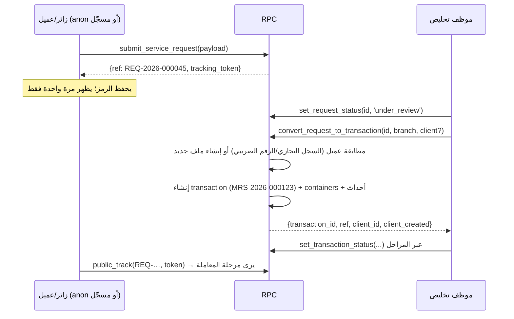

# مرسى أونلاين — المعمارية (بيئة تجريبية Staging)

> **الحالة:** نموذج أولي (Prototype) على بيئة **Staging** ببيانات اختبار فقط. ليس بيئة إنتاج، ولا يُعد إغلاقًا لـ G0 ولا اعتمادًا لتصميم G1. كل ما هنا قابل للتغيير بقرار المالك.
> **المراجع الحاكمة:** وثيقة الرؤية v1.0 (المرجع الأعلى)، مرجع G0 v0.1، خطة G0–G7، مراجعات التكامل ودفترة والأدلة، وتقرير المراجعة `Marsa_G0_Review_2026-10-31.md` (القسمان 5 و8).
> **الفرع:** `online-staging`.

---

## 1. الصورة العامة (Components)

```
المتصفح (HTML/CSS/JS ثابت، بلا Build)
  ├─ assets/js/config.js   ← window.MARSA_CONFIG (فارغ = وضع العرض المحلي)
  ├─ assets/js/i18n.js     ← window.MarsaI18n (G2.11: القاموس المركزي، اللغة والاتجاه، تنسيق التاريخ والأرقام)
  ├─ assets/i18n/<page>.js ← قاموس الصفحة (index وlogin وadmin وplatform وapp وportal وocr وbulk، ومنذ G3 ops لوحدات العمليات)
  ├─ assets/js/main.js     ← window.Marsa (مساعدات الواجهة الحالية)
  ├─ assets/js/supa.js     ← window.MarsaApi (طبقة البيانات: أونلاين أو محلي)
  ├─ assets/js/ops/*.js    ← G3: window.MarsaOps (شاشات العمليات وأقسام المعاملة، تُحمَّل قبل admin.js)
  ├─ assets/js/fin/*.js    ← G4: شاشات المالية التشغيلية وأقسامها في المعاملة (عبر MarsaOps نفسه)
  ├─ assets/js/bill/*.js   ← G5: الفوترة ودفترة (#billing، #daftra، قسم bill-invoices) — لا تستدعي دفترة أبدًا
  ├─ assets/js/rpt/*.js    ← G6a: اللوحات والبحث والتقارير والتصدير (#dashboard، #search، #reports)
  ├─ assets/js/msg/*.js    ← G6b: صندوق المراسلات الموحد (#inbox، #channels، #contacts، #templates، قسم msg-thread) — نصوص الرسائل textContent فقط
  └─ assets/js/<page>.js   ← منطق الصفحة يستدعي MarsaApi فقط
            │  HTTPS (anon/publishable key + JWT المستخدم)
            ▼
Supabase (مشروع Staging واحد)
  ├─ Auth            ← تسجيل الدخول بالبريد وكلمة المرور، استعادة كلمة المرور
  ├─ PostgREST       ← الجداول في schema public + RPCs (Row Level Security على كل جدول)
  ├─ PostgreSQL 15+  ← schema app (دوال مساعدة وتريغرات، غير مكشوفة عبر API)
  ├─ Storage         ← buckets خاصة: "documents"، و"finance" (G4)، و"messages" (G6b، مرفقات الرسائل؛ يكتبها service_role فقط)
  └─ Edge Functions  ← G5: daftra-sync (مصدر فقط، غير منشورة). العامل الوحيد الذي يكلّم دفترة،
                       بمفتاح service_role عبر دوال daftra_* فقط؛ في G5 عبر محاكي دفترة وحده (لا شبكة ولا مفتاح)
                     G6b: inbox-sync (مصدر فقط، غير منشورة). العامل الوحيد الذي يكلّم البريد / واتساب، عبر دوال msg_* الثماني
                       لـ service_role؛ في G6b عبر محاكي بريد ومحاكي واتساب ومزوّد قواعد محلي فقط (لا صندوق ولا حساب ولا LLM ولا شبكة)
```

- **وضعان للواجهة:** إذا كان `supabaseUrl` و`supabaseAnonKey` فارغين، يبقى الموقع كما هو الآن: localStorage وشريط «نسخة عرض تجريبية»، ولا يُحمَّل أي سكربت خارجي. إذا امتلآ، يحمّل `supa.js` مكتبة supabase-js v2.45.4 (UMD) من jsDelivr عند الحاجة، ويحوّل نص الشريط إلى «بيئة تجريبية متصلة (Staging) — بيانات اختبار فقط».
- **لا مفتاح service_role في الواجهة أبدًا.** يرفض `supa.js` العمل إذا اكتشف مفتاح `service_role` أو `sb_secret_…`.
- **schema `app` يجب ألا يُضاف إلى Exposed schemas في إعدادات API.** المكشوف هو `public` فقط.

## 2. البيئات (Environments)

| البيئة | الحالة | الملاحظات |
|---|---|---|
| Local demo | قائمة | الموقع الحالي بلا خادم (config فارغ) |
| Local DB test | قائمة | PGlite (Postgres 16 في الذاكرة) + `supabase/tests/shim.sql` + `run-migrations.js` |
| **Staging** | الهدف الآن | مشروع Supabase مستقل، `organizations.environment = 'staging'`، بيانات اختبار فقط، عناوين `@example.com` |
| Production | **خارج النطاق** | يتطلب اعتماد المالك، ونسخًا احتياطيًا، وتمرين استرجاع، ومراجعة أمنية (G2/G7) |

**خطوات تجهيز Staging (يدوية، بعد موافقة المالك، ولا تُنفذ ضمن هذه المهمة):**
1. إنشاء مشروع Supabase جديد باسم يدل على أنه تجريبي (مثل `marsa-staging`).
2. تشغيل ملفات `supabase/migrations/*.sql` بالترتيب (SQL Editor أو `supabase db push`)، ثم `supabase/seed.sql`.
3. Authentication → Providers → Email: تفعيل التأكيد بالبريد، وضبط Site URL وRedirect URLs على عنوان الموقع التجريبي.
4. إنشاء مستخدمي الاختبار من Dashboard (انظر رأس `seed.sql`) ثم تشغيل مقطع ربط الأدوار في آخره.
5. وضع Project URL والمفتاح العام (anon/publishable) في `assets/js/config.js`.
6. **G2:** تشغيل `20261102000100_idempotency.sql` ثم `…000200_orgs_branches_invites.sql` ثم `…000300_ops_observability.sql` (أو الحزمة `supabase/all_migrations.sql`)، ثم `supabase/make_platform_admin.sql` ببريد مدير المنصة. التفاصيل في `docs/online/G2_REPORT_AR.md` و`ENVIRONMENTS_AR.md`.
7. **G3:** تشغيل `20261103000100_g3_registry.sql` ثم `…000200_g3_operations.sql`، **A ثم B دائمًا** (أو `supabase/all_migrations.sql`، 13 ترحيلًا). يُستحسن تفعيل `pg_cron` قبلهما. التفاصيل في `docs/online/G3_REPORT_AR.md` §3.

## 3. نموذج البيانات (ERD)

```mermaid
erDiagram
  organizations ||--o{ branches : has
  organizations ||--o{ memberships : grants
  profiles ||--o{ memberships : holds
  auth_users ||--|| profiles : "1:1 (trigger)"
  branches |o--o{ memberships : "scope (NULL = all)"
  organizations ||--o{ clients : owns
  clients ||--o{ client_users : "portal users"
  profiles ||--o{ client_users : links
  organizations ||--o{ service_requests : receives
  import_rows |o--o| service_requests : "source row (unique)"
  service_requests |o--o| transactions : "converted to (0..1)"
  clients ||--o{ transactions : "client of"
  branches ||--o{ transactions : "handled by"
  transactions ||--o{ containers : "container visits"
  transactions ||--o{ documents : has
  service_requests ||--o{ documents : "pre-conversion"
  documents |o--o{ containers : "empty-return evidence"
  documents |o--o{ documents : "supersedes (versions)"
  transactions ||--o{ transaction_events : "append-only timeline"
  organizations ||--o{ import_batches : has
  import_batches ||--o{ import_rows : contains
  organizations ||--o{ contact_messages : receives
  organizations ||--o{ audit_log : "row-change trail"
  organizations ||--o{ org_counters : "ref sequences"
  profiles ||--o| platform_admins : "G2: platform operator"
  organizations ||--o{ invitations : "G2: pending / accepted"
  branches |o--o{ invitations : "scope"
  clients |o--o{ invitations : "client-portal invite"
  organizations |o--o{ idempotency_keys : "G2: replay store"
  organizations |o--o{ client_errors : "G2: scrubbed UI errors"
  organizations ||--o{ parties : "G3: counterparties"
  parties ||--o{ drivers : "carrier"
  parties ||--o{ trucks : "carrier"
  clients ||--o{ client_aliases : "G3.2: other spellings"
  transactions ||--o{ customs_declarations : "G3.5: declarations"
  customs_declarations |o--o| customs_declarations : "replaced_by"
  documents |o--o{ customs_declarations : "source document"
  organizations ||--o{ bills_of_lading : "G3.6: B/Ls"
  parties |o--o{ bills_of_lading : "shipping agent"
  transactions ||--o{ transaction_bls : "B/L links (many-to-many)"
  bills_of_lading ||--o{ transaction_bls : "feeds"
  transaction_bls |o--o{ containers : "bl_id (same transaction)"
  parties |o--o{ containers : "return yard"
  documents |o--o{ containers : "Return Note (instruction)"
  organizations ||--o{ document_requirements : "G3.10: rules"
  transactions ||--o{ port_appointments : "G3.11"
  containers |o--o{ port_appointments : "for container"
  port_appointments |o--o| port_appointments : "rescheduled_from"
  parties |o--o{ port_appointments : "terminal"
  transactions ||--o{ transport_trips : "G3.12: legs"
  containers |o--o{ transport_trips : "for container"
  parties |o--o{ transport_trips : "carrier"
  drivers |o--o{ transport_trips : "driver"
  trucks |o--o{ transport_trips : "truck"
  transactions ||--o{ operational_exceptions : "G3.14"
  documents |o--o{ operational_exceptions : "supporting doc"
  transactions ||--o{ operational_alerts : "G3.16"
  organizations ||--o| operational_alert_runs : "refresh rate limit"
  branches ||--o{ finance_documents : "G4: originals (bucket finance)"
  parties ||--o{ supplier_invoices : "G4: supplier"
  branches ||--o{ supplier_invoices : "receiving branch"
  finance_documents |o--o{ supplier_invoices : "original file"
  documents |o--o{ supplier_invoices : "operator_invoice (source)"
  supplier_invoices |o--o{ supplier_invoices : "adjusts / duplicate_of"
  supplier_invoices ||--o{ supplier_invoice_lines : "lines (never dropped)"
  supplier_invoice_lines ||--o{ cost_allocations : "Σ ≤ line net"
  transactions ||--o{ cost_allocations : "allocated to"
  containers |o--o{ cost_allocations : "container"
  transport_trips |o--o{ cost_allocations : "trip"
  demurrage_cases |o--o{ cost_allocations : "case"
  cost_accruals |o--o{ cost_allocations : "matches"
  transactions ||--o{ cost_accruals : "G4: expected costs"
  transport_trips |o--o| cost_accruals : "one live per trip"
  demurrage_cases |o--o| cost_accruals : "one live per case"
  cost_adjustments |o--o| cost_accruals : "approved fee"
  supplier_invoices ||--o{ supplier_payments : "payment evidence"
  clients |o--o{ supplier_payments : "payer = client"
  transactions ||--o{ client_charges : "G4: sell side"
  cost_allocations |o--o| client_charges : "from_cost / markup"
  cost_accruals |o--o| client_charges : "from_cost / markup"
  transport_trips |o--o| client_charges : "from_trip"
  demurrage_cases |o--o{ client_charges : "case"
  client_charges ||--o{ charge_collections : "collected evidence"
  transactions ||--o{ demurrage_cases : "G4: storage / demurrage"
  parties |o--o{ demurrage_cases : "operator"
  operational_exceptions |o--o{ demurrage_cases : "G3 exception"
  transactions |o--o{ cost_adjustments : "G4: fees / adjustments"
  supplier_invoices |o--o{ cost_adjustments : "invoice / related"
  finance_documents |o--o{ cost_adjustments : "evidence"
  organizations ||--o| daftra_connections : "G5: one Daftra account per org"
  clients ||--o{ daftra_client_links : "G5: MRSC-<id> (one live link)"
  transactions ||--o{ billing_intents : "G5: one per purpose + currency"
  clients ||--o{ billing_intents : "billed client (fixed)"
  billing_intents ||--o{ billing_intent_lines : "MRSL-<hex> line refs"
  client_charges ||--o{ billing_intent_lines : "one live line per charge"
  billing_intents |o--o{ billing_sync_jobs : "outbox (invoice_push / pull)"
  daftra_client_links |o--o{ billing_sync_jobs : "client_*"
  daftra_item_links |o--o{ billing_sync_jobs : "item_ensure"
  billing_sync_jobs ||--o{ billing_sync_attempts : "append-only log"
  billing_intents ||--o{ billing_review_items : "late / mismatch / cancelled"
  client_charges |o--o{ billing_review_items : "late charge"
```



`schema_versions` (G2) جدول مستقل بلا علاقات: صف لكل ملف ترحيل.

جداول G3 كلها تتبع القواعد العامة أدناه: `org_id` في كل صف، ومفاتيح أجنبية مركّبة `(x_id, org_id)` إلى الأب، وRLS، وتريغر تدقيق. في `operational_alerts` يُدقَّق UPDATE فقط، لأن `last_seen_at` يتغير كل 15 دقيقة. `drivers` و`trucks` يمكن أن يكون الناقل فيهما فارغًا.

جداول G4 العشرة (`20261104000100`، العقد في `G4_SPEC.md`) تتبع القواعد نفسها، ويُضاف إليها:
- **القراءة:** SELECT فقط لأدوار `fin_read_roles`. نطاق الفرع يأتي من المعاملة الأم (`app.has_tx_role`) أو من فرع فاتورة المورد.
- **الكتابة:** عبر دوال SECURITY DEFINER فقط. لا DELETE في أي جدول، و«الحذف» إلغاء (`void` / `rejected` / `reversed`) بسبب، والصف يبقى.
- **المال والعملة:** المال `numeric(14,2)` موجب دائمًا (الإشارة من نوع المستند)، والكمية `numeric(14,3)`، والعملة `char(3)` افتراضيًا `SAR`، والضريبة عمود منفصل. لا تحويل عملات.
- **التدقيق والمراجع:** `trg_audit` على الجداول العشرة، ومراجع الأب مركّبة `(x_id, org_id)` أو `(x_id, transaction_id)`، فكل هدف تخصيص داخل المعاملة نفسها.

جداول G5 التسعة (`20261105000100`، العقد في `G5_SPEC.md`) تتبع القواعد نفسها، ويُضاف إليها:
- **القراءة:** SELECT فقط لأدوار `fin_read_roles`؛ صفوف المعاملة بنطاق فرعها، وصفوف المؤسسة (الاتصال، الربط، المهام على مستوى المؤسسة) بـ `app.has_role(org, fin_read)`. `daftra_mock_accounts` بلا سياسة ولا صلاحية API.
- **الكتابة:** دوال الموظفين ودوال العامل (`service_role`) فقط. لا DELETE؛ الحذف تغيير حالة بسبب. `billing_sync_attempts` إضافة فقط (تريغر يرفض كل تعديل إلا إغلاق المحاولة المفتوحة مرة واحدة، ويرفض الحذف).
- **المال:** `numeric(14,2)` والكمية `numeric(14,3)` والضريبة `numeric(5,2)` والعملة `char(3)`. أرقام دفترة الرسمية (`remote_*`) منفصلة عن مجاميع مرسى (`lines_*`) ولا تُخلط. بصمة المحتوى يحسبها العامل (SHA-256)، وSQL يخزّنها ويقارنها فقط.
- **التدقيق:** `trg_audit` على سبعة جداول (لا على `billing_sync_attempts` ولا على `daftra_mock_accounts`)، ومراجع مركّبة `(x_id, org_id)` أو `(x_id, transaction_id)`، فبند الفاتورة لا يشير أبدًا إلى مبلغ من معاملة أخرى.

**قواعد عامة:**
- كل جدول تشغيلي يحمل `org_id`، ويرتبط بالأب عبر **مفتاح أجنبي مركّب `(parent_id, org_id)`**؛ لذلك يستحيل ربط معاملة في مؤسسة بعميل أو فرع من مؤسسة أخرى حتى لو أُدخل المعرّف يدويًا.
- المعرّف الداخلي `uuid`، والرقم المرجعي يُولَّد على الخادم لكل مؤسسة وسنة: `MRS-2026-000123` للمعاملات، و`REQ-2026-000045` للطلبات، و`MSG-…` للرسائل، و`IMP-…` لدفعات الاستيراد (`app.next_ref`، جدول `org_counters`، السنة بتوقيت الرياض).
- القوائم المرمّزة (الحالات، الأدوار، أنواع المستندات) نص + `CHECK`، وتسمياتها العربية والإنجليزية في جدول **`status_labels`** (جاهزية RTL/LTR؛ الواجهة تقرأ التسميات من هنا أو من ملف ترجمة، ولا تكتبها داخل المكوّنات).

| الجدول | الغرض | أهم الحقول والقيود |
|---|---|---|
| `organizations` | المستأجر | `slug` فريد، `ref_prefix`، `environment` (staging/production)، `public_intake_enabled`، `is_active`. منذ G2 لا كتابة مباشرة عبر API: الإنشاء بـ`platform_create_org` (البيئة تُفرض `staging`)، والتعديل بـ`admin_update_org` (حقول محددة فقط) |
| `branches` | الفروع | `(org_id, code)` فريد — جدة `JED`، الدمام `DMM`. منذ G2 عبر `admin_create_branch / admin_update_branch` فقط؛ الرمز لا يتغير بعد الإنشاء، ولا يُعطَّل آخر فرع نشط |
| `profiles` | 1:1 مع `auth.users` | يُنشأ بتريغر عند التسجيل؛ **لا تُؤخذ أي صلاحية من بيانات التسجيل** |
| `memberships` | مستخدم × مؤسسة × فرع اختياري × دور | `branch_id NULL` = كل الفروع؛ دور `client` بلا فرع. G2: ‏CHECK يفرض `admin` بلا فرع و`branch_manager` بفرع. عضوية فرع غير مفعّل لا تُحتسب |
| `platform_admins` (G2) | مشغّلو المنصة | `user_id` → `profiles`، `note`. يُكتب من SQL Editor فقط (`make_platform_admin.sql`)، ولا يقرؤه API، وعليه تريغر تدقيق |
| `invitations` (G2) | الدعوات | `email` بأحرف صغيرة، `role`، `branch_id`/`client_id` بمفاتيح مركّبة، `token_hash` (SHA-256 فقط)، `invited_by`، `expires_at` (+7 أيام)، `accepted_*`، `revoked_*`. دعوة معلّقة واحدة لكل (مؤسسة، بريد، دور، فرع، عميل). قراءة: مدير المؤسسة (كلها) ومدير الفرع (فرعه). لا كتابة مباشرة؛ عليه تريغر تدقيق |
| `idempotency_keys` (G2) | منع التكرار | `(scope, key)` مفتاح أساسي، `org_id`، `user_id`، `request_hash`، `response` (بلا أسرار أبدًا)، `expires_at` (+7 أيام). داخلي، لا صلاحية لـ API |
| `schema_versions` (G2) | نسخة المخطط | `version` (14 رقمًا)، `name`، `applied_at`. يُقرأ عبر `health_check()` فقط |
| `client_errors` (G2) | أخطاء الواجهة | `org_id` (للأعضاء فقط)، `user_id`، `actor_key` (SHA-256، لا IP خام)، `page`، `code`، `message` (بعد إخفاء البيانات الشخصية)، `ua`. يُكتب بـ`log_client_error` فقط |
| `clients` | ملف العميل المستقل (§5) | فرد/منشأة، السجل التجاري (10 أرقام) والرقم الضريبي (15 رقمًا) فريدان داخل المؤسسة، العنوان الوطني الكامل `jsonb` والمختصر `AAAA9999` |
| `client_users` | ربط مستخدم بوابة بملف عميل | يربطه الموظف فقط (D-02: لا ربط تلقائي بالهوية) |
| `service_requests` | الطلب العام (Intake) | كل حقول نموذج `request.html`، `status` (new/under_review/converted/rejected)، `tracking_token_hash`، `declared_count` + `count_kind` منفصلان (arch-10)، `estimate` تقدير غير ضريبي (arch-08) |
| `transactions` | **محور الربط** | `ref`، العملية import/export، الوسيلة، المنافذ، B/L (غير فريد)، رقم البيان (فريد داخل المؤسسة، D-03)، `container_count` رقمي، `operational_status` و`financial_status` منفصلان |
| `containers` | زيارة حاوية لكل معاملة | رقم ISO `AAAA9999999` فريد **داخل المعاملة فقط** (DEC-02)، `return_deadline`، `return_status`، `evidence_document_id`. G3: `bl_id` (يجب أن يكون من بوالص المعاملة نفسها)، `seal_no`، `size_type`، `gross_weight_kg`، `operational_state` (expected/at_port/released/gated_out/delivered/empty_returned؛ `empty_returned` فقط بعد `returned_verified` أو `waived`)، `visit_ref` (`<رقم الحاوية>@<المرجع>`)، `return_yard_party_id`، `return_instruction_document_id` (تعليمات، ليست دليلًا)، `evidence_received_at` (يختمه الخادم) |
| `documents` | الأصل الثابت ومصدره | `kind` (ادعاء الرافع) ≠ `classification` (تحقق الموظف) + `classified_by/at`، `sha256`، `original_name`، `size_bytes`، `version` + `supersedes_id`، `source`/`source_ref`، `visibility`، الإلغاء بدل الحذف |
| `transaction_events` | سجل زمني **Append-only** | `event_type`، `from_status`/`to_status`، `note`، `visible_to_client`، `actor` |
| `import_batches` / `import_rows` | منطقة Staging للرفع الجماعي | بصمة الملف SHA-256، الورقة، رقم الصف، `raw` ثابت، `normalized`، `corrections`، `UNIQUE(org_id, fingerprint, sheet, row_no)` |
| `contact_messages` | رسائل «تواصل معنا» | عبر RPC فقط |
| `audit_log` | أثر تدقيق عام **Append-only** | الجدول، الصف، العملية، الحقول المتغيرة، القيم قبل وبعد، المنفّذ ودوره |
| `parties` (G3) | دليل الجهات التشغيلية | `kinds text[]` (shipping_agent، terminal_operator، carrier، yard، customs_broker، supplier، other، وقد تجمع الجهة أكثر من نوع)، `name_ar` فريد داخل المؤسسة (بلا حالة أحرف)، السجل التجاري، الرقم الضريبي، التواصل، `notes`، `is_active`. لا حذف، بل تعطيل |
| `drivers` / `trucks` (G3) | سائقو الناقل وشاحناته | `drivers`: الاسم، الجوال، `national_id_last4` (آخر 4 أرقام فقط)، الرخصة. `trucks`: `plate_no` فريد داخل المؤسسة، `plate_type`. كلاهما مرتبط اختياريًا بناقل من `parties` |
| `client_aliases` (G3.2) | أسماء العميل البديلة | `alias`، `alias_norm` (`app.norm_name`) فريد داخل المؤسسة، `source` (bl/invoice/manual/ocr). إضافة وحذف فقط، بلا تعديل |
| `customs_declarations` (G3.5) | البيانات الجمركية | `declaration_no` فريد داخل المؤسسة بين البيانات غير الملغاة أو المستبدلة. `status` (draft/submitted/under_inspection/released/cancelled/replaced)، `source` (manual/ocr/import/fasah)، `source_document_id`، `corrected_at`، `cancelled_at`، `cancel_reason`، `replaced_by_id`. الكتابة عبر RPC فقط. `transactions.declaration_no/date/type` مرآة لآخر بيان نشط |
| `bills_of_lading` (G3.6) | البوالص | `(org_id, bl_number, bl_type)` فريد. `bl_type` (master/house/sea_waybill/awb/other)، الوكيل الملاحي، الناقل، السفينة والرحلة، الموانئ، المنشأ، البضاعة، الطرود، الوزن. الكتابة عبر RPC فقط. القراءة عبر المعاملات المرتبطة (`app.can_read_bl`) |
| `transaction_bls` (G3.6) | ربط البوليصة بالمعاملة (كثير إلى كثير) | `(transaction_id, bl_id)`، `is_primary` (واحدة لكل معاملة، وتنعكس في `transactions.bl_number`) |
| `document_requirements` (G3.10) | قواعد المستندات | `operation`/`mode`/`port` (NULL = أي)، `document_kind`، `required_for_stage`، `is_optional` (يظهر ولا يمنع)، `is_active`، `note`. فريد لكل (عملية، وسيلة، منفذ، نوع، مرحلة). 15 قاعدة افتراضية (`app.seed_document_requirements`) |
| `port_appointments` (G3.11) | مواعيد الموانئ | المشغّل، `appointment_at`، `window_minutes`، `appointment_no`، السائق، الشاحنة، `status` (requested/confirmed/completed/missed/cancelled/rescheduled)، `status_reason`، `rescheduled_from_id`. إعادة الجدولة صف جديد |
| `transport_trips` (G3.12) | رحلات النقل (نقلات) | `leg_no`، الناقل والسائق والشاحنة، المنشأ، الوجهة، `planned_at/loaded_at/unloaded_at`، `status` (planned/dispatched/loaded/delivered/cancelled)، `cost_*` و`sell_*` و`cost_basis` **خارج منح القراءة** (`trip_finance`). بلا حقول سداد |
| `operational_exceptions` (G3.14) | الحالات الاستثنائية | `kind` (10 أنواع)، `occurred_at` و`source` و`reason` إلزامية، `document_id` أو `amount` إلزامي لـ demurrage/repair_fee/cleaning_fee، `status` (open/in_progress/resolved/waived)، `resolution_note` |
| `operational_alerts` (G3.16) | التنبيهات التشغيلية | `kind` (7 أنواع)، `severity` (info/warning/critical)، `branch_id` يتبع المعاملة، `dedupe_key` فريد داخل المؤسسة، `first_seen_at/last_seen_at`، `status` (open/acknowledged/resolved)، `resolution` (auto/manual) |
| `operational_alert_runs` (G3.16) | آخر تحديث للتنبيهات لكل مؤسسة | حد «مرة في الدقيقة». داخلي، بلا صلاحية API |
| `parties` (إضافات G4.1) | البيانات الرسمية والمالية للجهة | `address`، `contact_name` (كتابة مباشرة كبقية الحقول). أعمدة مالية: `iban_last4` (آخر 4 أرقام فقط)، `bank_name`، `payment_terms_days` (0–365)، `default_currency`. لا تتغير إلا عبر `save_party_finance` (تريغر `app.tg_parties_fin_guard` ← `MRS_FORBIDDEN 'party_finance'`) |
| `finance_documents` (G4) | أصول الفواتير والأدلة المالية | `branch_id`، `kind` (supplier_invoice/credit_note/payment_evidence/collection_evidence/adjustment_evidence/demurrage_evidence/other)، `storage_bucket = 'finance'`، `storage_path` = `{org}/{id}/{file}`، `sha256` فريد بين غير الملغاة، `original_name`، `mime_type`، `size_bytes` (≤ 25 MB)، الإلغاء بدل الحذف. لا يُرفق إلا بسجل من فرعه نفسه (`app.fin_check_findoc`) |
| `supplier_invoices` (G4) | فواتير الموردين والإشعارات | `supplier_id`، `branch_id` (ثابت)، `doc_type` (invoice/credit_note/debit_note) + `adjusts_invoice_id`، `invoice_number` + `number_norm` (`app.fin_norm_no`؛ فريد لكل مورد ونوع بين غير الملغاة)، التواريخ، `currency`، `subtotal + vat_amount = total_amount`، `reference`، `supplier_vat_number`، `finance_document_id` / `source_document_id`، `status` (received/under_review/approved/disputed/void)، `discrepancy_note`، ذاكرة سداد يحدّثها التريغر فقط (`company_paid_amount`، `client_paid_amount`، `payment_status`)، `duplicate_of_id` |
| `supplier_invoice_lines` (G4) | بنود الفاتورة، لا تُحذف أبدًا | `line_no` فريد في الفاتورة، `description` (أو «(بند غير مقروء)»)، `quantity`، `unit_price`، `net + vat = total`، `vat_rate`، `service_code` (`fin_service`)، `source` (manual/ocr/import)، `review_status` (pending_review/ok/overhead/excluded/disputed) و`review_reasons[]` آلية |
| `cost_allocations` (G4) | تخصيص البند للمعاملات | `line_id`، `transaction_id`، واختياريًا `container_id` / `trip_id` / `demurrage_case_id` / `accrual_id` من المعاملة نفسها، `amount` (صافٍ، بعملة الفاتورة)، `share_pct`، `is_late`، `status` (proposed/approved/rejected/reversed). تريغر `app.tg_alloc_cap`: Σ (proposed + approved) ≤ صافي البند (`MRS_OVER_ALLOCATED`) |
| `cost_accruals` (G4) | التكاليف المتوقعة (استحقاق الناقل) | `source` (trip/demurrage/adjustment/manual)، استحقاق حي واحد لكل مصدر (فهارس جزئية)، `supplier_id`، `amount` (NULL = مجهول)، `basis` (agreed/estimated)، `matched_amount` (من التخصيصات المعتمدة)، `status` (open/matched/variance/void)، `variance_reason`، `pending_amount`. تريغر `trg_g4_accrual` على `transport_trips` |
| `supplier_payments` (G4) | أدلة السداد، إضافة فقط | `amount`، `paid_at`، `method`، `payer` (company/client) + `client_id`، `reference` أو `evidence_document_id` (والعميل يتطلب دليلًا)، `status` (recorded/void). التريغر يحسب حالة السداد على `app.fin_invoice_payable` ويرفض الزائد (`MRS_OVERPAID`) |
| `client_charges` (G4) | المبالغ المحمّلة على العميل | `kind` (service/internal_service/reimbursable)، `source` (manual/from_cost/markup/from_trip) + مرجع واحد للمصدر، `quantity × unit_price = net`، `vat_rate`، `total`، `markup_pct`، `cost_snapshot`، `status` (draft/approved/invoiced/void؛ `invoiced` لـ G5 وحده). فهارس فريدة تمنع تحميل المصدر مرتين |
| `charge_collections` (G4) | أدلة التحصيل من العميل، إضافة فقط | `charge_id` (معتمد)، `amount`، `collected_at`، `method`، `reference` أو دليل، `status` (recorded/void). Σ ≤ إجمالي المبلغ المحمّل. ليست سند قبض |
| `demurrage_cases` (G4) | الأرضيات والغرامات | `kind` (storage/demurrage/detention)، `container_id`، `operator_id`، `exception_id` (G3)، `free_until`، `charged_until`، `days`، `estimated_amount` (يزامن استحقاق `source='demurrage'`)، `currency`، `status` (open/closed/waived/void). أربعة أرقام محسوبة: المحمّل، والمحصَّل، والمدفوع للمشغّل، والمتبقي |
| `cost_adjustments` (G4) | الرسوم الاستثنائية والتسويات | `kind` (late_cost/empty_fee/washing/repair/amendment/duplicate_invoice/other)، المعاملة أو الفاتورة، `related_invoice_id`، `exception_id`، `amount`، `reason` إلزامي، ربط إلزامي بمستند (CHECK)، `status` (proposed/approved/rejected)، `accrual_id` عند الاعتماد |
| `daftra_connections` (G5) | اتصال المؤسسة بدفترة (واحد لكل مؤسسة) | `mode` (mock/live_pending)، `status` (not_connected/connected/error/disabled)، `subdomain` نص بديل فقط بفهرس فريد على `lower(subdomain)` (حساب دفترة واحد لكل مؤسسة)، `sync_enabled`، `capabilities` (17 مفتاحًا، `supported` + `evidence`)، `capabilities_source`، `last_check_*`، إعدادات الضريبة (`default_service_vat_rate`، `allowed_vat_rates`، `reimbursable_tax_code`، `invoice_notes`). **لا عمود سرّي** (مختبر) |
| `daftra_client_links` (G5) | ربط عميل مرسى بعميل دفترة | `client_ref` = `MRSC-<client_id>` (ثابت)، `external_id` فريد داخل المؤسسة بين غير المفكوكة، `status` (pending/linked/drift/needs_review/error/unlinked)، `pushed_snapshot` و`remote_snapshot`، `drift[]` (`local:<field>` / `remote:<field>`)، `candidates`. لا كتابة تلقائية في أي اتجاه |
| `daftra_item_links` (G5) | ربط مفتاح الخدمة بصنف دفترة | `item_key` = `<kind>:<service_code\|none>`، `product_code` = `MRS-<kind>-<code>` (ثابت)، `name_ar/en`، `default_vat_rate`، `tax_code` (standard/zero/exempt/out_of_scope)، `external_product_id`، `status` (pending/linked/needs_review/error/retired). فهرسان فريدان: مفتاح ↔ صنف في الاتجاهين |
| `billing_intents` (G5) | «غرض الفوترة» (فاتورة تشغيلية) | `transaction_id`، `client_id` (ثابت)، `purpose` (final/interim/supplementary) + `purpose_key` (F/I1/S1…)، `currency`، `operational_ref` فريد لكل مؤسسة عبر كل الصفوف، `status` (open/draft/issued/cancelled)، `sync_state` (idle/pending/in_flight/synced/unknown/conflict/error)، مرآة دفترة (`external_invoice_id` فريد، `daftra_number`، `daftra_status`، `remote_*`، `payment_status`، `paid_amount`)، `pushed_hash`/`remote_hash`، `lines_*` (تريغر)، `conflict`. فريد `(transaction_id, currency, purpose_key)` بين غير الملغاة |
| `billing_intent_lines` (G5) | بنود الغرض من المبالغ المعتمدة | `intent_id` + `charge_id` بمفاتيح `(…, transaction_id)`، `line_ref` = `MRSL-<16 hex>` فريد، لقطة ثابتة (الوصف والكمية والسعر والضريبة والمجاميع)، `state` (pending_add/synced/pending_remove/removed)، `pushed`، `remote_line_id`، `remote_override`. `UNIQUE (charge_id) WHERE state <> 'removed'` (لا فوترة مزدوجة) |
| `billing_sync_jobs` (G5) | صندوق الصادر (outbox) للمزامنة | `kind` (probe/client_ensure/client_refresh/client_push/item_ensure/invoice_push/invoice_pull)، الهدف (intent/client_link/item_link)، `dedupe_key` فريد بين الحية، `options`، `status` (queued/running/unknown/done/conflict/failed/dead/cancelled)، `attempts`/`max_attempts`، `next_run_at`، `locked_by/until`، `expected_hash`، `last_error_*` |
| `billing_sync_attempts` (G5) | سجل الطلب والرد، إضافة فقط | `job_id`، `attempt_no`، `worker`، `outcome` (ok/retry/failed/unknown/conflict/frozen/abandoned/lease_lost)، `adapter_mode`، `calls` (≤ 50، ≤ 256 KiB، محجوبة الأسرار)، `error`. يُغلق مرة واحدة؛ لا تدقيق عليه (هو السجل نفسه) |
| `billing_review_items` (G5) | طابور المراجعة والتسوية | `kind` (late_charge/issued_mismatch/issued_cancelled)، `charge_id`، `details` (فروق ومعرّفات، محجوبة ومحدودة بـ 256 KiB)، `status` (open/resolved/dismissed)، `resolution`، `resolved_intent_id` |
| `daftra_mock_accounts` (G5) | حساب دفترة المحاكى (Staging فقط) | `org_id` مفتاح أساسي، `state jsonb`، `version`. بلا سياسة، وبلا أي صلاحية API (service_role وحده عبر `daftra_mock_load/save`) |

## 4. الأدوار ومصفوفة الصلاحيات (Role matrix)

الأدوار (من §8.2 في الرؤية): `client` عميل، `clearance_staff` موظف تخليص، `transport_staff` موظف نقل، `accountant` محاسب، `accounts_manager` مدير حسابات، `operations_manager` مدير عمليات، `supervisor` مشرف، `admin` مدير نظام (مدير المؤسسة). أضاف G2 الدور `branch_manager` مدير فرع، ومدير المنصة (ليس دور عضوية، بل صف في `platform_admins`).

| دور الخطة (G2.7) | التطبيق |
|---|---|
| مدير المنصة | `platform_admins` + `app.is_platform_admin()`. يدير المؤسسات فقط (`platform_*`)، وليس عضوًا في أي مؤسسة، ولا يقرأ بياناتها التشغيلية |
| مدير المؤسسة | عضوية `admin` بلا فرع (CHECK) |
| مدير الفرع | عضوية `branch_manager` بفرع واحد إلزامي (CHECK) |
| الموظف | `clearance_staff`، `transport_staff`، `accountant`، `accounts_manager`، `operations_manager`، `supervisor` |
| العميل | عضوية `client` + روابط `client_users` |

تعدد العضويات مدعوم: `my_context().organizations[]`، ومبدّل المؤسسة النشطة في `admin.html` (`marsa_active_org`).

**نطاق الفرع:** عضوية الموظف المرتبطة بفرع ترى معاملات ذلك الفرع فقط. العضوية بلا فرع ترى كل فروع المؤسسة. ملف العميل مشترك على مستوى المؤسسة (قرار مفتوح، انظر القسم 13).

**G2 — مدير الفرع ومدير المنصة وقواعد الإيقاف** (`20261102000200`):
- `branch_manager` (مدير فرع) مرتبط بفرع واحد دائمًا، ومسموح له حيث يُسمح لـ `operations_manager` داخل فرعه. يدير أعضاء ودعوات فرعه للأدوار `clearance_staff` و`transport_staff` و`accountant`. يدعو مستخدمي بوابة العميل **فقط** لعميل كل معاملاته وطلباته المسندة في فرعه (أو فروعه)، ولا يدعو بريده هو، ولا يكتب `client_users` مباشرة. الربط بعميل يفتح معاملاته في كل الفروع، لذلك يمر عبر الدعوة.
- مدير المنصة (`platform_admins`) يدير المؤسسات فقط، ولا يقرأ بيانات المستأجرين. يرى بريد مديري المؤسسة مقنّعًا (`admin_emails_masked`). يعيد إصدار رابط المدير الأول بـ `platform_reissue_admin_invitation` ما دامت المؤسسة بلا مدير نشط. كل منح أو سحب لهذا الدور يُسجَّل في `audit_log`.
- الإيقاف يقطع الوصول فورًا:
  - المؤسسة الموقوفة: لا وصول للموظفين، ولا لبوابة العميل، ولا للتتبع العام.
  - الفرع غير المفعّل: عضويات ذلك الفرع لا تُحتسب، بينما الأدوار على مستوى المؤسسة تبقى.
  - عضوية `client` المعطّلة: تُغلق روابط البوابة.
  - العضو المعطّل: تُلغى الدعوات المعلّقة الموجّهة إليه، والدعوات التي أصدرها ولم يعد مخوّلًا بها.
  - الدعوة تعمل فقط ما دام من أصدرها يملك الصلاحية نفسها وقت القبول.
- **امتداد على مستوى المؤسسة (قرار مفتوح رقم 10):** كل دور موظف مرتبط بفرع (`clearance_staff` و`operations_manager` و`branch_manager`) يصل إلى ما ليس له `branch_id` في كل المؤسسة. هذا يشمل: ملفات العملاء (قراءة وتعديل)، وقراءة `client_users`، و`import_batches/rows`، و`contact_messages`، والطلبات غير المسندة لفرع، وإظهار الملفات الشخصية عبر `can_see_profile`.

الرموز: R قراءة، I إضافة، U تعديل، D حذف (`client_aliases` فقط)، — لا شيء. «RPC» تعني أن العملية متاحة عبر دالة خادم فقط.

| الكيان | client | clearance | transport | accountant | accounts_mgr | ops_mgr | branch_mgr | supervisor | admin |
|---|---|---|---|---|---|---|---|---|---|
| organizations | R | R | R | R | R | R | R | R | R · RPC |
| branches | R | R | R | R | R | R | R | R | R · RPC |
| memberships | R (عضويته) | R (عضويته) | R (عضويته) | R (عضويته) | R (عضويته) | R (عضويته) | R (عضويته) · RPC لأدوار فرعه الأدنى | R | R · RPC |
| invitations | — | — | — | — | — | — | R (فرعه + دعوات العملاء التي أصدرها) · RPC | — | R · RPC |
| clients | R (ملفه) | R I U | R | R | R | R I U | R I U | R I U | R I U |
| client_users | R (ربطه) | R | R | R | R | R I U | R (بلا كتابة؛ الربط بالدعوة) | R I U | R I U |
| service_requests | R (ما قدّمه) · I عبر RPC | R U · RPC | — | — | — | R U · RPC | R U · RPC | R U · RPC | R U · RPC |
| transactions | R (معاملاته) | R I U | R | R | R | R I U | R I U | R I U | R I U |
| containers | R (معاملاته) | R I U | R I U | R | R | R I U | R I U | R I U | R I U |
| documents | R (المتاح للعميل + ما رفعه) · I على معاملاته | R I U* | R I U* | R I U* | R I U* | R I U* | R I U* | R I U* | R I U* |
| transaction_events | R (المرئي للعميل) | R · I ملاحظة | R · I ملاحظة | R · I ملاحظة | R · I ملاحظة | R · I ملاحظة | R · I ملاحظة | R · I ملاحظة | R · I ملاحظة |
| import_batches/rows | R I U (دفعاته لملفه) | R I U | — | — | — | R I U | R I U | R I U | R I U |
| contact_messages | — | R U | — | — | — | R U | R U | R U | R U |
| audit_log | — | — | — | — | — | — | — | R | R |
| parties / drivers / trucks (G3) | — | R I U | R I U | R | R | R I U | R I U | R I U | R I U |
| client_aliases (G3) | — | R I D | R | R | R | R I D | R I D | R I D | R I D |
| customs_declarations (G3) | R (معاملاته، بلا الملاحظات وسبب الإلغاء) | R · RPC | R | R | R | R · RPC | R · RPC | R · RPC | R · RPC |
| bills_of_lading / transaction_bls (G3) | R (ما يغذي معاملاته وحده) | R · RPC | R | R | R | R · RPC | R · RPC | R · RPC | R · RPC |
| document_requirements (G3) | — | R | R | R | R | R | R | R | R I U |
| port_appointments (G3) | — (أوقات المؤكد عبر الأحداث) | R · RPC | R · RPC | R | R | R · RPC | R · RPC | R · RPC | R · RPC |
| transport_trips (G3) | — | R · RPC | R · RPC (بلا التكلفة والبيع) | R + التكلفة والبيع | R + التكلفة والبيع | R · RPC + التكلفة والبيع | R · RPC + التكلفة والبيع | R · RPC + التكلفة والبيع | R · RPC + التكلفة والبيع |
| operational_exceptions (G3) | — | R · RPC | R · RPC | R | R | R · RPC | R · RPC | R · RPC | R · RPC |
| operational_alerts (G3) | — | R · RPC | R · RPC | R · RPC | R · RPC | R · RPC | R · RPC | R · RPC | R · RPC |
| جداول G4 العشرة (finance_documents … cost_adjustments) | — | — | — | R · RPC (إنشاء) | R · RPC (إنشاء + اعتماد) | — | R · RPC (إنشاء + اعتماد، فرعه) | R | R · RPC (إنشاء + اعتماد) |
| أعمدة parties المالية (G4) | — | R | R | R · RPC | R · RPC | R | R · RPC | R | R · RPC |
| جداول G5 الثمانية (daftra_connections … billing_review_items) | — | — | — | R · RPC (إنشاء وإرسال) | R · RPC (إنشاء + اعتماد + إعداد دفترة) | — | R · RPC (إنشاء + اعتماد، فرعه) | R | R · RPC (إنشاء + اعتماد + إعداد دفترة) |
| daftra_mock_accounts (G5) | — | — | — | — | — | — | — | — | — (service_role فقط) |

\* تعديل المستند يقتصر على التصنيف والظهور والإلغاء؛ الأصل (المسار، البصمة، الاسم، الحجم) لا يتغير أبدًا. لا يوجد DELETE لأي مستند أو حدث أو سجل تدقيق.

- عمود branch_mgr مقيّد بفرعه عبر `has_branch_role` في كل ما يحمل `branch_id`؛ وما لا يحمله امتداد على مستوى المؤسسة (القرار المفتوح 10 أعلاه).
- مدير المنصة ليس في الجدول: لا يقرأ أي جدول تشغيلي، ويعمل عبر `platform_*` فقط.
- `client_errors` و`idempotency_keys` و`schema_versions` و`platform_admins`: لا صلاحية لأي دور عبر API؛ القراءة عبر RPC (`admin_recent_errors`، `platform_recent_errors`، `health_check`).

**G4 — أدوار المالية التشغيلية** (`app.fin_*_roles`، ومرآتها `R.finRead/finWrite/finApprove` في `admin.js` و`app-shell.js`):
- **القراءة `fin_read_roles`:** accountant، accounts_manager، branch_manager، supervisor، admin. تشمل التكاليف، وأسعار الموردين، والسداد، والمبالغ المحمّلة، والهامش، وأرقام الأرضيات.
- **الإنشاء `fin_write_roles`:** accountant، accounts_manager، branch_manager، admin. يشمل الفواتير، والبنود، والتخصيصات، والسداد، والمبالغ المحمّلة، والحالات، والتسويات.
- **الاعتماد `fin_approve_roles`:** accounts_manager، branch_manager، admin. يشمل اعتماد الفواتير والتخصيصات والمبالغ والتسويات والفروقات، وإلغاء السداد.
- **العينان الأربع:** المعتمِد غير منشئ الصف، إلا `admin` (`MRS_FORBIDDEN 'self_approval'`). الاعتماد في فرع **المعاملة** (`app.fin_can_decide`)، والقراءات تعيد لكل صف `branch_id` و`can_approve` / `can_review`، فلا تعتمد الواجهة على «دور في أي فرع».
- **المشرف على مستوى المؤسسة إلزاميًا:** القيدان `memberships_supervisor_no_branch` و`invitations_supervisor_no_branch`، لأن `audit_log` يعرض عليه مبالغ G4 في كل الفروع.
- **خارج المالية:** `operations_manager` (يبقى له `trip_finance` من G3)، و`clearance_staff`، و`transport_staff`، والعميل: صفر صفوف، و`MRS_FORBIDDEN` / `MRS_NOT_FOUND` من كل دالة مالية.

**G5 — أدوار الفوترة ودفترة** (تعيد استعمال أدوار G4، ومرآتها `R.finRead/finWrite/finApprove/billAdmin` في `admin.js` و`app-shell.js`، و`billAdmin` ضمن `OPS_SETS`):
- **القراءة `fin_read_roles`:** كل صفوف G5 في النطاق. صفوف المعاملة (الأغراض والبنود ومهامها والمراجعة) بنطاق فرع المعاملة (`app.has_tx_role`)، وصفوف المؤسسة (الاتصال، ربط العملاء والأصناف، المهام على مستوى المؤسسة) بـ `app.has_role(org, fin_read)`.
- **الإنشاء `fin_write_roles`:** إنشاء غرض الفوترة، وإضافة البنود وحذفها (بسبب)، وربط العملاء، وطلب الإرسال والسحب وإعادة المحاولة.
- **الاعتماد `fin_approve_roles`:** حل التعارضات، وحل عناصر المراجعة، وإلغاء الغرض، وقرار اختلاف بيانات العميل (`push_local` …)، كلها بملاحظة إلزامية.
- **جديد `app.bill_admin_roles()` = accounts_manager، admin** (على مستوى المؤسسة): إعداد الاتصال، وفحص الإمكانات (وإعادة مهمة `probe` / `item_ensure`)، وكتالوج الأصناف والضريبة، وفك ربط العميل.
- **العامل:** دوال `daftra_*` لـ `service_role` وحده (`MRS_FORBIDDEN 'service_only'` لغيره، ولا EXECUTE للموظفين). دوال الموظفين تعيد للعامل `MRS_AUTH_REQUIRED`.
- **خارج الفوترة:** العميل، و`operations_manager`، و`clearance_staff`، و`transport_staff`: صفر صفوف ولا نتيجة دالة (G5-6). منذ G5 صار `transactions.financial_status` عمودًا مخفيًا عن أدوار الـ API (منح SELECT على مستوى الأعمدة بدونه)، والموظفون يقرؤونه عبر `staff_internal_fields('transactions')`.

لا يكتب أي دور الحقول `ref` و`org_id` و`operational_status` و`financial_status` و`tracking_token_hash` مباشرة؛ تريغرات الحماية ترفض ذلك (`MRS_IMMUTABLE`) وتمر التغييرات عبر RPC.

**نقل الحالة التشغيلية (`set_transaction_status`):**

| الحالة الهدف | الأدوار المسموحة (ضمن فرعها) |
|---|---|
| new، in_progress، customs_declaration | clearance_staff، operations_manager، branch_manager، supervisor، admin |
| appointment، transport، empty_return | ما سبق + transport_staff |
| operationally_complete | clearance_staff، operations_manager، branch_manager، supervisor، admin — **بشرط** أن تكون كل الحاويات `returned_verified` أو `waived` |
| under_billing، billed | accountant، accounts_manager، admin |
| closed | accounts_manager، supervisor، admin |
| أي رجوع للخلف (تصحيح) | operations_manager، branch_manager، supervisor، admin مع سبب إلزامي؛ إعادة فتح `closed` للـ admin فقط |

منذ G2 تقبل `set_transaction_status` و`set_financial_status` معاملًا أخيرًا اختياريًا `p_idem_key uuid` (القسم 15).

**G3 — بوابة المستندات:** صار التوقيع `set_transaction_status(p_transaction_id, p_status, p_note, p_idem_key, p_docs_override boolean DEFAULT false)`، وحُذف توقيع الأربعة معاملات.
- **متى يُرفض:** الانتقال للأمام إلى مرحلة S (أو بعدها) يُرفض بـ `MRS_DOCS_MISSING`، والتفصيل يحمل الأنواع الناقصة، ما دام مستند إلزامي لـ S ناقصًا أو غير مراجَع. يُمنع هذا الانتقال وحده، لا المعاملة.
- **التجاوز:** بالعلَم `p_docs_override = true` مع سبب في `p_note`. يسمح به لـ `operations_manager` و`branch_manager` و`supervisor` و`admin` (`app.senior_ops_roles`)، ويُسجَّل حدث داخلي `docs_override`.
- **الأخطاء:** العلَم من دور آخر ← `MRS_FORBIDDEN 'docs_override'`. العلَم بلا سبب ← `MRS_NOTE_REQUIRED 'docs_override'`. الملاحظة وحدها لا تتجاوز البوابة أبدًا.

يمكن القفز للأمام (مثل الشحن الجوي بلا حاويات). كل نقل يضيف حدثًا، ولا يُعدَّل حدث سابق.

## 5. قواميس الحالات (Status dictionaries)

**الحالة التشغيلية `operational_status`** — الحالات العشر في §6.3 من الرؤية:

| # | code | العربية | English |
|---|---|---|---|
| 1 | new | جديدة | New |
| 2 | in_progress | قيد العمل | In progress |
| 3 | customs_declaration | البيان الجمركي | Customs declaration |
| 4 | appointment | الموعد | Appointment |
| 5 | transport | النقل | Transport |
| 6 | empty_return | إعادة الحاوية الفارغة | Empty container return |
| 7 | operationally_complete | منتهية تشغيليًا | Operationally complete |
| 8 | under_billing | تحت الفوترة | Under billing |
| 9 | billed | تمت الفوترة | Billed |
| 10 | closed | مغلقة | Closed |

المرحلتان 8 و9 تبقيان معالم في المسار كما في الرؤية، لكن لا يحرّكهما إلا أدوار المالية، ولا تعنيان إصدار فاتورة ضريبية داخل النظام.

**الحالة المالية `financial_status`** — كانت مؤقتة حتى G4 (القرار G4-9)؛ **منذ G5 يحرّكها G5 للأمام فقط** (G5-7)، ومستقلة تمامًا عن التشغيلية، ولا تظهر للعميل (عمود مخفي عن أدوار الـ API منذ G5؛ الموظفون يقرؤونه عبر `staff_internal_fields`): `not_started` لم تبدأ، `estimate_only` تقدير غير ضريبي فقط، `draft_pending` مسودة قيد الإعداد، `invoiced` صدرت الفاتورة (خارج النظام)، `settled` مسددة.

**حالات أخرى:** الطلب `request_status` (new، under_review، converted، rejected). إرجاع الحاوية `container_return_status` (pending، evidence_submitted، returned_verified، disputed، waived). تصنيف المستند `classification_status` (unreviewed، confirmed، reclassified، ambiguous). الرسالة `contact_status`. صف الاستيراد `import_row_status`.

**قواميس G3** (في `status_labels`؛ المرئي للعميل مذكور):
- `party_kind`، `alias_source`، `client_match` (strong/alias/weak).
- `declaration_status` (مرئي للعميل) و`declaration_source`.
- `bl_type` و`container_state` (مرئيان للعميل).
- `requirement_status` (satisfied/unreviewed/missing/not_applicable).
- `appointment_status` (للعميل فقط requested/confirmed/completed).
- `trip_status`، `cost_basis`.
- `exception_kind`، `exception_source`، `exception_status`.
- `alert_kind`، `alert_severity`، `alert_status`.

**قواميس G4** (كلها `client_visible = false`، بالعربية والإنجليزية):
- الفواتير والبنود: `fin_invoice_status`، `fin_invoice_doc_type`، `fin_payment_status`، `fin_line_review`.
- التخصيص والاستحقاق: `fin_alloc_status`، `fin_accrual_status`، `fin_accrual_source`، `fin_variance_reason`.
- المبالغ المحمّلة والسداد: `fin_charge_kind`، `fin_charge_status`، `fin_charge_source`، `fin_payment_method`، `fin_payer`.
- الأرضيات والتسويات: `fin_demurrage_kind`، `fin_demurrage_status`، `fin_adjustment_kind`، `fin_adjustment_status`.
- عامة: `fin_level` (confirmed/estimated/unknown)، `fin_doc_kind`.
- `fin_service`: كتالوج من 14 خدمة (customs_clearance، transport، port_charges، delivery_order، storage، demurrage، detention، inspection، empty_handling، washing، repair، documentation، saber، other). يتحقق منه `app.fin_check_service`.

**أنواع المستندات `document_kind`:** bill_of_lading، commercial_invoice، packing_list، certificate_of_origin، saber_certificate، customs_declaration، delivery_order، appointment، container_delivery_eir، empty_return_note، **empty_return_receipt**، operator_invoice، government_doc، import_file، other.

## 6. مسار الطلب → المراجعة → العميل والمعاملة



- الطلب **ليس** ملف العميل: يحفظ ما كتبه مقدم الطلب كما هو. التحويل يطابق ملف عميل موجود بالمفتاح الطبيعي، أو ينشئ واحدًا، أو يستخدم `p_client_id` يختاره الموظف (arch-01).
- لا يُربط حساب مقدم الطلب بملف العميل تلقائيًا؛ الربط عبر `client_users` قرار بشري (D-02).
- المستندات المرفوعة على الطلب تنتقل إلى المعاملة بإضافة `transaction_id` دون نقل الملف.
- الرفض يحتاج سببًا. الطلب المحوّل لا يُحوّل مرة ثانية (`MRS_ALREADY_CONVERTED`).
- نموذج الطلب العام لا يرفع ملفات في الوضع المتصل (الزائر غير مسجّل)، بل يرسل قائمة أسماء المستندات المعلنة. الرفع الفعلي يتم من بوابة العميل بعد تسجيل الدخول، أو من الموظف.

## 7. التتبع العام (Public tracking)

- `public_track(p_ref, p_token)`: الرقم المرجعي **و**رمز سري عشوائي بطول 256 بت (64 خانة hex). يُخزَّن SHA-256 للرمز فقط، ولا يُكتب الرمز في سجل التدقيق.
- الخطأ نفسه (`MRS_NOT_FOUND`) للرقم غير الموجود وللرمز الخاطئ، فلا يكشف وجود الرقم.
- **الحقول المعادة:** الرقم المرجعي، نوع العملية والوسيلة، حالة الطلب، ثم للمعاملة: المرحلة وتسميتها بالعربية والإنجليزية، ورقمها من 10، وتاريخ آخر تغيير، وخط زمني للمراحل (حالة + وقت فقط)، وعدد الحاويات والمُرجع منها. **لا** أسماء ولا أرقام جوال ولا قيم ولا ملاحظات ولا أرقام حاويات ولا بيانات مالية.
- الطلب المحوّل يبقى قابلًا للتتبع برمزه الأصلي ويعرض مرحلة المعاملة. للمعاملات التي ينشئها الموظف مباشرة: `issue_tracking_token(transaction_id)` يصدر رمزًا جديدًا، ويُبطل السابق.
- ملاحظات الموظف عند تغيير الحالة تُحفظ في حدث `note` داخلي منفصل؛ أحداث الحالة المرئية للعميل لا تحمل نصًا حرًا.
- **قرار مفتوح (القرار 8 في التقرير):** إبقاء التتبع العام بهذه الصيغة المختصرة أو حصره في البوابة.

## 8. التخزين (Storage layout)

- bucket خاص `documents` (غير عام)، بحد 25 ميغابايت، وأنواع PDF وصور JPEG/PNG/WebP/HEIC وXLSX وCSV.
- **مسار الكائن:** `{org_id}/{transaction_id}/{document_id}/{safe_file_name}`، أو `{org_id}/r_{request_id}/{document_id}/{safe_file_name}` قبل التحويل. القيد `documents_path_chk` يفرض هذه الصيغة. الاسم الأصلي (العربي) يُحفظ في `original_name`، واسم الملف في التخزين ASCII فقط.
- **الرفع:** (1) إدخال صف `documents` بمعرّف يولّده المتصفح، وبصمة SHA-256 محسوبة في المتصفح. (2) رفع الملف إلى المسار نفسه بالضبط. سياسة INSERT على `storage.objects` تسمح فقط بمسار صف سجّله المستخدم نفسه خلال 24 ساعة.
- **القراءة:** سياسة SELECT تسمح بالكائن إذا كان المستخدم يستطيع قراءة صف `documents` المطابق؛ أي أن RLS على `documents` هي الحكم. التنزيل عبر Signed URL قصير العمر (`MarsaApi.documentUrl`، افتراضيًا 5 دقائق).
- **لا UPDATE ولا DELETE:** الأصل لا يُستبدل. النسخة الجديدة صف جديد بـ`supersedes_id` و`version + 1`. الخطأ يُعالج بالإلغاء (`voided_at` + `void_reason`).
- **G4 — bucket خاص `finance`** (25 ميغابايت، الأنواع نفسها) لأصول الفواتير وأدلة السداد والتحصيل والتسويات، ولا تدخل `documents` أبدًا. المسار `{org_id}/{finance_document_id}/{file}`. القراءة (`marsa_finance_read`) لصف `finance_documents` مرئي تحت RLS، والإدراج (`marsa_finance_insert`) لصف المستخدم نفسه غير الملغى خلال 24 ساعة. لا UPDATE ولا DELETE. الملف المكرر (البصمة نفسها) يُرفض `file_duplicate`، إلا تسجيل المستخدم نفسه غير المرفق بعد، فيُعاد له (`reused: true`). `MarsaApi.uploadFinanceDocument` و`financeDocumentUrl`.
- **G6b — bucket خاص `messages`** (25 ميغابايت) لمرفقات الرسائل الواردة. المسار المحجوز `{org}/{channel}/{message}/{attachment}/{safe name}`. سياسة واحدة `marsa_messages_read` (SELECT لصف `msg_attachments` مرئي تحت RLS، أي نطاق فرع المحادثة)؛ **لا INSERT ولا UPDATE ولا DELETE** لـ authenticated، فلا يكتب فيه إلا العامل (service_role). العميل 0 صف. في v1 المحاكي لا يعطي بايتات (`storage_status='not_fetched'`)، و`MarsaApi.msgAttachmentUrl` يرفض ما لم يكن `stored`.
- **حد معروف في Staging:** البصمة يحسبها المتصفح ولا يتحقق منها الخادم. كان مخططًا إضافة Edge Function في G2 تتحقق من الحجم والبصمة بعد الرفع، و**لم تُنفَّذ بعد** (حد معروف في `G2_REPORT_AR.md`). العزل بين المؤسسات في التخزين مختبر في `rls-tests.js` (قراءة كائن مؤسسة أخرى بالمسار مرفوضة).

## 9. التدقيق والأحداث (Audit & events)

- **`transaction_events`** خط زمني للأعمال: `created`، `request_converted`، `operational_status`، `financial_status`، `container_return`، `document`، `note`، `tracking_token`. أضاف G3 الأنواع `declaration` و`bl` و`container` و`appointment` و`trip` و`exception` و`docs_override`.
- **ما يراه العميل من أحداث G3:** حالة البيان، والحاوية (`operational_state` والإرجاع)، والموعد المؤكد. حدث الموعد يحمل الوقت والنافذة ورقم الحاوية و`appointment_ref` معتمًا، ثم `withdrawn` أو `completed` عند خروج الموعد من «مؤكد».
- **ما يبقى داخليًا:** أحداث البوليصة (ومنها `conflict`)، والرحلات، والاستثناءات، و`docs_override`.
- **G4:** نوع جديد `finance`، أُعيد إنشاء `transaction_events_event_type_check` ليشمل قائمة G3 كاملة + `'finance'`. هذه الأحداث `visible_to_client = false` دائمًا، و**لا تحمل مبالغ أبدًا**: الحمولة `{op, entity, id, …ids}`. أمثلة `op`: `allocation_proposed/approved/rejected/reversed`، `late_cost`، `accrual_created/reviewed/voided`، `charge_created`، `charge_status`، `collection_recorded/voided`، `demurrage_created/updated/status`، `adjustment_created/reviewed`. مزامنة استحقاق الرحلة أو الحالة لا تكتب أحداثًا. المبالغ قبل وبعد تبقى في `audit_log` وحده.
- **G5:** نوع جديد `billing`، والقيد `transaction_events_event_type_check` أُعيد إنشاؤه ليشمل قائمة G4 كاملة + `'billing'`. الأحداث `visible_to_client = false`، والحمولة `{op, entity, id, …ids}` **بلا مبالغ ولا أجسام طلبات أو ردود ولا مجاميع دفترة**. أمثلة `op`: `intent_created`، `lines_added`، `line_removed`، `push_requested`، `draft_synced`، `conflict`، `conflict_resolved`، `issued`، `paid`، `sync_failed`، `review_resolved`، `intent_cancelled`، `late_write`. أحداث العامل `actor` فيها فارغ. تغيير `financial_status` من G5 يكتب حدث `financial_status` كالعادة. الطلبات والردود تبقى في `billing_sync_attempts` وحده (محجوبة)، ولا تُنسخ إلى `audit_log`.
- **G6b:** نوع جديد `message`، والقيد أُعيد إنشاؤه ليشمل قائمة G5 كاملة + `'message'`. الأحداث `visible_to_client = false` وفقط لمحادثة مربوطة بمعاملة، والحمولة `{op, entity, id, thread_id, method?, category?}` **بلا جسم ولا موضوع ولا عنوان ولا اسم ملف ولا قيمة مستخرجة**. `op`: `thread_linked`، `thread_unlinked`، `reply_approved`، `reply_rejected`، `reply_send_requested`، `reply_sent`، `reply_failed`، `reply_delivered`، `send_resolved`، `late_write`. نسخ الرسائل والإصدارات والاعتمادات والإرسال وأحداث التسليم جداول إلحاق فقط خارج `tg_audit`، و`msg_threads` يُدقَّق بـ `app.tg_msg_audit` (بلا الموضوع والرقم المقابل والمرشحين، وبلا صف لتحديث العدادات).

الإضافة تأتي من RPC وتريغرات الخادم. المستخدم يضيف مباشرة نوع `note` فقط، ويُختم بـ`auth.uid()`.
- **`audit_log`** أثر تقني عام لكل INSERT/UPDATE/DELETE على: organizations، branches، memberships، clients، client_users، service_requests، transactions، containers، documents، import_batches، contact_messages، و(منذ G2) invitations وplatform_admins (صفوف الأخيرة `org_id` فيها فارغ، فلا يراها إلا من SQL Editor). يحفظ القيم قبل وبعد (jsonb)، والحقول المتغيرة، و`actor` و`actor_role`. التحديث الذي لا يغير شيئًا لا يُسجَّل. `import_rows` مستثنى لأنه كثيف، وتصحيحاته محفوظة داخله في `corrections`. منذ G3 وG4 يشمل التدقيق جداولهما أيضًا: الجداول المالية العشرة كلها، و`parties` ومعها الأعمدة المالية. الاستحقاقات المرحَّلة عند تطبيق G4 لها صف INSERT، لأن التريغر يُركَّب قبل الترحيل.
- **Append-only:** لا سياسات UPDATE/DELETE، وسحب الامتياز من `authenticated`، وتريغر `BEFORE UPDATE OR DELETE` وآخر `BEFORE TRUNCATE` يرفضان حتى مالك الجدول (`MRS_APPEND_ONLY`).
- **التصحيح لا يمحو التاريخ:** الرجوع بالحالة حدث جديد بسبب إلزامي. إلغاء التحقق من حاوية يحتفظ بالدليل، ويسجل حدثًا. تعديل البيانات العادية يحفظ قبل وبعد في `audit_log`.
- **قراءة السجل (G2.12):** `admin_audit_log(p_org, p_filters)` لمدير المؤسسة والمشرف: مرشحات `table_name، actor، from، to، row_id`، وحد أقصى 200 صف، وترقيم بـ`before_id`، مع بريد المنفّذ. تبويب «سجل التدقيق» في `admin.html`.
- **أخطاء الواجهة (G2.12/G2.14):** `window.onerror` و`unhandledrejection` ← `log_client_error` (في الوضع المتصل فقط، 5 لكل تحميل صفحة كحد أقصى). الخادم يقص الحقول ويخفي البريد (ومنه `%40`) والجوال والآيبان السعودي وسلاسل الأرقام الطويلة (ولو بمسافات أو شرطات) وما يشبه JWT، ويحد المعدل: 20 لكل مستخدم أو زائر، و300 للزوار مجتمعين، و500 إجمالًا كل 10 دقائق، ثم يُسقط بصمت. مفتاح الزائر من `cf-connecting-ip` ثم `x-real-ip` ثم آخر قفزة في `X-Forwarded-For`، ويُحفظ مجزّأً لا خامًا.
- **التنظيف:** `app.idem_purge_expired()` و`app.client_errors_purge(30)` تُجدولان يوميًا عبر `pg_cron` إن كان مفعّلًا قبل تشغيل 0300؛ وإلا تُشغَّلان يدويًا (`ENVIRONMENTS_AR.md`).

## 10. الحاويات ودليل إرجاع الفارغ

- لكل حاوية حالة إرجاع مستقلة (G0-004). الحالة `returned_verified` تتطلب `evidence_document_id` لمستند من **نفس المعاملة** صنّفه الموظف `empty_return_receipt` بحالة `confirmed` أو `reclassified`، ويُختم `verified_by/at` تلقائيًا.
- إيصال تسليم الحاوية الممتلئة (EIR)، وتعليمات الإرجاع (Empty Return Note)، ورسالة الناقل **لا تثبت الإرجاع** (EV-01، EV-02، D-09)، ويرفضها الخادم (`MRS_EVIDENCE_INVALID`). عبارة «EMPTY RETURN By» تُسجَّل في `return_deadline`، فهي موعد وليست دليلًا.
- `waived` تتطلب سببًا موثقًا. `disputed` للدليل الغامض بانتظار مراجعة بشرية.
- إثبات الإرجاع لا يعني تسوية رسوم الغسيل أو الإصلاح، ولا يمس الحالة المالية.
- **G3.13:** `set_container_return(p_container, p_payload)` يضبط المهلة والساحة والموقع ومستند التعليمات (Return Note). مستند التعليمات لا يُقبل دليلًا أبدًا. يُختم `evidence_received_at` على الخادم. `operational_state = 'empty_returned'` لا تُقبل إلا بعد `returned_verified` أو `waived`، وترجع إلى delivered أو gated_out أو released إذا أُلغي التحقق.

## 11. الرفع الجماعي (Import staging)

1. يحسب المتصفح SHA-256 للملف الأصلي (`file_fingerprint`)، وينشئ `import_batches`. يمكن حفظ الملف نفسه كمستند `import_file`.
2. يُدخل كل صف إلى `import_rows`: `raw` كما قُرئ (لا يتغير أبدًا)، و`normalized` بمفاتيح `submit_service_request` نفسها، و`row_status` (pending/valid/error)، و`validation_errors`.
3. **معرّف مصدر ثابت لكل سطر:** `source_row_id = fingerprint:sheet:row_no` (عمود مولَّد)، مع `UNIQUE(org_id, fingerprint, sheet, row_no)`. رفع الملف نفسه مرة أخرى يُرفض على مستوى الصف (`DUPLICATE`)؛ والواجهة تبحث أولًا عن دفعة بالبصمة نفسها (`findBatchByFingerprint`) وتعرضها.
4. تعديل `normalized` يضيف تلقائيًا `{at, by, before, after}` إلى `corrections` (arch-11).
5. `import_commit(batch_id)`: لكل صف صالح يُنشئ طلب خدمة `source='bulk'` بـ`import_row_id` فريد، فلا تكرار حتى عند إعادة المحاولة. إذا كان رقم البوليصة معروفًا مسبقًا في طلب أو معاملة، يصبح الصف `duplicate` مع `duplicate_of` وينتظر قرارًا بشريًا (`decision = accept | skip`). الأخطاء تُكتب على الصف ولا توقف الدفعة. الدالة **Idempotent**: يمكن استدعاؤها مرة أخرى بعد التصحيح، وتصبح الدفعة `committed` عندما لا يبقى صف مفتوح.
6. من يستورد: موظفو التخليص والعمليات والمشرف والمدير لأي عميل في المؤسسة، والعميل لملفه فقط (`client_id` من روابطه). الزائر غير المسجّل لا يستورد في الوضع المتصل؛ صفحة الرفع الجماعي تطلب تسجيل الدخول.
7. ناتج الاعتماد يتضمن لكل صف الرقم المرجعي ورمز التتبع، ويظهر مرة واحدة ليُصدَّر للمستخدم.

## 12. ما هو خارج النطاق عمدًا

- المحاسبة: دفتر الأستاذ، القيود، سندات القبض والصرف، العهد (G5+). ~~الأرضيات، الربحية~~ **أُنجزت تحليليًا في G4**: متابعة الأرضيات، والتكاليف، والهامش التحليلي (ليس ربحًا محاسبيًا)، دون دفتر حسابات ثانٍ (`G4_REPORT_AR.md`).
- G4 أيضًا خارج نطاقه: تحويل العملات، وقواعد الإضافة الآلية، واستخراج بنود الفاتورة آليًا (OCR)، وأي رقم مالي في بوابة العميل، وتغيير `financial_status`.
- ~~تكامل دفترة~~ **أُنجز في G5 على محاكي دفترة فقط** (مسودات ومزامنة بلا ازدواج، `G5_REPORT_AR.md`). ما زال خارج النطاق: أي اتصال بدفترة الحقيقية أو مفتاح أو نشر للعامل؛ والإصدار الضريبي ZATCA/فاتورة وأي فاتورة ضريبية داخل النظام (المحاسب يصدر داخل دفترة)؛ والإشعارات الدائنة عبر API؛ وتجميع الفترة لكل عميل؛ وتحويل العملات؛ والإنشاء التلقائي للفواتير؛ وعرض الفاتورة في البوابة؛ ومطابقة تحصيل G4 مع سداد دفترة.
- كتالوج البنود والضرائب والتسعير لكل مؤسسة. تقدير الحاسبة يُحفظ في `estimate` ويُوسم `is_tax_document = false`.
- تكاملات فسح/سابر الحكومية، والإشعارات الآلية (واتساب/بريد)، وRealtime. (G6b أضاف صندوق مراسلات موحدًا **على محاكيات فقط**، والإرسال فيه بعد اعتماد بشري وحده؛ لا صندوق بريد ولا حساب WhatsApp Business حقيقي ولا LLM، والردود الآلية معطلة: `G6B_REPORT_AR.md`.) **إرسال الدعوات بالبريد غير موصول:** الرابط يظهر مرة واحدة ويُنسخ يدويًا.
- ~~الواجهة الإنجليزية الكاملة ومبدّل اللغة~~ **جزئيًا في G2:** `i18n.js` ومبدّل اللغة والقواميس جاهزة للواجهة المشتركة (الرأس والتذييل ورسائل الأخطاء) ولصفحات index وlogin وadmin وplatform. بقية الصفحات (request وtracking وportal وcontact وغيرها) تُعرض بالعربية وحدها، وبلا زر لغة، حتى تُكتب قواميسها.
- بيئة الإنتاج، وMFA، واختبار الاختراق. (النسخ الاحتياطي وتمرين الاسترجاع **أُنجزا في G2** على PGlite: `restore-drill.js` و`BACKUP_RESTORE_AR.md`؛ لم تُشغَّل سكربتات pg_dump على Staging بعد.)
- التحقق من بصمة الملف وحجمه على الخادم بعد الرفع (يحتاج Edge Function؛ لم يُنفَّذ في G2).
- تنبيهات صحية خارجية (Uptime/Alerting): `health_check()` جاهزة، ولا يوجد ما يستدعيها دوريًا.
- ~~لوحات الموظفين والبوابة نفسها~~ لوحة الموظفين (`admin.html`) والبوابة (`portal.html`) ولوحة المنصة (`platform.html`) موجودة كنموذج أولي؛ توسعتها التشغيلية **أُنجزت في G3** (`docs/online/G3_REPORT_AR.md`).
- G3 أيضًا خارج نطاقه:
  - مدفوعات الناقل وفواتير الموردين (G4)؛
  - نقل الحقول المستخرجة آليًا (OCR) إلى البيانات والبوالص؛
  - كيان «مهام» مستقل؛
  - إشعارات التنبيهات بالبريد أو واتساب.

## 13. قرارات مفتوحة للمالك

1. **ملكية العملاء بين الفروع:** حاليًا ملف العميل مشترك لكل موظفي المؤسسة، والمعاملات معزولة بالفرع. هل يُعزل العميل بالفرع أيضًا؟ (مانع في مرجع G0 §7.)
2. **التتبع العام:** إبقاؤه برقم + رمز سري وحالة مختصرة، أو حصره في بوابة العميل (القرار 8).
3. **شرط الإغلاق التشغيلي:** المطبّق الآن: «منتهية تشغيليًا» تتطلب إثبات إرجاع كل حاوية أو استثناءً موثقًا. هل يُعتمد هذا، وما علاقته بالفوترة (G0-003 مقابل D-08، القرار 3)؟
4. **رفع الزائر للمستندات:** هل يُسمح برفع ملفات قبل تسجيل الدخول (يتطلب Edge Function بروابط رفع موقّعة ومكافحة إساءة)، أم يبقى الرفع بعد الدخول فقط؟
5. **التسجيل الذاتي للعملاء:** مفتوح الآن، والحساب الجديد بلا أي وصول حتى يربطه موظف أو يقبل دعوة. **منذ G2 يوجد مسار الدعوة** (`admin_invite` ← `login.html?invite=…` ← `accept_invitation`)، ولم يعد `admin_add_member` متاحًا من الواجهة. يبقى السؤال: هل يُغلق التسجيل الذاتي في Supabase Auth فيصبح الدخول بالدعوة فقط؟
6. **وصول المحاسب وموظف النقل إلى كل المستندات:** حاليًا يقرأ كل موظف مستندات معاملات فرعه. هل يُقيَّد ذلك بنوع المستند؟
7. **الاسم والهوية:** «مرسى» أو «مرساة كلاود» أو «منصة المرساة المتكاملة» على الواجهة والمستندات (القرار 2). البذرة تستخدم «مؤسسة البحر الأزرق (بيئة تجريبية)».
8. **حد معدل الطلبات:** 5 طلبات لكل رقم جوال في الساعة، و120 طلبًا عامًا لكل مؤسسة كل 10 دقائق. هل يلزم CAPTCHA أو Edge rate limiting قبل أي استخدام عام؟
9. **صيغة الرقم الضريبي:** التحقق الحالي 15 رقمًا فقط. هل يُفرض النمط السعودي (يبدأ وينتهي بـ3)؟
10. **الجداول التي بلا فرع:** هل يُقصر تعديل ملفات العملاء والرفع الجماعي ورسائل التواصل على العضويات التي على مستوى المؤسسة (`branch_id IS NULL`، مثلًا عبر مساعد `app.has_org_wide_role`)؟ إن اعتُمد فيُطبَّق على كل الأدوار المرتبطة بفرع معًا، لا على `branch_manager` وحده.
11. **MFA:** لم يُفعَّل لمستخدمي التطبيق في G2 (مطلوب فقط لحسابات Supabase وHostinger الإدارية). هل يُفرض على `admin` ومدير المنصة قبل أي بيانات حقيقية؟
12. **إرسال الدعوات:** الروابط تُنسخ يدويًا الآن. هل يُربط بريد (SMTP/Edge Function) أم يبقى النسخ اليدوي في Staging؟
13. **التنظيف الدوري:** تفعيل `pg_cron` على مشروع Staging، أو الالتزام بالتشغيل اليدوي اليومي لـ`idem_purge_expired` و`client_errors_purge`.
14. **مدة صلاحية الدعوة:** 7 أيام حاليًا. هل تناسب، وهل تُقصَّر لدعوات `admin`؟
15. **G3 (G0 لم يُغلق):** قرارات العمل G3-1 إلى G3-14 في `G3_REPORT_AR.md` §5:
    - البوليصة بيانات رئيسية على مستوى المؤسسة؛ والترقية التلقائية للبوليصة الرئيسية؛ والبوليصة المشتركة بين عميلين؛
    - مسح رقم البيان؛ ونوع `other` القديم؛
    - من يتجاوز نقص المستندات؛ ومن يعدّل القواعد؛ والقواعد الافتراضية وشهادة المنشأ الاختيارية؛
    - حدود التنبيهات؛ ومواعيد العميل عبر الأحداث فقط؛ وإخفاء التكلفة والبيع عن موظف النقل؛
    - من يسجّل الاستثناءات؛ ورموز اللوحات وصيغ الجهات؛ وخيار «تلقائي» في تحويل الطلب.
16. **G4 (G0 لم يُغلق):** القرارات G4-1 إلى G4-15 في `G4_REPORT_AR.md` §5، والافتراض مطبَّق في كل منها:
    - الضريبة: التكلفة = الصافي، وضريبة المبالغ المحمّلة لكل مبلغ، ولا فاتورة ضريبية؛
    - نسبة الإضافة بلا قواعد؛ ومن يعتمد (مع العينين الأربع)؛ ولا تحويل عملات؛ واستحقاق الرحلة منذ إنشائها؛
    - العميل لا يرى شيئًا؛ والتحصيل دليل فقط؛ و`financial_status` لا يتغير؛
    - المشرف على مستوى المؤسسة؛ و`operations_manager` خارج المالية؛
    - منع رسوم الخدمة على تكلفة دفعها العميل مباشرة (يحتاج تأكيدًا)؛
    - حدود الإشعار الدائن؛ والربط التلقائي بالاستحقاق؛ وتطبيع رقم الفاتورة.
17. **G5 (G0 لم يُغلق):** القرارات G5-1 إلى G5-13 في `G5_REPORT_AR.md` §5، والافتراض مطبَّق في كل منها:
    - الغرض يدوي ولا ربط بإعادة الفارغ؛ فاتورة لكل معاملة وعملة، والمتأخر إلى فاتورة إضافية؛
    - ضريبة البند من G4، والمسترد `out_of_scope` (يحتاج تأكيد مختص)؛
    - المحاسب يصدر داخل دفترة، ومرسى ينشئ المسودات فقط؛ ودفترة مصدر الحقيقة؛
    - العميل لا يرى شيئًا؛ و`financial_status` للأمام فقط؛ ولا تحويل عملات؛
    - حساب دفترة واحد لكل مؤسسة؛ واختلاف بيانات العميل يُعرض ولا يُكتب تلقائيًا؛ والتحصيل مسموح على المفوتر.
    - **مفتوح:** إثبات إمكانات دفترة الحقيقية (الخطة G5 الخطوة ٢)، ومكان المفتاح (Vault أو أسرار Edge)، ونشر العامل وجدولته.
18. **G6a (G0 لم يُغلق):** القرارات G6a-1 إلى G6a-14 في `G6A_REPORT_AR.md` §4.
19. **G6b (G0 لم يُغلق):** القرارات G6b-1 إلى G6b-18 في `G6B_REPORT_AR.md` §4، والافتراض مطبَّق في كل منها:
    - `#messages` منفصل عن الصندوق؛ أدوار القراءة / الفرز / الاعتماد / الإرسال؛ العينان الأربع إلزامية؛ قاعدة الربط الآلي (إشارتان قويتان موثوقتان + مرسل موثق مرتبط)؛
    - الأنواع الحساسة؛ قائمة مواضيع فارغة = لا موضوع؛ مستوى الموافقة الأشد في تاريخ المحادثة؛
    - **مفتوح:** مدة الاحتفاظ النظامية، التاريخ الهجري، ربط الحقيقة المقيدة بنوع المستند، اختيار مزوّد البريد / واتساب / LLM وحساباتها وأسرارها (Vault)، نشر العامل وجدولته.

## 14. الربط بمبادئ G0

| المبدأ | التطبيق هنا |
|---|---|
| SaaS متعدد المؤسسات والفروع (G0-001/002) | organizations → branches → memberships؛ `org_id` في كل صف؛ مفاتيح أجنبية مركبة |
| العزل بـRLS لا بإخفاء الواجهة | RLS على كل جدول، وanon بلا أي صلاحية على الجداول، واختبارات عزل في `run-migrations.js` (مستأجر آخر، فرع آخر، إدخال المعرف مباشرة) |
| Least Privilege | سياسات بحسب الدور والفرع، وتغيير الحالة عبر RPC، وسحب EXECUTE الافتراضي عن الدوال، و`search_path = ''` في كل دالة SECURITY DEFINER |
| المعاملة محور الربط | الحاويات والمستندات والأحداث مرتبطة بالمعاملة؛ والطلب يتحول إليها |
| الإدخال مرة واحدة + مراجع مستقلة | ملفات مستقلة للعميل والمستند والحاوية؛ والتحويل ينقل بيانات الطلب دون إعادة إدخال |
| فصل التشغيل عن المال | `operational_status` ≠ `financial_status`؛ ولا جداول محاسبية |
| حفظ الأصل ومصدره | `documents`: بصمة، اسم أصلي، مصدر، نسخ، تصنيف بشري منفصل عن الادعاء |
| التصحيح لا يمحو الأثر | أحداث Append-only، و`audit_log`، و`corrections` في الاستيراد، والإلغاء بدل الحذف |
| دليل فارغ لكل حاوية (G0-004) | `containers.return_status` + دليل `empty_return_receipt` مؤكد فقط |
| معرف مصدر فريد لكل سطر (arch-05) | `source_row_id` + قيد فريد + `import_row_id` فريد في الطلبات |
| لا نجاح عند الفشل (arch-06) | كل استدعاء يعيد `{data, error}`؛ والواجهة لا تعرض رقمًا مرجعيًا إلا من الخادم |
| ترقيم الخادم لكل مؤسسة (arch-09) | `app.next_ref` + `org_counters` |
| العربية RTL والإنجليزية LTR | `status_labels.label_ar/label_en`، و`profiles.locale`، و`organizations.default_locale`، و`MarsaI18n` (`i18n.js` + `assets/i18n/<page>.js`) مع تنسيق Intl للتاريخ والأرقام والعملة |
| منع التكرار والنتيجة غير المعروفة (G2.13) | `idempotency_keys` + `app.idem_begin/finish`، ومفتاح يحفظه المتصفح عبر إعادة المحاولة، و`MRS_UNKNOWN_RESULT` يميّز «لم يتأكد» عن «فشل» |

## 15. واجهة RPC وطبقة MarsaApi (للمطورين)

**RPCs:**

| الدالة | من يستدعيها | يعيد |
|---|---|---|
| `submit_service_request(payload jsonb)` | anon، authenticated | `{ref, tracking_token, status, created_at, environment}` · G2: `payload.idempotencyKey`؛ الإعادة تعيد `tracking_token:null, token_shown:true` |
| `submit_contact_message(payload jsonb)` | anon، authenticated | `{ref, created_at}` · G2: `payload.idempotencyKey` |
| `public_track(p_ref text, p_token text)` | anon، authenticated | `{ref, kind, request?, transaction?{…, timeline[]}}` · G2: مؤسسة موقوفة ← `MRS_NOT_FOUND` |
| `my_context()` | authenticated | `{user_id, profile, memberships[], clients[]}` · G2: + `is_platform_admin`، `organizations[{org_id, slug, name_ar, name_en, roles[]}]` |
| `set_request_status(p_request_id uuid, p_status text, p_note text)` | موظفو العمليات | `{request_id, ref, from, to}` |
| `convert_request_to_transaction(p_request_id uuid, p_branch_id uuid, p_client_id uuid, p_idem_key uuid DEFAULT NULL)` | موظفو العمليات | `{transaction_id, ref, client_id, client_created, containers, request_ref}` |
| `set_transaction_status(p_transaction_id uuid, p_status text, p_note text, p_idem_key uuid DEFAULT NULL, p_docs_override boolean DEFAULT false)` | بحسب الجدول في القسم 4 | `{transaction_id, ref, from, to, event_id, docs_override[]}` · G3: بوابة المستندات (القسم 4) |
| `set_financial_status(p_transaction_id uuid, p_status text, p_note text, p_idem_key uuid DEFAULT NULL)` | أدوار المالية | `{transaction_id, from, to, event_id}` |
| `issue_tracking_token(p_transaction_id uuid, p_idem_key uuid DEFAULT NULL)` | موظفو العمليات | `{ref, tracking_token}` · الرمز لا يُخزَّن؛ الإعادة `token_shown:true` |
| `import_commit(p_batch_id uuid)` | منشئ الدفعة أو موظفو العمليات | `{committed, skipped, duplicates, errors, open_rows, batch_status, items[]}` |
| `staff_internal_fields(table, ids)` | الموظفون | الحقول الداخلية المخفية بمنح الأعمدة (0700) · G3: + `customs_declarations` (`notes`، `cancel_reason`) و`bills_of_lading` (`notes`، بشرط `app.can_read_bl`) |
| `admin_list_members(p_org uuid)` | مدير المؤسسة؛ مدير الفرع لفرعه | قائمة العضويات مع البريد |
| `admin_set_member_active(p_membership uuid, p_active boolean)` | مدير المؤسسة؛ مدير الفرع لأدوار فرعه الأدنى | `{id, is_active, role, invitations_revoked}` · حارسا «نفسه» و«آخر مدير» (بقفل صف المؤسسة) |
| `admin_add_member(…)` | **SQL Editor فقط** منذ G2 | — (سُحب EXECUTE من authenticated) |

**RPCs في G2** (`20261102000200` و`20261102000300`):

| الدالة | من يستدعيها | يعيد |
|---|---|---|
| `platform_list_orgs()` | مدير المنصة | `[{id, slug, name_ar, name_en, ref_prefix, environment, is_active, default_locale, created_at, branches, members, admins, admin_emails_masked, pending_admin_invitations}]` |
| `platform_create_org(p_payload jsonb)` | مدير المنصة (idempotent) | `{org_id, slug, branch_id, invitation_id, token, accept_path}` |
| `platform_set_org_active(p_org uuid, p_active boolean)` | مدير المنصة | حالة المؤسسة |
| `platform_reissue_admin_invitation(p_org uuid)` | مدير المنصة، فقط والمؤسسة بلا مدير نشط | `{org_id, invitation_id, email, expires_at, token, accept_path}` |
| `platform_recent_errors()` | مدير المنصة | آخر أخطاء الواجهة (كل المؤسسات والزوار) |
| `admin_update_org(p_org uuid, p_payload jsonb)` | مدير المؤسسة | المؤسسة بعد التعديل؛ مفتاح غير مسموح ← `MRS_INVALID 'unknown_key'` |
| `admin_create_branch(p_org uuid, p_payload jsonb)` | مدير المؤسسة | الفرع؛ رمز مكرر ← `MRS_INVALID 'code_taken'` |
| `admin_update_branch(p_branch uuid, p_payload jsonb)` | مدير المؤسسة | الفرع؛ تغيير الرمز ← `MRS_IMMUTABLE 'code'`؛ آخر فرع ← `MRS_FORBIDDEN 'last_branch'` |
| `admin_invite(p_org uuid, p_payload jsonb)` | مدير المؤسسة؛ مدير الفرع (أدوار فرعه الأدنى، وعملاء فرعه) (idempotent) | `{invitation_id, email, role, expires_at, token, accept_path}` |
| `admin_list_invitations(p_org uuid)` | مدير المؤسسة؛ مدير الفرع (ما يخصه) | قائمة الدعوات وحالاتها، بلا رموز |
| `admin_revoke_invitation(p_invitation uuid)` | من يملك إدارة الدعوة | `{invitation_id, status, revoked_at}` |
| `admin_reissue_invitation(p_invitation uuid)` | من يملك إدارة الدعوة | رمز جديد ورابط؛ القديم يموت، والمُعيد يصبح `invited_by` |
| `invitation_preview(p_token text)` | anon، authenticated | `{org_name_ar, org_name_en, role, role_label_ar, role_label_en, branch_name_ar, email_masked, expires_at}` أو `MRS_NOT_FOUND` موحّد |
| `accept_invitation(p_token text)` | authenticated، بريد مطابق ومؤكد | `{invitation_id, org_id, org_slug, role, branch_id, client_id, membership_id, client_user_id, accepted_at}` · تكرار القبول يعيد النتيجة نفسها |
| `health_check()` | anon، authenticated | `{ok, db_time, schema_version, environment}` |
| `log_client_error(p_payload jsonb)` | anon، authenticated | `{logged: true|false}` · لا يرفع خطأً إلا للحجم الزائد |
| `admin_recent_errors(p_org uuid)` | مدير المؤسسة | أخطاء الواجهة لمؤسسته |
| `admin_audit_log(p_org uuid, p_filters jsonb)` | مدير المؤسسة، المشرف | `{items[], next_before_id}` |

**RPCs في G3** (`20261103000100` = A و`20261103000200` = B). كلها `SECURITY DEFINER` بـ `search_path = ''`، والتحقق من الهوية أولًا، و`REVOKE … FROM PUBLIC, anon, authenticated` ثم `GRANT` لـ authenticated. «كتّاب العمليات» = `ops_writer_roles` (clearance_staff، operations_manager، branch_manager، supervisor، admin). «كتّاب النقل» = `transport_writer_roles` (ما سبق + transport_staff). كلها ضمن فرع المعاملة.

| الدالة | من يستدعيها | يعيد / ملاحظات |
|---|---|---|
| `match_client(p_org uuid, p_payload jsonb)` | الموظفون | `{candidates[{client_id, name_ar, name_en, cr_number, vat_number, is_active, match (strong/alias/weak), rank, score, reasons[]}], conflict, linked:false}` · لا يربط شيئًا |
| `add_declaration(p_tx uuid, p_payload jsonb, p_idem_key uuid DEFAULT NULL)` | كتّاب العمليات (idempotent) | البيان · `replaces_id` لبديل صريح |
| `set_declaration_status(p_id uuid, p_status text, p_note text DEFAULT NULL)` | كتّاب العمليات | البيان · الإلغاء والاستبدال عبر `cancel_declaration` فقط |
| `cancel_declaration(p_id uuid, p_reason text, p_replacement jsonb DEFAULT NULL)` | كتّاب العمليات | `{cancelled, replacement?, exception_id}` · البديل مربوط بـ `replaced_by_id` في العملية نفسها، ومعه استثناء `declaration_cancelled` تلقائي (نسخة B نهائية) |
| `correct_declaration(p_id uuid, p_payload jsonb, p_reason text)` | كتّاب العمليات | البيان · قبل/بعد في `audit_log`، و`corrected_at` |
| `save_bl(p_payload jsonb, p_idem_key uuid DEFAULT NULL)` | كتّاب العمليات (idempotent) | البوليصة + الربط إن وُجد `transaction_id` · رقم موجود في فرع آخر ← `MRS_FORBIDDEN 'bl_other_branch'`؛ تُعاد `shared_with_other_client` |
| `link_bl(p_tx uuid, p_bl uuid, p_primary boolean DEFAULT false)` | كتّاب العمليات | الربط · بوليصة لا يقرؤها المستدعي ← `MRS_NOT_FOUND 'bl'` |
| `unlink_bl(p_tx uuid, p_bl uuid, p_reason text)` | كتّاب العمليات | سبب إلزامي؛ `containers.bl_id` يُفرَّغ |
| `container_history(p_org uuid, p_container_no text)` | الموظفون | كل زيارات الرقم التي يقرؤها المستدعي |
| `transaction_completeness(p_tx uuid)` | الموظفون | `{score 0–100, missing[{field|document, label_ar, label_en}], ready_for[], ready_limit?}` · لا مرحلة بعد البيان قبل `released` (نسخة B نهائية) |
| `tx_checklist(p_tx uuid)` | الموظفون | لكل قاعدة: `satisfied / unreviewed / missing / not_applicable`، مع `is_optional` |
| `create_appointment(p_payload jsonb, p_idem_key uuid DEFAULT NULL)` | كتّاب النقل (idempotent) | الموعد |
| `reschedule_appointment(p_id uuid, p_payload jsonb, p_reason text, p_idem_key uuid DEFAULT NULL)` | كتّاب النقل (idempotent) | صف جديد بـ `rescheduled_from_id`، والقديم `rescheduled` |
| `set_appointment_status(p_id uuid, p_status text, p_reason text DEFAULT NULL)` | كتّاب النقل | `missed` و`cancelled` يتطلبان سببًا · `rescheduled` عبر `reschedule_appointment` فقط (`use_reschedule_appointment`) |
| `create_trip(p_payload jsonb, p_idem_key uuid DEFAULT NULL)` | كتّاب النقل (idempotent)؛ حقول التكلفة والبيع لأدوار `trip_finance_roles` فقط (غيرها ← `MRS_FORBIDDEN 'cost'`) | الرحلة (بلا التكلفة والبيع) |
| `update_trip(p_id uuid, p_payload jsonb)` | الموظفون: حقول التشغيل لكتّاب النقل، والتكلفة والبيع لأدوار `trip_finance_roles` | الرحلة |
| `set_trip_status(p_id uuid, p_status text, p_at timestamptz DEFAULT NULL, p_note text DEFAULT NULL)` | كتّاب النقل | يختم `loaded_at` و`unloaded_at` |
| `trip_finance(p_ids uuid[])` | accountant، accounts_manager، operations_manager، branch_manager، supervisor، admin | `{<trip_id>: {cost_amount, cost_currency, sell_amount, sell_currency, cost_basis}}` · غيرهم يحصل على `{}` |
| `set_container_return(p_container uuid, p_payload jsonb)` | كتّاب النقل | الحاوية · المهلة، الساحة، الموقع، مستند التعليمات |
| `create_exception(p_payload jsonb, p_idem_key uuid DEFAULT NULL)` | كتّاب النقل (idempotent) | الاستثناء · `document_or_amount` للغرامات والرسوم |
| `resolve_exception(p_id uuid, p_status text, p_note text DEFAULT NULL)` | كتّاب النقل؛ `waived` للأدوار العليا فقط | الاستثناء |
| `refresh_alerts(p_org uuid)` | الموظفون، مرة في الدقيقة لكل مؤسسة | `{refreshed:true, rate_limited:false, last_run_at, opened, resolved}` أو `{refreshed:false, rate_limited:true, last_run_at, retry_after_seconds}` |
| `list_alerts(p_org uuid, p_filters jsonb DEFAULT '{}')` | الموظفون (فرع المعاملة) | `{items[], counts, total, limit, offset}` · المرشحات: status، severity، kind، transaction_id، branch_id، limit (حتى 200)، offset |
| `ack_alert(p_id uuid)` | الموظفون | يبقى التنبيه مفتوحًا حتى يزول السبب |
| `resolve_alert(p_id uuid, p_note text)` | الموظفون | إغلاق يدوي بملاحظة إلزامية |

دوال `app.*` داخلية بلا EXECUTE لأي دور API، ما عدا مساعدَي السياسات `app.is_bl_client` و`app.can_read_bl` (authenticated). `app.seed_document_requirements(p_org)` تُستدعى للمؤسسات الموجودة ومن `platform_create_org` (أُعيد إنشاؤها في B). `app.refresh_all_alerts()` تُجدول بـ `pg_cron` كل 15 دقيقة إن وُجد. الكتابة المباشرة المسموحة عبر RLS: `parties` و`drivers` و`trucks` (كتّاب النقل)، و`client_aliases` (إضافة وحذف لكتّاب العمليات)، و`document_requirements` (مدير المؤسسة)، و`containers` كما في G1.

المجموع بعد G3: 6 دوال لـ anon و**56** لـ authenticated (31 + 25 في G3).

**RPCs في G4** (`20261104000100`، التفاصيل في `G4_SPEC.md` «RPC list»). القواعد نفسها: `SECURITY DEFINER`، `search_path = ''`، التحقق من الهوية أولًا، `REVOKE … FROM PUBLIC, anon, authenticated` ثم `GRANT` لـ authenticated. «قراءة / إنشاء / اعتماد» = `fin_read_roles` / `fin_write_roles` / `fin_approve_roles` (القسم 4)، في فرع المعاملة أو فرع الفاتورة. «idem» = `p_idem_key uuid` مع `app.idem_begin/finish`. مفاتيح الحمولة تُفحص بـ `app.only_keys`، وترتيب الأقفال ثابت: المعاملة ثم الفاتورة ثم البند.

| المجموعة | الدوال | الدور | ملاحظات |
|---|---|---|---|
| الجهة | `save_party_finance(p_party, p_payload)` | إنشاء (المؤسسة) | الأعمدة المالية الأربعة فقط |
| الأصول | `register_finance_document(p_payload, p_idem_key)`، `void_finance_document(p_id, p_reason)` | إنشاء @الفرع / اعتماد | يعيد `{id, storage_bucket, storage_path, reused?}` · `in_use` إن كان أصل فاتورة حية |
| الفواتير | `create_supplier_invoice(p_payload, p_idem_key)` (مع `lines` اختياريًا)، `update_supplier_invoice(p_id, p_payload)`، `set_supplier_invoice_status(p_id, p_status, p_note)`، `check_supplier_invoice_duplicate(p_org, p_payload)`، `list_supplier_invoices(p_org, p_filters)`، `get_supplier_invoice(p_id)` | إنشاء؛ الاعتماد والإلغاء = اعتماد؛ القراءة = قراءة | بوابة الاعتماد: الأصل، والبنود، ولا بند معلّق، وكل بند `ok` مخصص بالكامل ومعتمد، وفرق الرأس = 0 أو ملاحظة. `possible_duplicates` تحذير لا يمنع |
| البنود | `add_invoice_lines(p_invoice, p_lines, p_source, p_idem_key)` (≤ 200)، `update_invoice_line(p_id, p_payload)`، `review_invoice_line(p_id, p_decision, p_note, p_service_code)` | إنشاء | لا حذف؛ البند المخصص لا يُعدَّل (`allocated`) |
| التخصيص | `allocate_invoice_line(p_line, p_targets, p_idem_key)`، `approve_allocations(p_ids, p_note)` (≤ 100)، `reject_allocation(p_id, p_reason)`، `reverse_allocation(p_id, p_reason)`، `cost_review_queue(p_org, p_filters)` | إنشاء @كل معاملة؛ اعتماد @المعاملة + العينان الأربع | `MRS_OVER_ALLOCATED`؛ التكلفة المتأخرة تحتاج ملاحظة وتنشئ تسوية؛ الربط التلقائي بالاستحقاق الوحيد أو `MRS_REQUIRED 'accrual_id'` |
| الاستحقاقات | `create_accrual(p_payload, p_idem_key)`، `review_accrual_variance(p_id, p_decision, p_note)` (accept/keep_open/accept_new_amount/keep_amount)، `void_accrual(p_id, p_reason)`، `list_accruals(p_org, p_filters)` | إنشاء / اعتماد / قراءة | الإلغاء للمفتوح غير المطابق فقط، ولا يُلغى ما عليه مبلغ محمَّل حي |
| السداد | `record_supplier_payment(p_payload, p_idem_key)`، `void_supplier_payment(p_id, p_reason)`، `list_supplier_payments(p_org, p_filters)` | إنشاء @فرع الفاتورة / اعتماد / قراءة | ثلاثة مجاميع منفصلة: `due_approved_unpaid`، `paid_by_company`، `paid_by_client_direct` |
| المبالغ المحمّلة | `create_client_charge(p_payload, p_idem_key)`، `update_client_charge(p_id, p_payload)` (مسودة فقط)، `set_charge_status(p_id, p_status, p_note)`، `list_client_charges(p_tx)`، `suggest_client_charges(p_tx)` | إنشاء @المعاملة؛ كل تغيير حالة = اعتماد | `invoiced` ← `g5_only`؛ `paid_by_client`، `cost_charged`، `trip_charged` |
| التحصيل | `record_charge_collection(p_payload, p_idem_key)`، `void_charge_collection(p_id, p_reason)` | إنشاء / اعتماد | على المبالغ المعتمدة فقط، Σ ≤ الإجمالي |
| الأرضيات | `create_demurrage_case(p_payload, p_idem_key)`، `update_demurrage_case(p_id, p_payload)`، `set_demurrage_status(p_id, p_status, p_note)`، `list_demurrage(p_org, p_filters)` | إنشاء؛ `waived` و`void` = اعتماد | الأرقام الأربعة بعملة الحالة |
| التسويات | `create_cost_adjustment(p_payload, p_idem_key)`، `review_cost_adjustment(p_id, p_decision, p_note)`، `list_cost_adjustments(p_org, p_filters)` | إنشاء / اعتماد + العينان الأربع / قراءة | الرسم المعتمد ← استحقاق؛ المكررة المعتمدة ← إلغاء الفاتورة |
| التقارير | `tx_costs(p_tx)`، `tx_margin(p_tx)`، `margin_report(p_org, p_filters)`، `cost_report(p_org, p_filters)` | قراءة | `tx_margin` لمعاملة مرئية بلا دور مالي ← `MRS_FORBIDDEN 'finance'`؛ `cost_report` بلا ترقيم |

المساعدات الداخلية (`app.fin_*`، ومنها `fin_cost_items`، `fin_invoice_payable`، `fin_client_share`، `fin_can_decide`، `fin_check_findoc`، `fin_norm_no`، `fin_possible_duplicates`، `sync_trip_accrual`) بلا EXECUTE لأي دور API، ما عدا مساعدَي السياسات `app.fin_read_roles` و`app.fin_can_read_invoice` (authenticated).

المجموع بعد G4: **6** دوال لـ anon و**98** لـ authenticated (56 + 42 في G4).

**RPCs في G5** (`20261105000100`، التفاصيل في `G5_SPEC.md` «Staff RPC list» و«Worker RPC contract»). القواعد نفسها: `SECURITY DEFINER`، `search_path = ''`، التحقق من الهوية أولًا، `REVOKE … FROM PUBLIC, anon, authenticated` ثم `GRANT` إلى authenticated (الموظفون) أو `service_role` وحده (العامل). دوال الإنشاء والطلب idempotent (`p_idem_key`). «@المعاملة» = الدور في فرع المعاملة؛ «المؤسسة» = `app.has_role(org, …)`.

| المجموعة | الدوال | الدور | ملاحظات |
|---|---|---|---|
| الاتصال | `get_daftra_connection(p_org)`، `save_daftra_connection(p_org, p_payload)`، `request_daftra_probe(p_org, p_idem_key)` | قراءة / bill_admin / bill_admin | `push_ready` و`missing_capabilities[]`؛ `subdomain_taken`؛ الحالة يكتبها إكمال الفحص فقط |
| العملاء | `list_daftra_client_links(p_org, p_filters)`، `link_daftra_client(p_client, p_external_id, p_idem_key)`، `refresh_daftra_client(p_link)`، `resolve_client_drift(p_link, p_decision, p_note, p_external_id)`، `unlink_daftra_client(p_link, p_reason)` | قراءة / إنشاء / إنشاء / اعتماد / bill_admin | `unlinked[]` = عملاء بمبالغ معتمدة بلا ربط مع `approved_count` من الفروع المقروءة فقط؛ `external_id_taken`؛ `in_use` |
| الأصناف | `list_daftra_items(p_org)`، `save_daftra_item(p_org, p_item_key, p_payload)` | قراءة / bill_admin | كل مفتاح ممكن بالقيم الافتراضية؛ المعرّف اليدوي ← مهمة `item_ensure` للتحقق |
| أغراض الفوترة | `create_billing_intent(p_payload, p_idem_key)`، `add_billing_lines(p_intent, p_charge_ids, p_idem_key)` (≤ 200؛ NULL = كل المؤهل)، `remove_billing_line(p_line, p_reason)`، `cancel_billing_intent(p_intent, p_reason)` | إنشاء @المعاملة / اعتماد للإلغاء | `intent_taken`، `no_issued_final`، `final_issued`، `not_eligible`، `remote_draft_exists`، `sync_in_flight`، `conflict_open`، `unreconciled_remote` |
| المزامنة | `request_billing_push(p_intent, p_idem_key)`، `request_billing_pull(p_intent)`، `retry_billing_job(p_job)`، `resolve_billing_conflict(p_intent, p_decision, p_note)` | إنشاء @المعاملة (bill_admin لإعادة `probe` / `item_ensure`) / اعتماد للتعارض | الضغط المزدوج يعيد المهمة الحية (`deduplicated`)؛ بوابة `not_connected` / `capability` / `tax_rate_unmapped` / `intent_issued`؛ القرارات `keep_remote` / `overwrite_remote` / `recreate` / `release` |
| المراجعة | `billing_review_queue(p_org, p_filters)`، `resolve_billing_review(p_id, p_decision, p_note, p_intent)` | قراءة / اعتماد @المعاملة | `supplementary` / `dismiss` / `accept` / `credit_note_in_daftra` / `release_charges` |
| القراءة | `list_billing_intents(p_org, p_filters)`، `get_billing_intent(p_id)`، `list_billing_jobs(p_org, p_filters)`، `get_billing_job(p_id)`، `tx_billing(p_tx)` | قراءة | `get_billing_intent` يعيد `checks` و`can`؛ `tx_billing` بلا دور مالي ← `MRS_FORBIDDEN 'finance'`؛ المحاولات بطلبات وردود محجوبة |
| العامل (service_role فقط) | `daftra_claim_jobs(p_worker, p_limit)`، `daftra_complete_job(p_attempt, p_result)`، `daftra_renew_lease(p_attempt)`، `daftra_schedule_pulls(p_limit)`، `daftra_mock_load(p_org)`، `daftra_mock_save(p_org, p_state, p_version)` | `service_role` | مهمة جارية واحدة لكل مؤسسة، إيجار 5 دقائق، سياج كتابة قبل كل كتابة، `lease_lost` لا يطبّق شيئًا، `mock_version` |

أُعيد أيضًا إنشاء `staff_internal_fields` (يعيد `financial_status` للموظفين). المساعدات الداخلية `app.bill_*` (ومنها `bill_redact`، `bill_scrub_text`، `bill_secret_key`، `bill_error`، `bill_event`، `bill_mark_issued`، `bill_tx_financial`، `bill_unreconciled`، `bill_job_unreconciled`، `bill_charge_held`، `bill_bound_details`، `bill_diff_cap`) بلا EXECUTE لأي دور API، ما عدا مساعد السياسات `app.bill_can_read_job` (authenticated).

المجموع الآن: **6** دوال لـ anon و**123** لـ authenticated (98 + 25 في G5)، و6 دوال `daftra_*` لـ `service_role` وحده، ويتحقق `rls-tests.js` من القوائم الثلاث حرفيًا (لا زائد ولا ناقص).

**طبقة MarsaApi (G2):** `newIdemKey`، والأغلفة idempotent تعيد المحاولة مرتين بالمفتاح نفسه عند انقطاع الشبكة أو المهلة أو أي 5xx بلا رمز PG، ثم تعيد `MRS_UNKNOWN_RESULT`. المفتاح المحفوظ يُنسى بعد دقيقتين أو عند أي جواب قاطع، و`issue_tracking_token` لا يعيد استخدام مفتاح محفوظ. الإعادة على مفتاح محفوظ تعيد `replayedEarlier:true`. الدوال الجديدة: `platformListOrgs`، `platformCreateOrg`، `platformSetOrgActive`، `platformReissueAdminInvitation`، `platformRecentErrors`، `updateOrg`، `createBranch`، `updateBranch`، `invite`، `listInvitations`، `revokeInvitation`، `reissueInvitation`، `invitationPreview`، `acceptInvitation`، `auditLog`، `recentErrors`، `healthCheck`، `setMyLocale`، `signOutEverywhere`، `activeOrgId`، `setActiveOrg`. دوال القوائم تقبل `orgId` اختياريًا. `addMembership` باقية للتوافق، وتعيد `MRS_FORBIDDEN` دون اتصال.

**طبقة MarsaApi (G3):** الأسماء الـ 42 في `G3_SPEC.md` (`listParties` … `refreshAlerts`)، وكلها تعيد `{data, error}`، وفي وضع العرض `MRS_DEMO_MODE`.
- `setTransactionStatus(id, s, note, key, {docsOverride})` يرسل `p_docs_override`. ترسله نافذة التجاوز للأدوار العليا وحدها.
- `listAlerts(f)` يرسل مفاتيح الخادم فقط، بحد 200 لكل صفحة. يعيد `counts` و`total` من الخادم، ويضيف `transaction_ref` لكل صف. `{count_only:true}` يعيد `{count, counts}` لشارة القائمة.
- `listTrips({anyAt})` يطابق `planned_at` أو `loaded_at` أو `unloaded_at`.
- `globalSearch` يطابق البيانات بكل حالاتها وأرقام البوالص من الجداول الجديدة.
- **وحدات الواجهة:** `window.MarsaOps = {views, txSections}` في `assets/js/ops/*.js`، وتُحمَّل قبل `admin.js`. المسارات `#alerts` و`#schedule` و`#exceptions` و`#parties` للموظفين، و`#requirements` لمدير المؤسسة، والقواميس في `assets/i18n/ops.js`.

**طبقة MarsaApi (G4):** 42 اسمًا ثابتًا في `G4_SPEC.md` «Front end». كلها تعيد `{data, error}`، وفي وضع العرض `MRS_DEMO_MODE`. دوال الإنشاء تمر عبر `idemRpc` (`opts.idemKey`).
- **الأسماء:**
  - الجهة والأصول: `savePartyFinance`، `uploadFinanceDocument`، `financeDocumentUrl`، `voidFinanceDocument`.
  - الفواتير والبنود: `checkInvoiceDuplicate`، `listSupplierInvoices`، `getSupplierInvoice`، `createSupplierInvoice`، `updateSupplierInvoice`، `setSupplierInvoiceStatus`، `addInvoiceLines`، `updateInvoiceLine`، `reviewInvoiceLine`.
  - التخصيص والاستحقاق والسداد: `allocateInvoiceLine`، `approveAllocations`، `rejectAllocation`، `reverseAllocation`، `costReviewQueue`، `listAccruals`، `createAccrual`، `reviewAccrualVariance`، `voidAccrual`، `listSupplierPayments`، `recordSupplierPayment`، `voidSupplierPayment`.
  - المبالغ والتحصيل والأرضيات والتسويات: `listClientCharges`، `suggestClientCharges`، `createClientCharge`، `updateClientCharge`، `setChargeStatus`، `recordChargeCollection`، `voidChargeCollection`، `listDemurrage`، `createDemurrageCase`، `updateDemurrageCase`، `setDemurrageStatus`، `listCostAdjustments`، `createCostAdjustment`، `reviewCostAdjustment`.
  - التقارير: `txCosts`، `txMargin`، `marginReport`، `costReport`.
- **الرفع:** `uploadFinanceDocument({file, branchId, kind})` يحسب SHA-256 في المتصفح، ثم يستدعي `register_finance_document`، ثم يرفع إلى `storage.from('finance')`.
- **الحمولات:** ترسل مفاتيح الخادم فقط (`G4_SPEC.md` «As built»). لا `currency` في السداد والتحصيل، ولا `note` في الاستحقاق اليدوي، و`costReport` يحذف `limit` و`offset`.
- **وحدات الواجهة:** `assets/js/fin/{invoices,payables,margins,demurrage,tx-fin}.js` بعد `ops/*.js` وقبل `admin.js`، عبر `MarsaOps` نفسه. المسارات `#costs` و`#costs/review` و`#costs/<id>` و`#payables` و`#margins` و`#demurrage` (`allow: 'finRead'`)، ومجموعة القائمة «المالية التشغيلية» بين العمليات والإدارة. قسما المعاملة `fin-costs` (80) و`fin-margin` (85). القواميس `fin` في `assets/i18n/fin.js`، و`fintx` داخل `tx-fin.js`، والأنماط في `assets/css/pages/fin.css`. البوابة لا تحمّل أي ملف مالي.

**طبقة MarsaApi (G5):** 25 اسمًا ثابتًا في `G5_SPEC.md` «Front end»، كلها `{data, error}`، وفي وضع العرض `MRS_DEMO_MODE`، و`p_org` = المؤسسة النشطة. دوال الإنشاء والطلب عبر `idemRpc`. دوال العامل `daftra_*` **غير مكشوفة أبدًا** في MarsaApi.
- **الأسماء:**
  - الاتصال والربط: `getDaftraConnection`، `saveDaftraConnection`، `requestDaftraProbe`، `listDaftraClientLinks`، `linkDaftraClient`، `refreshDaftraClient`، `resolveClientDrift`، `unlinkDaftraClient`، `listDaftraItems`، `saveDaftraItem`.
  - الأغراض والبنود: `createBillingIntent`، `listBillingIntents`، `getBillingIntent`، `addBillingLines`، `removeBillingLine`، `requestBillingPush`، `requestBillingPull`، `resolveBillingConflict`، `cancelBillingIntent`.
  - الطابور والمراجعة: `listBillingJobs`، `getBillingJob`، `retryBillingJob`، `billingReviewQueue`، `resolveBillingReview`، `txBilling`.
- **`addBillingLines(intentId, chargeIds)`:** `null` = كل المؤهل؛ المصفوفة تُرسل كما هي (`[]` ← `MRS_REQUIRED 'lines'`، ومعرّف غير صالح ← `MRS_INVALID 'charge_ids'`).
- **`financial_status`:** لم يعد في `TX_COLS`؛ يُقرأ عبر `withInternal` (`staff_internal_fields`)، ومرشح `financialStatus` في `listTransactions` يعمل على الصفحة المحمّلة.
- **وحدات الواجهة:** `assets/js/bill/{billing,daftra,tx-bill}.js` بعد `fin/*.js` وقبل `admin.js`. المسارات `#billing` و`#billing/<id>` و`#billing/queue` و`#daftra` (`allow: 'finRead'`؛ أزرار الإنشاء لـ `finWrite`، والاعتماد لـ `finApprove`، والإعداد لـ `billAdmin`)، وعنصرا القائمة `billing` (أيقونة `sync`) و`daftra` (أيقونة `link`) في مجموعة المالية بعد `demurrage`. قسم المعاملة `bill-invoices` (90) لا يُرسم بلا `finRead`. القاموس `bill` في `assets/i18n/bill.js` و`billtx` داخل `tx-bill.js`، والأنماط في `assets/css/pages/bill.css`. شريط ثابت «وضع المحاكاة — لا اتصال بدفترة حقيقية». البوابة لا تحمّل أي ملف من G5.

**مفاتيح `payload` لطلب الخدمة** (هي أسماء حقول `request.html`): `fullName company phone email clientType taxId crNumber contactPref direction service mode country port goods hsCode declarationNo needAci value currency weight containerType containerNumbers count blNumber shippingLine eta docsLater notes documents[] calc terms branchCode orgSlug`. يقبل `MarsaApi.submitServiceRequest` السجل الحالي الذي يبنيه `request.js` (بالكائنين `client` و`shipment`) ويحوّله بنفسه.

**الأخطاء:** يرفع الخادم `MESSAGE = 'MRS_<CODE>'` و`DETAIL = <field>`. يحوّلها `supa.js` إلى `{code, field, message (عربي), raw}`. الرموز: MRS_INVALID، MRS_REQUIRED، MRS_TOO_LONG، MRS_RATE_LIMITED، MRS_NOT_FOUND، MRS_FORBIDDEN، MRS_AUTH_REQUIRED، MRS_INTAKE_CLOSED، MRS_BAD_TRANSITION، MRS_NOTE_REQUIRED، MRS_CONTAINERS_NOT_RETURNED، MRS_EVIDENCE_INVALID، MRS_APPEND_ONLY، MRS_IMMUTABLE، MRS_ALREADY_CONVERTED، MRS_BRANCH_REQUIRED، MRS_BATCH_NOT_DRAFT، وفي الواجهة فقط MRS_DEMO_MODE وMRS_NETWORK وMRS_CONFIG.

رموز G2 من الخادم: `MRS_EXPIRED` (دعوة أو مفتاح منتهٍ)، `MRS_EMAIL_MISMATCH` (بريد الحساب ≠ بريد الدعوة)، `MRS_EMAIL_UNCONFIRMED`، `MRS_IDEMPOTENCY_CONFLICT` (المفتاح نفسه بحمولة أو مستخدم أو مؤسسة مختلفة)، `MRS_IN_PROGRESS`. ومن الواجهة فقط: `MRS_UNKNOWN_RESULT` (النتيجة غير مؤكدة، وإعادة المحاولة آمنة)، `MRS_TIMEOUT`. لكل رمز مفتاح `err.<CODE>` بالعربية والإنجليزية في `i18n.js`.

حقول `DETAIL` الجديدة في G2: `slug_taken`، `code_taken`، `invitation_pending`، `unknown_key`، `last_branch`، `self_invite`، `email` (دعوة غير المدير لبريده)، `client` (عميل خارج فروع مدير الفرع)، `admin_exists`، `role`، `branch`. صفحتا admin وplatform تترجمان بعضها محليًا؛ الباقي يظهر برسالة الرمز العامة.

**رموز G3:** رمز خادم جديد واحد هو `MRS_DOCS_MISSING`، والتفصيل فيه قائمة الأنواع الناقصة مفصولة بفواصل. الباقي رموز قائمة بحقول `DETAIL` جديدة، منها:
- **التكرار والتعارض:** `alias_taken`، `bl_number_taken`، `declaration_no_taken`، `declaration_no_cancelled`، `bl_other_branch`.
- **التوجيه إلى الدالة الصحيحة:** `use_correct_declaration`، `use_cancel_declaration`، `use_reschedule_appointment`.
- **الصلاحية والسبب:** `docs_override` (`MRS_FORBIDDEN` أو `MRS_NOTE_REQUIRED`)، `cost` (`MRS_FORBIDDEN`).
- **البيانات الناقصة:** `document_or_amount`، `empty_return_receipt_required`.
- **الحالة:** `same_status`، `resolved`، `no_change`.

لكل تفصيل تسمية بالعربية في `supa.js` وبالإنجليزية في `i18n.js`، ولـ `err.MRS_DOCS_MISSING` مفتاح باللغتين.

**رموز G4:** رمزا خادم جديدان:
- `MRS_OVER_ALLOCATED`: التخصيص يتجاوز صافي البند.
- `MRS_OVERPAID`: السداد يتجاوز المستحق، أو التحصيل يتجاوز المبلغ المحمّل، أو دفع العميل المباشر يتجاوز إجمالي تخصيصاته.

في كليهما `DETAIL` يحمل المبلغ المتبقي، و`field` في الواجهة فارغ. بقية الأخطاء رموز قائمة بتفاصيل جديدة، منها:
- **التكرار:** `invoice_number_taken`، `file_duplicate`، `line_no_taken`.
- **الصلاحية:** `self_approval`، `finance`، `party_finance` (`MRS_FORBIDDEN`).
- **بوابة الاعتماد:** `original_file`، `lines` (`MRS_REQUIRED`)، `lines_pending_review`، `lines_unallocated` (`MRS_INVALID`)، `discrepancy`، `late_cost` (`MRS_NOTE_REQUIRED`).
- **منع التحميل المزدوج:** `paid_by_client`، `cost_charged`، `trip_charged` (`MRS_INVALID`)، `charged_to_client` (`MRS_BAD_TRANSITION`).
- **الإشعار الدائن:** `credit_exceeds_invoice`، `credit_target`، `credit_note_link`، `credit_allocated`.
- **العملة والحالة:** `currency`، `currency_in_use`، `invoice_locked`، `invoice_approved`، `has_payments`، `has_approved_allocations`، `in_use`، `allocated`، `g5_only`، `line_<status>`.

**رموز G5:** **لا رمز خادم جديد.** تفاصيل `DETAIL` الجديدة:
- **الحالة والبوابة (`MRS_BAD_TRANSITION`):** `not_connected`، `capability` (HINT = المفاتيح الناقصة)، `intent_issued`، `in_invoice`، `sync_in_flight`، `conflict_open`، `remote_draft_exists`، `unreconciled_remote`، `no_issued_final`، `final_issued`، `in_use`، `mock_version`، `lease_lost`، `no_conflict`، `conflict_reason`، `unlinked`، و`g5_only` (من G4، ما زال للموظفين).
- **التكرار والقيم (`MRS_INVALID`):** `intent_taken`، `external_id_taken`، `subdomain_taken`، `not_eligible`، `currency`، `tax_rate_unmapped`، `item_key`، `charge_ids`، `link_exists`.
- **الناقص (`MRS_REQUIRED`):** `lines`، `client` (معاملة بلا عميل)، `client_review`، `item_review`.
- **الصلاحية (`MRS_FORBIDDEN`):** `service_only` (دوال العامل)، `role`، `finance`.

لكل تفصيل رسالة بالعربية والإنجليزية في `supa.js` و`assets/i18n/bill.js`.

المعرّف الموجود (للتكرار) وأرقام البنود (للبوابة) ومعرّفات الاستحقاقات المرشحة تصل في **HINT** الخاص بـ Postgres. `normalizeError` في `supa.js` يقرؤها إلى `refId` و`extra`، ولكل تفصيل رسالة بالعربية والإنجليزية.

**قواعد للمطورين:**
- ترتيب السكربتات: `config.js` ← `i18n.js` ← [`assets/i18n/<page>.js`] ← `main.js` ← `supa.js` ← سكربت الصفحة، وكلها `defer`. الصفحات المترجمة تحمل `<html data-i18n-page>` وسكربتًا قصيرًا في `<head>` يضبط `lang/dir` قبل CSS؛ غيرها يُعرض بالعربية بلا زر لغة. لا تضف وسم supabase-js يدويًا؛ `supa.js` يحمّله عند الحاجة.
- كل دالة في `MarsaApi` تعيد Promise بالشكل `{data, error}` ولا ترمي استثناءً. **لا تعرض شاشة نجاح أو رقمًا مرجعيًا إلا إذا كان `error` فارغًا.**
- في وضع العرض: `submitServiceRequest` و`submitContactMessage` و`publicTrack` تحفظ وتقرأ من localStorage كما الآن (`publicTrack` يعيد السجل المحلي في `data.local`). بقية الدوال تعيد `MRS_DEMO_MODE`، فاعرض للمستخدم رسالة `error.message`.
- `tracking_token` يظهر مرة واحدة فقط: اعرضه مع رابط `tracking.html?ref=…&t=…`، ونبّه المستخدم إلى حفظه. لا تحفظه في localStorage إلا بموافقة صريحة.
- نص الفوتر عن «البيانات تبقى على جهازك» يجب أن يتغير في الوضع المتصل؛ العنصر `<html data-marsa-mode="online|demo">` متاح لذلك.
- الاختبار المحلي: `cd /tmp/pgtest && NODE_PATH=/tmp/pgtest/node_modules node supabase/tests/<file>.js --quiet` للملفات `rls-tests` و`g2-tests` و`g2-ops-tests` و`restore-drill` و`g3-tests` و`g3-cycle-tests` و`g4-tests` و`g4-cycle-tests` و`g5-tests` و`g5-cycle-tests` و`g5-review-tests` و`g6a-tests` و`g6b-tests` و`g6b-cycle-tests` و`g6b-review-tests` (يحمّل shim ثم كل الترحيلات ثم البذرة). الأرقام الحالية في `G6B_REPORT_AR.md` §2 (2254 / 222 / 110 / 28 / 578 / 70 / 300 / 87 / 318 / 177 / 78 / 371 / 271 / 174 / 101، بلا فشل، وتحذير واحد قديم في `rls-tests`).

## Security review (2026-10-31, staging)

Fixed in migrations (tests: `supabase/tests/rls-tests.js`):
- Internal columns hidden from API roles by column grants (0700): `transactions.notes`, `transactions.tracking_token_hash`, `clients.notes`, `clients.classification`, `service_requests.tracking_token_hash`. Staff read them via `staff_internal_fields(table, ids)`; `supa.js` merges them for staff. New columns on these tables are not selectable until added to the grant.
- `memberships`: no direct INSERT/UPDATE/DELETE for API roles; only `admin_add_member` / `admin_set_member_active` (self + last-admin guards).
- `app.next_ref` no longer executable by `authenticated`; invoker triggers use `app.next_ref_checked` (staff of that org only, no counter bump otherwise).
- Stage order: forward moves one stage at a time (empty_return may be passed over with no containers); other skips need operations_manager/supervisor/admin + reason. Declared-but-unregistered containers block `operationally_complete`.
- Container waiver: operations_manager/supervisor/admin only, reason required.
- Bulk import: staff only (client batches bypassed the intake rate guard and terms).
- Cancelled batch releases its source IDs (`import_rows.is_live`, partial unique index); rows are kept.
- Client/requester uploads are forced to `visibility='client'`, `source='upload'`.
- Off-boarded staff lose access to documents they uploaded.
- anon: no USAGE on sequences; default privileges for future objects revoked from anon.
- Frontend: signed document URLs must be on the configured Supabase origin.

Open (owner decision): ~~`admin_add_member` reveals whether an e-mail has an account~~ (resolved in G2, see below); intake rate guard is per phone + per org (needs edge/IP rate limit or CAPTCHA).

### G2 additions (2026-11-02, staging)

Fixed in migrations 0100 / 0200 / 0300 (tests: `rls-tests.js`, `g2-tests.js`, `g2-ops-tests.js`):
- Account-existence oracle closed: `admin_add_member` is SQL Editor only; the UI uses invitations. `admin_invite` never looks up the invitee in `auth.users` (it reads only the caller's own row, to refuse self-invites by non-admins).
- Invitations: 256-bit token (sha256 of three UUIDv4), only SHA-256 stored, shown once, 7-day expiry, uniform `MRS_NOT_FOUND` for unknown / expired / revoked / accepted. Accept requires the confirmed account e-mail to match. Inviter authority is re-checked at preview / accept (`app.invitation_authorized`); deactivating a member revokes invitations addressed to it and the ones it issued that are no longer backed.
- Login CSRF: `login.html?invite=…` auto-accepts only when the token came from this tab's own sign-up flow and the signed-in e-mail matches; otherwise the preview and an explicit accept button are shown.
- `branch_manager`: limited to its branch; cannot write `client_users`; invites client-portal users only for clients wholly inside its branch(es) (`app.bm_client_in_scope`); cannot invite itself.
- Suspension / deactivation cut access on the next query: inactive org → no staff, portal or public tracking access; inactive branch → its branch-scoped memberships stop counting; inactive `client` membership → its `client_users` links switched off.
- Last-admin guard serialized by locking the organization row.
- Direct API writes on `organizations` / `branches` closed (RPCs with whitelists; branch code immutable; last active branch guard).
- Platform admin: no tenant membership, no operational reads (tested), masked admin e-mails, `platform_admins` changes audited.
- Idempotency: key bound to its first user AND org; secrets (invite / tracking tokens) never stored in `idempotency_keys.response`; intake replay checked before the intake-open gate.
- `log_client_error`: scrubbed before storage, rate limited per user/visitor + all visitors + global; the visitor key ignores the client-controlled left-most `X-Forwarded-For` hop.
- Internal tables `idempotency_keys`, `platform_admins`, `schema_versions`, `client_errors`: no API privileges at all (tested as `NO_API_TABLES`).
- Backup scripts refuse a non-staging host unless `--force-other`; the DB URL comes from the environment only.

### G3 additions (2026-11-02, staging)

Fixed in migrations A / B (tests: `g3-tests.js`, `g3-cycle-tests.js`, `rls-tests.js` with the 12 new tenant tables and real per-org rows):
- **Branch scoping follows the parent transaction.**
  - Appointments, trips, exceptions and alerts use `app.has_tx_role`.
  - When a transaction moves branch, `trg_alert_branch` hands its active alerts to the new branch, and the old branch gets `MRS_NOT_FOUND`.
  - A B/L is readable only through a linked transaction the caller can read (`app.can_read_bl`). Its notes are reachable only through `staff_internal_fields`, under the same check.
- **Client privacy.**
  - Clients read declarations, B/Ls and containers of their own transactions only, without internal columns. A B/L shared with another client's transaction is hidden from both clients.
  - Legacy `bl_number` adoption never reuses another client's or another branch's B/L; it writes an internal `conflict` event instead.
  - Appointments, trips, exceptions, alerts and requirements are staff-only. The portal gets confirmed appointment times from client-visible events, which carry an opaque `appointment_ref` plus `withdrawn` / `completed`.
- **Trip money.** `cost_*` / `sell_*` / `cost_basis` sit outside the SELECT grant, which fails closed for new columns. Only `trip_finance` returns them, and only to `trip_finance_roles`; writing them needs the same roles.
- **Document gate.** The override is an explicit flag plus a reason, for senior roles only. A note alone never overrides. The flag is part of the idempotency hash.
- **Declarations.**
  - Renumbering or clearing through the transaction record is refused.
  - A cancelled number cannot be reused without an explicit replacement.
  - Corrections keep before/after values in `audit_log`.
- **Migration safety.**
  - A read-only preflight stops before any DDL on normalized declaration-number collisions.
  - The backfill tolerates containers whose evidence was voided later.
  - Backfilled declarations keep their legacy timestamps.
  - Re-running A alone after B keeps B's functions.
  - `20261102000200` / `0300` gained rerun guards against `set_transaction_status` overload ambiguity.
- **Grants and privileges.**
  - Every new SECURITY DEFINER function has `search_path = ''`, an auth check first, and REVOKE from PUBLIC / anon / authenticated before the GRANT to authenticated.
  - anon still executes exactly 6 functions, and authenticated exactly 56.
  - `operational_alert_runs` is in `NO_API_TABLES`.

Still open (G3): not exercised against the real PostgREST (composite-FK embeds) or a browser; voiding a document that is still a container's evidence is allowed; the B/L `conflict` event has no alert or badge yet; `seed.sql` does not seed document requirements on a fresh database.

Still open: server-side upload hash/size verification (Edge Function); MFA for app users; e-mail delivery of invitations; the `X-Forwarded-For` / `cf-connecting-ip` assumption must be confirmed on the real Supabase edge; the last-admin race fix is verified only by a source check (PGlite has one connection); none of the above was exercised against the real Staging project or in a browser.

### G4 additions (2026-11-04, staging)
Migration `20261104000100_g4_costs.sql` (spec: `G4_SPEC.md`). Paste-ready file for the live staging SQL Editor: **`g4_apply.sql` (the G4 file alone, after G3)**. The regenerated `supabase/all_migrations.sql` is for an **empty database (first install) only**: it replays G3 A, whose narrower `transaction_events_event_type_check` aborts the paste once any `'finance'` event exists.
- **Ten finance tables** (`finance_documents`, `supplier_invoices`, `supplier_invoice_lines`, `cost_allocations`, `cost_accruals`, `supplier_payments`, `client_charges`, `charge_collections`, `demurrage_cases`, `cost_adjustments`):
  - RLS on, SELECT for `fin_read_roles` only (accountant, accounts_manager, branch_manager, supervisor, admin). Branch scope comes through the parent transaction or the invoice branch.
  - The API holds SELECT only; every write is a SECURITY DEFINER RPC (42 new). No DELETE anywhere; payments and collections are append-only (recorded → void).
  - Composite tenant FKs, `trg_audit` on all ten, idempotent create RPCs.
- **Client privacy (G4-7).** Clients and non-finance staff (clearance, transport, operations_manager) read 0 rows from every finance table and get `MRS_FORBIDDEN` / `MRS_NOT_FOUND` from every finance RPC. Finance timeline events are never client-visible and carry no amounts. The portal loads no finance script.
- **Storage.** Originals live in the private `finance` bucket (`{org}/{doc}/{file}`), never in `documents`. Read = a finance_documents row visible under RLS; insert = the caller's own fresh row.
- **Party finance columns** (`iban_last4`, `bank_name`, `payment_terms_days`, `default_currency`) change only through `save_party_finance` (guard trigger).
- **Catalog.** anon still executes exactly 6 functions; authenticated exactly 98 (56 + 42). Only `app.fin_read_roles` and `app.fin_can_read_invoice` are granted to authenticated (policy helpers).
- **Migration safety.** Preflight stops before any DDL unless G3 B (`20261103000200`) is applied. The backfill creates one accrual per non-cancelled trip and no events. Applying the file twice changes no row, policy, trigger or function count.
  - **After G4, never re-paste `g3_apply.sql` or run G3 A (`20261103000100`) on its own.** Two outcomes: (a) finance events already exist → G3 A aborts on `transaction_events_event_type_check` and nothing changes; paste `g4_apply.sql` instead (it is the superset). (b) no finance event yet → G3 A succeeds and silently drops `'finance'` from the check, after which every G4 RPC that writes an event fails; paste `g4_apply.sql` straight after.
  - Preflight also stops while an **active branch-scoped supervisor** membership exists (supervisors read every G4 row through `audit_log`, which is org-wide, so G4 makes them org-wide: `memberships_supervisor_no_branch` / `invitations_supervisor_no_branch`, NOT VALID until the data is clean).
  - Backfilled trip accruals get their `audit_log` INSERT row (the audit trigger is attached before the backfill).

Still open (G4): not exercised against the real PostgREST / Supabase Storage or a real browser; payload whitelists were checked against the SQL `app.only_keys` lists in jsdom only.

### G5 additions (2026-11-02, staging)
Migration `20261105000100_g5_daftra.sql` (spec: `G5_SPEC.md`, incl. both "As built" sections; report: `G5_REPORT_AR.md`). Paste-ready file for the live staging SQL Editor: **`g5_apply.sql` (the G5 file alone, after G4)**; `supabase/all_migrations.sql` stays for an empty database only.
- **No real Daftra.** No account, no network call, no API key anywhere. Every Daftra call goes through the provider adapter in `supabase/functions/daftra-sync/`; G5 runs only the deterministic mock (`mock-adapter.js`). `createRealAdapter` throws `not_configured` from every method and lists `REAL_ENDPOINTS_TO_VERIFY` (data only). The Edge Function is source only, **not deployed and not precached**; staging jobs stay `queued` until the owner deploys it.
- **Secrets.** No G5 column is named like a key / secret / token / password (tested). The connection row holds status, mode and capabilities only. A future live key lives in Supabase Vault (`daftra_api_key:<org_id>`) or Edge Function secrets and is read only by the worker. `app.bill_redact` / `app.bill_scrub_text` (mirrored in `worker.js`) strip secret-like keys and scrub secret-like string values (URL query strings, `name=value`, Bearer / Basic) in every stored request, response, error and capability evidence.
- **Nine tables:** eight tenant tables (`daftra_connections`, `daftra_client_links`, `daftra_item_links`, `billing_intents`, `billing_intent_lines`, `billing_sync_jobs`, `billing_sync_attempts`, `billing_review_items`) with RLS, SELECT-only grants, composite tenant FKs, branch scope through the parent transaction, and `trg_audit` on seven (not on `billing_sync_attempts`, which is the append-only history itself); plus `daftra_mock_accounts` (no policy, no API grant, `NO_API_TABLES`).
- **Outbox + worker.** Staff RPCs enqueue `billing_sync_jobs`; the worker claims through `daftra_claim_jobs` (one running job per org, 5-minute lease, `FOR UPDATE SKIP LOCKED`), fences every write with `daftra_renew_lease`, caps each adapter call at 60 s, and completes through `daftra_complete_job`. A lost response is `unknown`, never `failed`; the next run reconciles by `operational_ref` before any create, and «possibly applied» stays sticky through retry / failed / dead.
- **No duplicates / no blind overwrite.** One live intent per tx + currency + purpose; one live line per charge; one Daftra account per org (unique `lower(subdomain)`); adoption by reference only for the same Daftra client and currency; read-before-update with a content hash, so an accountant edit is a `remote_edited` conflict and nothing is sent; issued invoices are frozen (review items, never edited).
- **Client privacy (G5-6).** Clients and non-finance staff read 0 G5 rows and get nothing from G5 RPCs; `transactions.financial_status` joins the 0700 hidden columns (column-level SELECT grant without it, fail closed); staff read it through `staff_internal_fields('transactions')`. `billing` events carry no amounts and are never client-visible.
- **G4 changes made by G5.** `client_charges.status='invoiced'` is set only by the completion path (`marsa.bill_invoiced` flag); a charge on a live line cannot leave `approved` (`in_invoice`); `app.tg_collection_check` accepts collections on `approved` or `invoiced` charges.
- **Catalog.** anon still executes exactly 6 functions; authenticated exactly 123 (98 + 25); the 6 `daftra_*` RPCs are executable by `service_role` only. Only `app.bill_can_read_job` is granted to authenticated (policy helper).
- **Migration safety.** Preflight stops before any DDL unless G4 (`20261104000100`) is applied, and (first run only) if any charge is already `invoiced`. It stops loudly if two orgs already share a subdomain. Applying `g5_apply.sql` three times on G4 data changes no count; it also applies twice over an older G5 build.
  - **After G5, never re-paste `g4_apply.sql` or `g3_apply.sql` alone.** They recreate `transaction_events_event_type_check` without `'billing'` (every G5 write RPC then fails) and restore the G4 collection check (no collection on an invoiced charge). If one was refused, nothing changed; if one succeeded, paste `g5_apply.sql` straight after.
- **Integration fixes** (found by running the real views on real captured responses): a client refresh on an already linked link keeps its baseline, so a rename inside Daftra shows as `remote:<field>`; the probe's capability record is rebuilt from the fixed key list (redaction had dropped `invoices.version_token`); `list_daftra_client_links` unlinked rows carry `approved_count` and `tx_billing` intents carry `job_status`; review items read `charge.description` / `charge.currency`.

Still open (G5): real Daftra capabilities unproven (plan G5 step ٢, every `REAL_ENDPOINTS_TO_VERIFY` item); live key storage is design only; the Edge Function is not deployed or scheduled and `index.ts` was never run under Deno; the 2-minute reconcile delay is an assumption; lock-order / deadlock handling is checked only by source (PGlite has one connection); probe call logs still drop `invoices.version_token` (key-name redaction); product adoption by code does not compare name / tax; nothing was exercised against the real Supabase project or a browser.

### G6a additions (2026-11-02, staging)
Migration `20261106000100_g6a_portal_reports.sql` (spec: `G6A_SPEC.md` incl. "As built"; report: `G6A_REPORT_AR.md`). Paste-ready file for the live staging SQL Editor: **`g6a_apply.sql` (the G6a file alone, after G5)**; `supabase/all_migrations.sql` stays for an empty database only.
- **Read-side only.** No new column on any existing table (the 0700 / G3 / G5 column grants stay fail-closed), no change to an earlier function, policy or grant, no new `transaction_events` type, no Daftra contact. The only write is the append-only `report_exports` log.
- **Ten SECURITY DEFINER RPCs** (`search_records`, `report_transactions`, `report_containers`, `report_trips`, `dash_ops`, `dash_finance`, `dash_management`, `portal_invoices`, `log_report_export`, `list_report_exports`): `search_path=''`, auth first, `app.fail('MRS_*')`, EXECUTE for authenticated only. Each filters inside SQL by org, by the parent transaction's branch (`app.rpt_scope`, the caller's `has_branch_role` scope computed once per call) and by role: `financial_status` only with fin_read at that row's branch, trip cost / sell only with `include_finance` **and** trip_finance at that branch, management figures only with a mgmt role (`app.mgmt_roles()` = admin, supervisor, branch_manager). Clients reach only `portal_invoices` (issued Daftra-synced fields of invoices billed to their own client — `billing_intents.client_id`, not the transaction's current client); every other G6a RPC answers `MRS_FORBIDDEN`. Search and the transactions report share one matcher (`app.rpt_tx_match`), so a search export equals the report for the same filters. Paged readers return `total`, whole-set `totals` and a `fingerprint`; dates are Asia/Riyadh.
- **Official vs analytical figures.** Dashboard / report invoice money comes only from the Daftra-synced columns of issued `billing_intents`; Marsa `lines_total` appears only as «قيد الإعداد — غير رسمي» counts and is never added; G4 margins stay «تحليلي».
- **Export.** In the browser only: Excel = real `.xlsx` written by `assets/js/rpt/xlsx.js` (stored ZIP + CRC-32, RTL, numeric cells), CSV with BOM, print / PDF through `window.print()`. The exporter pages the same RPC with the visible filters, checks totals in integer minor units and the fingerprint, refuses above 10 000 rows (print 2 000), and calls `log_report_export` (who, report, format, filters, row count; never data) before any file exists.
- **Search indexes (after review).** 8 btree indexes always (`transactions_g6a_created_idx` / `_eta_idx` / `_status_changed_idx`, `transport_trips_g6a_carrier_idx`, `billing_intents_g6a_issued_idx`, `transaction_events_g6a_status_idx`, `report_exports_org_idx` / `_actor_idx`); 5 GIN trigram indexes (`containers.container_no`, `customs_declarations.declaration_no`, `bills_of_lading.bl_number` / `carrier_name`, `parties.name_ar`) only if `pg_trgm` is already installed (never created by the migration; NOTICE otherwise). Indexes of the first build that no query could use are removed with `DROP INDEX IF EXISTS` on re-run. The file starts with `lock_timeout = 5s`.
- **Live apply order.** `g3_apply.sql` → `g4_apply.sql` → `g5_apply.sql` → `g6a_apply.sql`; on a live DB that already has G5 (`health_check().schema_version = 20261105000100`), paste `g6a_apply.sql` alone (afterwards `20261106000100`). Never re-paste g3 / g4 after G5. Then redeploy the front end (`sw.js` VERSION `2026-11-06.2`).
- **Verified (docs run, 2026-11-02).** All 12 PGlite suites green (3873 checks, 0 failed; rls 1537, restore-drill 25, g6a 371, the rest at baseline); real-DB jsdom smoke 381/0; apply-check 12/0; upgrade-check 14/0.
- **Catalog.** anon still executes exactly 6 functions; authenticated exactly **133** (123 + 10). `report_exports` is a tenant table with one SELECT policy (own rows; admin / supervisor all), SELECT-only grant and append-only triggers (UPDATE / DELETE / TRUNCATE → `MRS_APPEND_ONLY`), not under `trg_audit`. All G6a `app.*` helpers are revoked.
- **Front end.** NAV group `insight` (search, reports) between ops and finance; `#dashboard` role tabs (`assets/js/rpt/dashboards.js`); `#search`, `#reports/<kind>` (`assets/js/rpt/*`); portal tabs «حاوياتي» / «فواتيري», deep links `#tx/<id>`, `#containers`, `#invoices`, `#req/<id>`, Arabic + English (`portal` namespace). `sw.js` VERSION `2026-11-06.2` (review fixes). Reserved for G6b (not created): NAV group `comms`, namespace `msg`, folder `assets/js/msg/`, routes `#inbox`, `#channels`, `#contacts`, migration slot `20261107000100_g6b_messaging.sql`.

Still open (G6a): `pg_trgm` on live staging unknown (enable it, then re-run `g6a_apply.sql`); `og:image` / canonical wait for the production domain; English for the remaining public pages; invoice PDF in the portal needs the real Daftra account; export caps to be revisited with real volumes; `transactions.client_id` can still change after an invoice is issued (G5 guard open); nothing was exercised against the real Supabase project or a real browser.

### G6b additions (2026-11-02, staging)
Migration `20261107000100_g6b_inbox.sql` (spec: `G6B_SPEC.md` incl. both "As built" sections; report: `G6B_REPORT_AR.md`). Paste-ready file for the live staging SQL Editor: **`g6b_apply.sql` (the G6b file alone, after G6a)**; `supabase/all_migrations.sql` stays for an empty database only (its header now states the full re-paste rule).
- **No real channel, no LLM.** No mailbox, no WhatsApp Business account, no network call, no key, no LLM call anywhere. Channels are per-org `msg_channels` rows (`email | whatsapp`, mode `mock | live_pending`, status, capabilities; **no secret column**, tested). Every provider interaction goes through `supabase/functions/inbox-sync/adapters.js`: the deterministic mocks `mock-email.js` / `mock-whatsapp.js` are the only adapters used; `createLiveEmailAdapter` / `createLiveWhatsAppAdapter` / `createLlmProvider` throw `not_configured`; `LIVE_ENDPOINTS_TO_VERIFY` is data. "AI" = the rule provider `ai-mock.js` (regex / keyword extraction with ISO 6346 check digit, keyword classifier, template summary and draft, ar + en, from confirmed data only; clarification when data is missing). Every AI run logs a cost estimate (`rule_mock` = 0). Future secrets: Vault names `msg_email_credential:<channel>`, `msg_whatsapp_token:<channel>`, `msg_webhook_secret:<channel>`, read by the worker only. The Edge Function is **source only, not deployed, not precached**; staging jobs stay `queued` until the owner deploys it.
- **25 tables:** 24 tenant tables (`msg_settings, msg_channels, msg_contacts, msg_contact_addresses, msg_contact_authorizations, msg_threads, msg_messages, msg_message_events, msg_attachments, msg_extractions, msg_classifications, msg_summaries, msg_ai_runs, msg_thread_links, msg_instructions, msg_templates, msg_replies, msg_reply_versions, msg_reply_approvals, msg_outbound, msg_delivery_events, msg_auto_reply_policies, msg_jobs, msg_job_attempts`) with RLS, SELECT-only grants and SELECT-only policies, composite tenant FKs; plus `msg_mock_mailboxes` (no policy, no API grant, `NO_API_TABLES`). Append-only (`MRS_APPEND_ONLY`, also for the owner): messages, message events, attachments / extractions / summaries / outbound (guarded movable columns only, outbound state forward only), classifications, links, AI runs, reply versions, approvals, delivery events, job attempts. Audit on the 11 mutable tables; `msg_threads` through `app.tg_msg_audit` (no subject, counterpart number, candidates or provider thread id; no row for counter-only updates). Fail-closed column grants hide `msg_channels.capabilities / poll_cursor / status_cursor / last_error_message`, `msg_messages.raw`, `msg_threads.match_candidates`.
- **Isolation per org AND branch.** Thread scope = `app.has_branch_role(org, thread.branch_id, msg_read_roles)`; a NULL-branch thread is visible to org-wide members only; every child inherits the thread scope (`app.msg_can_read_thread / _message / _job`, the only 3 helpers granted to authenticated). Clients and anon see nothing of G6b (0 rows from all 24 tables, nothing from any RPC, no portal change). Candidates, link bases and contact authorizations of a transaction the caller cannot read are masked. Tested in `rls-tests.js` with branch-only users (JED / DMM) and an org-B admin.
- **Inbound.** Ingest (`msg_ingest_messages`, poll completion) dedupes by `UNIQUE (org_id, channel_id, provider_message_id)` (`duplicate:true`, nothing changes), threads by `In-Reply-To` / `References` / provider thread id (WhatsApp: open thread of the number within 7 days), records source, times, receiving address, SPF / DKIM / DMARC and the sender status (`unknown / known / verified / mismatch / spoof_suspected`). Attachments: metadata in `msg_attachments`, bytes reserved for the private `messages` bucket (one SELECT policy, no write policy; only the service role writes).
- **Extraction & matching.** References carry source + code-point span (trigger-checked against the stored text). `app.msg_match` auto-links only with ≥ 2 distinct **trusted** strong signals (from a verified sender related to the transaction) to exactly one transaction and no strong signal elsewhere; otherwise `suggested` / `review`. Every link change writes one `msg_thread_links` row with its basis and a `message` event. An auto-linked thread is re-decided on a new strong conflict or an unverified latest sender. Classification and summary are suggestions; no category triggers a send, link, attachment or approval.
- **Replies: approval and send are two facts.** Drafts come from an SQL-built context of confirmed data only (restricted facts only when every to + cc recipient is verified and authorized). Recipients are set by SQL / staff from the directory or thread participants, never from message text. Attachments only by a staff call, only shareable documents of the linked transaction; sensitive kinds need `sensitive_ack`. Four-eyes (`CHECK`): the approver never created, submitted, authored or requested any version. Approval level = the strictest category the thread ever had (`app.msg_effective_level`). `send_msg_reply` (send role) creates one `msg_outbound` per approved version with a fixed `provider_request_id`; `app.msg_send_problem` re-checks approval / channel / WhatsApp 24 h window / sharing at send, retry, `confirmed_not_sent` **and** at the worker's claim. An unknown result is never re-sent blindly (lookup by request id or human resolution); tested: one provider send per request id. Auto-replies: policy rows with `enabled CHECK (NOT enabled)`.
- **Injection resistance.** Message, attachment and file-name text is data: `detectInjection` only adds risk flags; category, extractions and match decision are identical to the clean twin, and an injected address never reaches a recipient, suggestion, draft or send (cycle §9). Bodies, subjects, addresses and file names never reach `transaction_events`, `msg_ai_runs`, attempt `calls` or error messages. Retention: settings + `msg_retention_preview`, `purge_enabled CHECK (NOT purge_enabled)`.
- **Catalog.** anon still executes exactly 6 functions; authenticated exactly **179** (133 + the 46 G6b staff RPCs, all SECURITY DEFINER with `search_path=''`); the 8 worker / ingest RPCs (`msg_ingest_messages, msg_record_delivery, msg_claim_jobs, msg_complete_job, msg_renew_lease, msg_schedule, msg_mock_load, msg_mock_save`) are executable by `service_role` only; staff RPCs called as the service role fail `MRS_AUTH_REQUIRED`. New `transaction_events` type `'message'` (G5 list + `'message'`).
- **Migration safety.** Preflight stops before any DDL unless G6a (`20261106000100`) is applied. Re-runnable: applied twice on G2–G6a data with identical catalog and row counts, and over the pre-review G6b build twice. No column added to an existing table, no earlier function / policy replaced. Starts with `lock_timeout = 5s`.
  - **After G6b, never re-paste `g3_apply.sql`, `g4_apply.sql` or `g5_apply.sql` alone** (they drop `'message'` from the event-type check); if one was pasted, paste `g6b_apply.sql` straight after.
  - **Live apply order:** `g3_apply.sql` → `g4_apply.sql` → `g5_apply.sql` → `g6a_apply.sql` → `g6b_apply.sql`; on a live DB at `20261106000100`, paste `g6b_apply.sql` alone (afterwards `20261107000100`). Then redeploy the front end (`sw.js` VERSION `2026-11-07.2`).
- **Front end.** NAV group `comms` (inbox with badge = unassigned or review, contacts, templates, channels) after `insight`; views `#inbox`, `#inbox/<id>`, `#channels`, `#contacts`, `#templates`, `#templates/instructions`, `#templates/auto` (`assets/js/msg/*`, namespace `msg`, ar + en) and transaction section `msg-thread` (order 100). Untrusted text through `textContent` / `createElement` only (no `innerHTML` in `assets/js/msg`, tested with hostile bodies). The G2 `#messages` contact-form view is unchanged and separate (G6b-1), with a note link to `#inbox`.
- **Verified (docs run, 2026-11-02).** All 15 PGlite suites green (5139 checks, 0 failed; rls 2254, restore-drill 28, g6b 271, g6b-cycle 174, g6b-review 101, the rest at baseline); real-DB jsdom smoke 183/0; UI harnesses green; `node --check` on every JS file.

Still open (G6b): every item of `LIVE_ENDPOINTS_TO_VERIFY` (real mailbox provider and delegated consent per org; WhatsApp Business Platform onboarding, webhook signatures, templates, send lookup); live secret storage is design only; LLM provider, terms, prices and budget; the Edge Function is not deployed or scheduled and `index.ts` was never type-checked under Deno; legal retention period (no purge path); attachment byte fetching / scanning / promotion to `documents`; WhatsApp edit / reaction events not ingested by poll; `audit_log` still holds directory addresses (`msg_contact_addresses` / `msg_contacts` via `tg_audit`); `msg_thread_links.basis` directly readable (opaque other-branch candidate ids); the extraction-correction RPC can reveal that a masked other-branch candidate exists; Hijri dates; nothing was exercised against the real Supabase project or a real browser.
