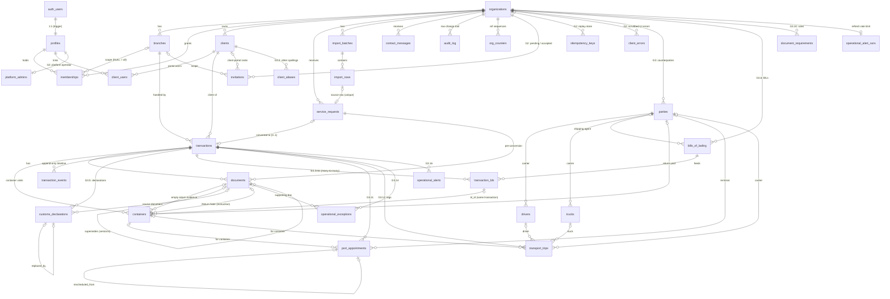
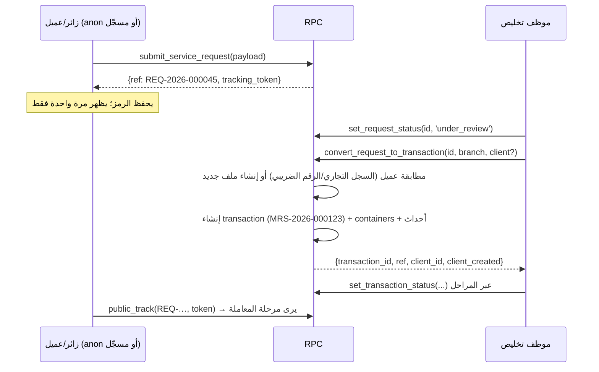

# مرسى أونلاين — المعمارية (بيئة تجريبية Staging)

> **الحالة:** نموذج أولي (Prototype) على بيئة **Staging** ببيانات اختبار فقط. ليس بيئة إنتاج، ولا يُعد إغلاقًا لـ G0 ولا اعتمادًا لتصميم G1. كل ما هنا قابل للتغيير بقرار المالك.
> **المراجع الحاكمة:** وثيقة الرؤية v1.0 (المرجع الأعلى)، مرجع G0 v0.1، خطة G0–G7، مراجعات التكامل ودفترة والأدلة، وتقرير المراجعة `Marsa_G0_Review_2026-10-31.md` (القسمان 5 و8).
> **الفرع:** `online-staging`.

---

## 1. الصورة العامة (Components)

```
المتصفح (HTML/CSS/JS ثابت، بلا Build)
  ├─ assets/js/config.js   ← window.MARSA_CONFIG (فارغ = وضع العرض المحلي)
  ├─ assets/js/i18n.js     ← window.MarsaI18n (G2.11: القاموس المركزي، اللغة والاتجاه، تنسيق التاريخ والأرقام)
  ├─ assets/i18n/<page>.js ← قاموس الصفحة (index وlogin وadmin وplatform وapp وportal وocr وbulk، ومنذ G3 ops لوحدات العمليات)
  ├─ assets/js/main.js     ← window.Marsa (مساعدات الواجهة الحالية)
  ├─ assets/js/supa.js     ← window.MarsaApi (طبقة البيانات: أونلاين أو محلي)
  ├─ assets/js/ops/*.js    ← G3: window.MarsaOps (شاشات العمليات وأقسام المعاملة، تُحمَّل قبل admin.js)
  └─ assets/js/<page>.js   ← منطق الصفحة يستدعي MarsaApi فقط
            │  HTTPS (anon/publishable key + JWT المستخدم)
            ▼
Supabase (مشروع Staging واحد)
  ├─ Auth            ← تسجيل الدخول بالبريد وكلمة المرور، استعادة كلمة المرور
  ├─ PostgREST       ← الجداول في schema public + RPCs (Row Level Security على كل جدول)
  ├─ PostgreSQL 15+  ← schema app (دوال مساعدة وتريغرات، غير مكشوفة عبر API)
  └─ Storage         ← bucket خاص "documents" (سياسات مرتبطة بجدول documents)
```

- **وضعان للواجهة:** إذا كان `supabaseUrl` و`supabaseAnonKey` فارغين، يبقى الموقع كما هو الآن: localStorage وشريط «نسخة عرض تجريبية»، ولا يُحمَّل أي سكربت خارجي. إذا امتلآ، يحمّل `supa.js` مكتبة supabase-js v2.45.4 (UMD) من jsDelivr عند الحاجة، ويحوّل نص الشريط إلى «بيئة تجريبية متصلة (Staging) — بيانات اختبار فقط».
- **لا مفتاح service_role في الواجهة أبدًا.** يرفض `supa.js` العمل إذا اكتشف مفتاح `service_role` أو `sb_secret_…`.
- **schema `app` يجب ألا يُضاف إلى Exposed schemas في إعدادات API.** المكشوف هو `public` فقط.

## 2. البيئات (Environments)

| البيئة | الحالة | الملاحظات |
|---|---|---|
| Local demo | قائمة | الموقع الحالي بلا خادم (config فارغ) |
| Local DB test | قائمة | PGlite (Postgres 16 في الذاكرة) + `supabase/tests/shim.sql` + `run-migrations.js` |
| **Staging** | الهدف الآن | مشروع Supabase مستقل، `organizations.environment = 'staging'`، بيانات اختبار فقط، عناوين `@example.com` |
| Production | **خارج النطاق** | يتطلب اعتماد المالك، ونسخًا احتياطيًا، وتمرين استرجاع، ومراجعة أمنية (G2/G7) |

**خطوات تجهيز Staging (يدوية، بعد موافقة المالك، ولا تُنفذ ضمن هذه المهمة):**
1. إنشاء مشروع Supabase جديد باسم يدل على أنه تجريبي (مثل `marsa-staging`).
2. تشغيل ملفات `supabase/migrations/*.sql` بالترتيب (SQL Editor أو `supabase db push`)، ثم `supabase/seed.sql`.
3. Authentication → Providers → Email: تفعيل التأكيد بالبريد، وضبط Site URL وRedirect URLs على عنوان الموقع التجريبي.
4. إنشاء مستخدمي الاختبار من Dashboard (انظر رأس `seed.sql`) ثم تشغيل مقطع ربط الأدوار في آخره.
5. وضع Project URL والمفتاح العام (anon/publishable) في `assets/js/config.js`.
6. **G2:** تشغيل `20261102000100_idempotency.sql` ثم `…000200_orgs_branches_invites.sql` ثم `…000300_ops_observability.sql` (أو الحزمة `supabase/all_migrations.sql`)، ثم `supabase/make_platform_admin.sql` ببريد مدير المنصة. التفاصيل في `docs/online/G2_REPORT_AR.md` و`ENVIRONMENTS_AR.md`.
7. **G3:** تشغيل `20261103000100_g3_registry.sql` ثم `…000200_g3_operations.sql`، **A ثم B دائمًا** (أو `supabase/all_migrations.sql`، 13 ترحيلًا). يُستحسن تفعيل `pg_cron` قبلهما. التفاصيل في `docs/online/G3_REPORT_AR.md` §3.

## 3. نموذج البيانات (ERD)



`schema_versions` (G2) جدول مستقل بلا علاقات: صف لكل ملف ترحيل.

جداول G3 كلها تتبع القواعد العامة أدناه: `org_id` في كل صف، ومفاتيح أجنبية مركّبة `(x_id, org_id)` إلى الأب، وRLS، وتريغر تدقيق. في `operational_alerts` يُدقَّق UPDATE فقط، لأن `last_seen_at` يتغير كل 15 دقيقة. `drivers` و`trucks` يمكن أن يكون الناقل فيهما فارغًا.

**قواعد عامة:**
- كل جدول تشغيلي يحمل `org_id`، ويرتبط بالأب عبر **مفتاح أجنبي مركّب `(parent_id, org_id)`**؛ لذلك يستحيل ربط معاملة في مؤسسة بعميل أو فرع من مؤسسة أخرى حتى لو أُدخل المعرّف يدويًا.
- المعرّف الداخلي `uuid`، والرقم المرجعي يُولَّد على الخادم لكل مؤسسة وسنة: `MRS-2026-000123` للمعاملات، و`REQ-2026-000045` للطلبات، و`MSG-…` للرسائل، و`IMP-…` لدفعات الاستيراد (`app.next_ref`، جدول `org_counters`، السنة بتوقيت الرياض).
- القوائم المرمّزة (الحالات، الأدوار، أنواع المستندات) نص + `CHECK`، وتسمياتها العربية والإنجليزية في جدول **`status_labels`** (جاهزية RTL/LTR؛ الواجهة تقرأ التسميات من هنا أو من ملف ترجمة، ولا تكتبها داخل المكوّنات).

| الجدول | الغرض | أهم الحقول والقيود |
|---|---|---|
| `organizations` | المستأجر | `slug` فريد، `ref_prefix`، `environment` (staging/production)، `public_intake_enabled`، `is_active`. منذ G2 لا كتابة مباشرة عبر API: الإنشاء بـ`platform_create_org` (البيئة تُفرض `staging`)، والتعديل بـ`admin_update_org` (حقول محددة فقط) |
| `branches` | الفروع | `(org_id, code)` فريد — جدة `JED`، الدمام `DMM`. منذ G2 عبر `admin_create_branch / admin_update_branch` فقط؛ الرمز لا يتغير بعد الإنشاء، ولا يُعطَّل آخر فرع نشط |
| `profiles` | 1:1 مع `auth.users` | يُنشأ بتريغر عند التسجيل؛ **لا تُؤخذ أي صلاحية من بيانات التسجيل** |
| `memberships` | مستخدم × مؤسسة × فرع اختياري × دور | `branch_id NULL` = كل الفروع؛ دور `client` بلا فرع. G2: ‏CHECK يفرض `admin` بلا فرع و`branch_manager` بفرع. عضوية فرع غير مفعّل لا تُحتسب |
| `platform_admins` (G2) | مشغّلو المنصة | `user_id` → `profiles`، `note`. يُكتب من SQL Editor فقط (`make_platform_admin.sql`)، ولا يقرؤه API، وعليه تريغر تدقيق |
| `invitations` (G2) | الدعوات | `email` بأحرف صغيرة، `role`، `branch_id`/`client_id` بمفاتيح مركّبة، `token_hash` (SHA-256 فقط)، `invited_by`، `expires_at` (+7 أيام)، `accepted_*`، `revoked_*`. دعوة معلّقة واحدة لكل (مؤسسة، بريد، دور، فرع، عميل). قراءة: مدير المؤسسة (كلها) ومدير الفرع (فرعه). لا كتابة مباشرة؛ عليه تريغر تدقيق |
| `idempotency_keys` (G2) | منع التكرار | `(scope, key)` مفتاح أساسي، `org_id`، `user_id`، `request_hash`، `response` (بلا أسرار أبدًا)، `expires_at` (+7 أيام). داخلي، لا صلاحية لـ API |
| `schema_versions` (G2) | نسخة المخطط | `version` (14 رقمًا)، `name`، `applied_at`. يُقرأ عبر `health_check()` فقط |
| `client_errors` (G2) | أخطاء الواجهة | `org_id` (للأعضاء فقط)، `user_id`، `actor_key` (SHA-256، لا IP خام)، `page`، `code`، `message` (بعد إخفاء البيانات الشخصية)، `ua`. يُكتب بـ`log_client_error` فقط |
| `clients` | ملف العميل المستقل (§5) | فرد/منشأة، السجل التجاري (10 أرقام) والرقم الضريبي (15 رقمًا) فريدان داخل المؤسسة، العنوان الوطني الكامل `jsonb` والمختصر `AAAA9999` |
| `client_users` | ربط مستخدم بوابة بملف عميل | يربطه الموظف فقط (D-02: لا ربط تلقائي بالهوية) |
| `service_requests` | الطلب العام (Intake) | كل حقول نموذج `request.html`، `status` (new/under_review/converted/rejected)، `tracking_token_hash`، `declared_count` + `count_kind` منفصلان (arch-10)، `estimate` تقدير غير ضريبي (arch-08) |
| `transactions` | **محور الربط** | `ref`، العملية import/export، الوسيلة، المنافذ، B/L (غير فريد)، رقم البيان (فريد داخل المؤسسة، D-03)، `container_count` رقمي، `operational_status` و`financial_status` منفصلان |
| `containers` | زيارة حاوية لكل معاملة | رقم ISO `AAAA9999999` فريد **داخل المعاملة فقط** (DEC-02)، `return_deadline`، `return_status`، `evidence_document_id`. G3: `bl_id` (يجب أن يكون من بوالص المعاملة نفسها)، `seal_no`، `size_type`، `gross_weight_kg`، `operational_state` (expected/at_port/released/gated_out/delivered/empty_returned؛ `empty_returned` فقط بعد `returned_verified` أو `waived`)، `visit_ref` (`<رقم الحاوية>@<المرجع>`)، `return_yard_party_id`، `return_instruction_document_id` (تعليمات، ليست دليلًا)، `evidence_received_at` (يختمه الخادم) |
| `documents` | الأصل الثابت ومصدره | `kind` (ادعاء الرافع) ≠ `classification` (تحقق الموظف) + `classified_by/at`، `sha256`، `original_name`، `size_bytes`، `version` + `supersedes_id`، `source`/`source_ref`، `visibility`، الإلغاء بدل الحذف |
| `transaction_events` | سجل زمني **Append-only** | `event_type`، `from_status`/`to_status`، `note`، `visible_to_client`، `actor` |
| `import_batches` / `import_rows` | منطقة Staging للرفع الجماعي | بصمة الملف SHA-256، الورقة، رقم الصف، `raw` ثابت، `normalized`، `corrections`، `UNIQUE(org_id, fingerprint, sheet, row_no)` |
| `contact_messages` | رسائل «تواصل معنا» | عبر RPC فقط |
| `audit_log` | أثر تدقيق عام **Append-only** | الجدول، الصف، العملية، الحقول المتغيرة، القيم قبل وبعد، المنفّذ ودوره |
| `parties` (G3) | دليل الجهات التشغيلية | `kinds text[]` (shipping_agent، terminal_operator، carrier، yard، customs_broker، supplier، other، وقد تجمع الجهة أكثر من نوع)، `name_ar` فريد داخل المؤسسة (بلا حالة أحرف)، السجل التجاري، الرقم الضريبي، التواصل، `notes`، `is_active`. لا حذف، بل تعطيل |
| `drivers` / `trucks` (G3) | سائقو الناقل وشاحناته | `drivers`: الاسم، الجوال، `national_id_last4` (آخر 4 أرقام فقط)، الرخصة. `trucks`: `plate_no` فريد داخل المؤسسة، `plate_type`. كلاهما مرتبط اختياريًا بناقل من `parties` |
| `client_aliases` (G3.2) | أسماء العميل البديلة | `alias`، `alias_norm` (`app.norm_name`) فريد داخل المؤسسة، `source` (bl/invoice/manual/ocr). إضافة وحذف فقط، بلا تعديل |
| `customs_declarations` (G3.5) | البيانات الجمركية | `declaration_no` فريد داخل المؤسسة بين البيانات غير الملغاة أو المستبدلة. `status` (draft/submitted/under_inspection/released/cancelled/replaced)، `source` (manual/ocr/import/fasah)، `source_document_id`، `corrected_at`، `cancelled_at`، `cancel_reason`، `replaced_by_id`. الكتابة عبر RPC فقط. `transactions.declaration_no/date/type` مرآة لآخر بيان نشط |
| `bills_of_lading` (G3.6) | البوالص | `(org_id, bl_number, bl_type)` فريد. `bl_type` (master/house/sea_waybill/awb/other)، الوكيل الملاحي، الناقل، السفينة والرحلة، الموانئ، المنشأ، البضاعة، الطرود، الوزن. الكتابة عبر RPC فقط. القراءة عبر المعاملات المرتبطة (`app.can_read_bl`) |
| `transaction_bls` (G3.6) | ربط البوليصة بالمعاملة (كثير إلى كثير) | `(transaction_id, bl_id)`، `is_primary` (واحدة لكل معاملة، وتنعكس في `transactions.bl_number`) |
| `document_requirements` (G3.10) | قواعد المستندات | `operation`/`mode`/`port` (NULL = أي)، `document_kind`، `required_for_stage`، `is_optional` (يظهر ولا يمنع)، `is_active`، `note`. فريد لكل (عملية، وسيلة، منفذ، نوع، مرحلة). 15 قاعدة افتراضية (`app.seed_document_requirements`) |
| `port_appointments` (G3.11) | مواعيد الموانئ | المشغّل، `appointment_at`، `window_minutes`، `appointment_no`، السائق، الشاحنة، `status` (requested/confirmed/completed/missed/cancelled/rescheduled)، `status_reason`، `rescheduled_from_id`. إعادة الجدولة صف جديد |
| `transport_trips` (G3.12) | رحلات النقل (نقلات) | `leg_no`، الناقل والسائق والشاحنة، المنشأ، الوجهة، `planned_at/loaded_at/unloaded_at`، `status` (planned/dispatched/loaded/delivered/cancelled)، `cost_*` و`sell_*` و`cost_basis` **خارج منح القراءة** (`trip_finance`). بلا حقول سداد |
| `operational_exceptions` (G3.14) | الحالات الاستثنائية | `kind` (10 أنواع)، `occurred_at` و`source` و`reason` إلزامية، `document_id` أو `amount` إلزامي لـ demurrage/repair_fee/cleaning_fee، `status` (open/in_progress/resolved/waived)، `resolution_note` |
| `operational_alerts` (G3.16) | التنبيهات التشغيلية | `kind` (7 أنواع)، `severity` (info/warning/critical)، `branch_id` يتبع المعاملة، `dedupe_key` فريد داخل المؤسسة، `first_seen_at/last_seen_at`، `status` (open/acknowledged/resolved)، `resolution` (auto/manual) |
| `operational_alert_runs` (G3.16) | آخر تحديث للتنبيهات لكل مؤسسة | حد «مرة في الدقيقة». داخلي، بلا صلاحية API |

## 4. الأدوار ومصفوفة الصلاحيات (Role matrix)

الأدوار (من §8.2 في الرؤية): `client` عميل، `clearance_staff` موظف تخليص، `transport_staff` موظف نقل، `accountant` محاسب، `accounts_manager` مدير حسابات، `operations_manager` مدير عمليات، `supervisor` مشرف، `admin` مدير نظام (مدير المؤسسة). أضاف G2 الدور `branch_manager` مدير فرع، ومدير المنصة (ليس دور عضوية، بل صف في `platform_admins`).

| دور الخطة (G2.7) | التطبيق |
|---|---|
| مدير المنصة | `platform_admins` + `app.is_platform_admin()`. يدير المؤسسات فقط (`platform_*`)، وليس عضوًا في أي مؤسسة، ولا يقرأ بياناتها التشغيلية |
| مدير المؤسسة | عضوية `admin` بلا فرع (CHECK) |
| مدير الفرع | عضوية `branch_manager` بفرع واحد إلزامي (CHECK) |
| الموظف | `clearance_staff`، `transport_staff`، `accountant`، `accounts_manager`، `operations_manager`، `supervisor` |
| العميل | عضوية `client` + روابط `client_users` |

تعدد العضويات مدعوم: `my_context().organizations[]`، ومبدّل المؤسسة النشطة في `admin.html` (`marsa_active_org`).

**نطاق الفرع:** عضوية الموظف المرتبطة بفرع ترى معاملات ذلك الفرع فقط. العضوية بلا فرع ترى كل فروع المؤسسة. ملف العميل مشترك على مستوى المؤسسة (قرار مفتوح، انظر القسم 13).

**G2 — مدير الفرع ومدير المنصة وقواعد الإيقاف** (`20261102000200`):
- `branch_manager` (مدير فرع) مرتبط بفرع واحد دائمًا، ومسموح له حيث يُسمح لـ `operations_manager` داخل فرعه. يدير أعضاء ودعوات فرعه للأدوار `clearance_staff` و`transport_staff` و`accountant`. يدعو مستخدمي بوابة العميل **فقط** لعميل كل معاملاته وطلباته المسندة في فرعه (أو فروعه)، ولا يدعو بريده هو، ولا يكتب `client_users` مباشرة. الربط بعميل يفتح معاملاته في كل الفروع، لذلك يمر عبر الدعوة.
- مدير المنصة (`platform_admins`) يدير المؤسسات فقط، ولا يقرأ بيانات المستأجرين. يرى بريد مديري المؤسسة مقنّعًا (`admin_emails_masked`). يعيد إصدار رابط المدير الأول بـ `platform_reissue_admin_invitation` ما دامت المؤسسة بلا مدير نشط. كل منح أو سحب لهذا الدور يُسجَّل في `audit_log`.
- الإيقاف يقطع الوصول فورًا:
  - المؤسسة الموقوفة: لا وصول للموظفين، ولا لبوابة العميل، ولا للتتبع العام.
  - الفرع غير المفعّل: عضويات ذلك الفرع لا تُحتسب، بينما الأدوار على مستوى المؤسسة تبقى.
  - عضوية `client` المعطّلة: تُغلق روابط البوابة.
  - العضو المعطّل: تُلغى الدعوات المعلّقة الموجّهة إليه، والدعوات التي أصدرها ولم يعد مخوّلًا بها.
  - الدعوة تعمل فقط ما دام من أصدرها يملك الصلاحية نفسها وقت القبول.
- **امتداد على مستوى المؤسسة (قرار مفتوح رقم 10):** كل دور موظف مرتبط بفرع (`clearance_staff` و`operations_manager` و`branch_manager`) يصل إلى ما ليس له `branch_id` في كل المؤسسة. هذا يشمل: ملفات العملاء (قراءة وتعديل)، وقراءة `client_users`، و`import_batches/rows`، و`contact_messages`، والطلبات غير المسندة لفرع، وإظهار الملفات الشخصية عبر `can_see_profile`.

الرموز: R قراءة، I إضافة، U تعديل، D حذف (`client_aliases` فقط)، — لا شيء. «RPC» تعني أن العملية متاحة عبر دالة خادم فقط.

| الكيان | client | clearance | transport | accountant | accounts_mgr | ops_mgr | branch_mgr | supervisor | admin |
|---|---|---|---|---|---|---|---|---|---|
| organizations | R | R | R | R | R | R | R | R | R · RPC |
| branches | R | R | R | R | R | R | R | R | R · RPC |
| memberships | R (عضويته) | R (عضويته) | R (عضويته) | R (عضويته) | R (عضويته) | R (عضويته) | R (عضويته) · RPC لأدوار فرعه الأدنى | R | R · RPC |
| invitations | — | — | — | — | — | — | R (فرعه + دعوات العملاء التي أصدرها) · RPC | — | R · RPC |
| clients | R (ملفه) | R I U | R | R | R | R I U | R I U | R I U | R I U |
| client_users | R (ربطه) | R | R | R | R | R I U | R (بلا كتابة؛ الربط بالدعوة) | R I U | R I U |
| service_requests | R (ما قدّمه) · I عبر RPC | R U · RPC | — | — | — | R U · RPC | R U · RPC | R U · RPC | R U · RPC |
| transactions | R (معاملاته) | R I U | R | R | R | R I U | R I U | R I U | R I U |
| containers | R (معاملاته) | R I U | R I U | R | R | R I U | R I U | R I U | R I U |
| documents | R (المتاح للعميل + ما رفعه) · I على معاملاته | R I U* | R I U* | R I U* | R I U* | R I U* | R I U* | R I U* | R I U* |
| transaction_events | R (المرئي للعميل) | R · I ملاحظة | R · I ملاحظة | R · I ملاحظة | R · I ملاحظة | R · I ملاحظة | R · I ملاحظة | R · I ملاحظة | R · I ملاحظة |
| import_batches/rows | R I U (دفعاته لملفه) | R I U | — | — | — | R I U | R I U | R I U | R I U |
| contact_messages | — | R U | — | — | — | R U | R U | R U | R U |
| audit_log | — | — | — | — | — | — | — | R | R |
| parties / drivers / trucks (G3) | — | R I U | R I U | R | R | R I U | R I U | R I U | R I U |
| client_aliases (G3) | — | R I D | R | R | R | R I D | R I D | R I D | R I D |
| customs_declarations (G3) | R (معاملاته، بلا الملاحظات وسبب الإلغاء) | R · RPC | R | R | R | R · RPC | R · RPC | R · RPC | R · RPC |
| bills_of_lading / transaction_bls (G3) | R (ما يغذي معاملاته وحده) | R · RPC | R | R | R | R · RPC | R · RPC | R · RPC | R · RPC |
| document_requirements (G3) | — | R | R | R | R | R | R | R | R I U |
| port_appointments (G3) | — (أوقات المؤكد عبر الأحداث) | R · RPC | R · RPC | R | R | R · RPC | R · RPC | R · RPC | R · RPC |
| transport_trips (G3) | — | R · RPC | R · RPC (بلا التكلفة والبيع) | R + التكلفة والبيع | R + التكلفة والبيع | R · RPC + التكلفة والبيع | R · RPC + التكلفة والبيع | R · RPC + التكلفة والبيع | R · RPC + التكلفة والبيع |
| operational_exceptions (G3) | — | R · RPC | R · RPC | R | R | R · RPC | R · RPC | R · RPC | R · RPC |
| operational_alerts (G3) | — | R · RPC | R · RPC | R · RPC | R · RPC | R · RPC | R · RPC | R · RPC | R · RPC |

\* تعديل المستند يقتصر على التصنيف والظهور والإلغاء؛ الأصل (المسار، البصمة، الاسم، الحجم) لا يتغير أبدًا. لا يوجد DELETE لأي مستند أو حدث أو سجل تدقيق.

- عمود branch_mgr مقيّد بفرعه عبر `has_branch_role` في كل ما يحمل `branch_id`؛ وما لا يحمله امتداد على مستوى المؤسسة (القرار المفتوح 10 أعلاه).
- مدير المنصة ليس في الجدول: لا يقرأ أي جدول تشغيلي، ويعمل عبر `platform_*` فقط.
- `client_errors` و`idempotency_keys` و`schema_versions` و`platform_admins`: لا صلاحية لأي دور عبر API؛ القراءة عبر RPC (`admin_recent_errors`، `platform_recent_errors`، `health_check`).

لا يكتب أي دور الحقول `ref` و`org_id` و`operational_status` و`financial_status` و`tracking_token_hash` مباشرة؛ تريغرات الحماية ترفض ذلك (`MRS_IMMUTABLE`) وتمر التغييرات عبر RPC.

**نقل الحالة التشغيلية (`set_transaction_status`):**

| الحالة الهدف | الأدوار المسموحة (ضمن فرعها) |
|---|---|
| new، in_progress، customs_declaration | clearance_staff، operations_manager، branch_manager، supervisor، admin |
| appointment، transport، empty_return | ما سبق + transport_staff |
| operationally_complete | clearance_staff، operations_manager، branch_manager، supervisor، admin — **بشرط** أن تكون كل الحاويات `returned_verified` أو `waived` |
| under_billing، billed | accountant، accounts_manager، admin |
| closed | accounts_manager، supervisor، admin |
| أي رجوع للخلف (تصحيح) | operations_manager، branch_manager، supervisor، admin مع سبب إلزامي؛ إعادة فتح `closed` للـ admin فقط |

منذ G2 تقبل `set_transaction_status` و`set_financial_status` معاملًا أخيرًا اختياريًا `p_idem_key uuid` (القسم 15).

**G3 — بوابة المستندات:** صار التوقيع `set_transaction_status(p_transaction_id, p_status, p_note, p_idem_key, p_docs_override boolean DEFAULT false)`، وحُذف توقيع الأربعة معاملات.
- **متى يُرفض:** الانتقال للأمام إلى مرحلة S (أو بعدها) يُرفض بـ `MRS_DOCS_MISSING`، والتفصيل يحمل الأنواع الناقصة، ما دام مستند إلزامي لـ S ناقصًا أو غير مراجَع. يُمنع هذا الانتقال وحده، لا المعاملة.
- **التجاوز:** بالعلَم `p_docs_override = true` مع سبب في `p_note`. يسمح به لـ `operations_manager` و`branch_manager` و`supervisor` و`admin` (`app.senior_ops_roles`)، ويُسجَّل حدث داخلي `docs_override`.
- **الأخطاء:** العلَم من دور آخر ← `MRS_FORBIDDEN 'docs_override'`. العلَم بلا سبب ← `MRS_NOTE_REQUIRED 'docs_override'`. الملاحظة وحدها لا تتجاوز البوابة أبدًا.

يمكن القفز للأمام (مثل الشحن الجوي بلا حاويات). كل نقل يضيف حدثًا، ولا يُعدَّل حدث سابق.

## 5. قواميس الحالات (Status dictionaries)

**الحالة التشغيلية `operational_status`** — الحالات العشر في §6.3 من الرؤية:

| # | code | العربية | English |
|---|---|---|---|
| 1 | new | جديدة | New |
| 2 | in_progress | قيد العمل | In progress |
| 3 | customs_declaration | البيان الجمركي | Customs declaration |
| 4 | appointment | الموعد | Appointment |
| 5 | transport | النقل | Transport |
| 6 | empty_return | إعادة الحاوية الفارغة | Empty container return |
| 7 | operationally_complete | منتهية تشغيليًا | Operationally complete |
| 8 | under_billing | تحت الفوترة | Under billing |
| 9 | billed | تمت الفوترة | Billed |
| 10 | closed | مغلقة | Closed |

المرحلتان 8 و9 تبقيان معالم في المسار كما في الرؤية، لكن لا يحرّكهما إلا أدوار المالية، ولا تعنيان إصدار فاتورة ضريبية داخل النظام.

**الحالة المالية `financial_status`** — **مؤقتة (Placeholder) إلى G4**، ومستقلة تمامًا عن التشغيلية، ولا تظهر للعميل: `not_started` لم تبدأ، `estimate_only` تقدير غير ضريبي فقط، `draft_pending` مسودة قيد الإعداد، `invoiced` صدرت الفاتورة (خارج النظام)، `settled` مسددة.

**حالات أخرى:** الطلب `request_status` (new، under_review، converted، rejected). إرجاع الحاوية `container_return_status` (pending، evidence_submitted، returned_verified، disputed، waived). تصنيف المستند `classification_status` (unreviewed، confirmed، reclassified، ambiguous). الرسالة `contact_status`. صف الاستيراد `import_row_status`.

**قواميس G3** (في `status_labels`؛ المرئي للعميل مذكور):
- `party_kind`، `alias_source`، `client_match` (strong/alias/weak).
- `declaration_status` (مرئي للعميل) و`declaration_source`.
- `bl_type` و`container_state` (مرئيان للعميل).
- `requirement_status` (satisfied/unreviewed/missing/not_applicable).
- `appointment_status` (للعميل فقط requested/confirmed/completed).
- `trip_status`، `cost_basis`.
- `exception_kind`، `exception_source`، `exception_status`.
- `alert_kind`، `alert_severity`، `alert_status`.

**أنواع المستندات `document_kind`:** bill_of_lading، commercial_invoice، packing_list، certificate_of_origin، saber_certificate، customs_declaration، delivery_order، appointment، container_delivery_eir، empty_return_note، **empty_return_receipt**، operator_invoice، government_doc، import_file، other.

## 6. مسار الطلب → المراجعة → العميل والمعاملة



- الطلب **ليس** ملف العميل: يحفظ ما كتبه مقدم الطلب كما هو. التحويل يطابق ملف عميل موجود بالمفتاح الطبيعي، أو ينشئ واحدًا، أو يستخدم `p_client_id` يختاره الموظف (arch-01).
- لا يُربط حساب مقدم الطلب بملف العميل تلقائيًا؛ الربط عبر `client_users` قرار بشري (D-02).
- المستندات المرفوعة على الطلب تنتقل إلى المعاملة بإضافة `transaction_id` دون نقل الملف.
- الرفض يحتاج سببًا. الطلب المحوّل لا يُحوّل مرة ثانية (`MRS_ALREADY_CONVERTED`).
- نموذج الطلب العام لا يرفع ملفات في الوضع المتصل (الزائر غير مسجّل)، بل يرسل قائمة أسماء المستندات المعلنة. الرفع الفعلي يتم من بوابة العميل بعد تسجيل الدخول، أو من الموظف.

## 7. التتبع العام (Public tracking)

- `public_track(p_ref, p_token)`: الرقم المرجعي **و**رمز سري عشوائي بطول 256 بت (64 خانة hex). يُخزَّن SHA-256 للرمز فقط، ولا يُكتب الرمز في سجل التدقيق.
- الخطأ نفسه (`MRS_NOT_FOUND`) للرقم غير الموجود وللرمز الخاطئ، فلا يكشف وجود الرقم.
- **الحقول المعادة:** الرقم المرجعي، نوع العملية والوسيلة، حالة الطلب، ثم للمعاملة: المرحلة وتسميتها بالعربية والإنجليزية، ورقمها من 10، وتاريخ آخر تغيير، وخط زمني للمراحل (حالة + وقت فقط)، وعدد الحاويات والمُرجع منها. **لا** أسماء ولا أرقام جوال ولا قيم ولا ملاحظات ولا أرقام حاويات ولا بيانات مالية.
- الطلب المحوّل يبقى قابلًا للتتبع برمزه الأصلي ويعرض مرحلة المعاملة. للمعاملات التي ينشئها الموظف مباشرة: `issue_tracking_token(transaction_id)` يصدر رمزًا جديدًا، ويُبطل السابق.
- ملاحظات الموظف عند تغيير الحالة تُحفظ في حدث `note` داخلي منفصل؛ أحداث الحالة المرئية للعميل لا تحمل نصًا حرًا.
- **قرار مفتوح (القرار 8 في التقرير):** إبقاء التتبع العام بهذه الصيغة المختصرة أو حصره في البوابة.

## 8. التخزين (Storage layout)

- bucket خاص `documents` (غير عام)، بحد 25 ميغابايت، وأنواع PDF وصور JPEG/PNG/WebP/HEIC وXLSX وCSV.
- **مسار الكائن:** `{org_id}/{transaction_id}/{document_id}/{safe_file_name}`، أو `{org_id}/r_{request_id}/{document_id}/{safe_file_name}` قبل التحويل. القيد `documents_path_chk` يفرض هذه الصيغة. الاسم الأصلي (العربي) يُحفظ في `original_name`، واسم الملف في التخزين ASCII فقط.
- **الرفع:** (1) إدخال صف `documents` بمعرّف يولّده المتصفح، وبصمة SHA-256 محسوبة في المتصفح. (2) رفع الملف إلى المسار نفسه بالضبط. سياسة INSERT على `storage.objects` تسمح فقط بمسار صف سجّله المستخدم نفسه خلال 24 ساعة.
- **القراءة:** سياسة SELECT تسمح بالكائن إذا كان المستخدم يستطيع قراءة صف `documents` المطابق؛ أي أن RLS على `documents` هي الحكم. التنزيل عبر Signed URL قصير العمر (`MarsaApi.documentUrl`، افتراضيًا 5 دقائق).
- **لا UPDATE ولا DELETE:** الأصل لا يُستبدل. النسخة الجديدة صف جديد بـ`supersedes_id` و`version + 1`. الخطأ يُعالج بالإلغاء (`voided_at` + `void_reason`).
- **حد معروف في Staging:** البصمة يحسبها المتصفح ولا يتحقق منها الخادم. كان مخططًا إضافة Edge Function في G2 تتحقق من الحجم والبصمة بعد الرفع، و**لم تُنفَّذ بعد** (حد معروف في `G2_REPORT_AR.md`). العزل بين المؤسسات في التخزين مختبر في `rls-tests.js` (قراءة كائن مؤسسة أخرى بالمسار مرفوضة).

## 9. التدقيق والأحداث (Audit & events)

- **`transaction_events`** خط زمني للأعمال: `created`، `request_converted`، `operational_status`، `financial_status`، `container_return`، `document`، `note`، `tracking_token`. أضاف G3 الأنواع `declaration` و`bl` و`container` و`appointment` و`trip` و`exception` و`docs_override`.
- **ما يراه العميل من أحداث G3:** حالة البيان، والحاوية (`operational_state` والإرجاع)، والموعد المؤكد. حدث الموعد يحمل الوقت والنافذة ورقم الحاوية و`appointment_ref` معتمًا، ثم `withdrawn` أو `completed` عند خروج الموعد من «مؤكد».
- **ما يبقى داخليًا:** أحداث البوليصة (ومنها `conflict`)، والرحلات، والاستثناءات، و`docs_override`.

الإضافة تأتي من RPC وتريغرات الخادم. المستخدم يضيف مباشرة نوع `note` فقط، ويُختم بـ`auth.uid()`.
- **`audit_log`** أثر تقني عام لكل INSERT/UPDATE/DELETE على: organizations، branches، memberships، clients، client_users، service_requests، transactions، containers، documents، import_batches، contact_messages، و(منذ G2) invitations وplatform_admins (صفوف الأخيرة `org_id` فيها فارغ، فلا يراها إلا من SQL Editor). يحفظ القيم قبل وبعد (jsonb)، والحقول المتغيرة، و`actor` و`actor_role`. التحديث الذي لا يغير شيئًا لا يُسجَّل. `import_rows` مستثنى لأنه كثيف، وتصحيحاته محفوظة داخله في `corrections`.
- **Append-only:** لا سياسات UPDATE/DELETE، وسحب الامتياز من `authenticated`، وتريغر `BEFORE UPDATE OR DELETE` وآخر `BEFORE TRUNCATE` يرفضان حتى مالك الجدول (`MRS_APPEND_ONLY`).
- **التصحيح لا يمحو التاريخ:** الرجوع بالحالة حدث جديد بسبب إلزامي. إلغاء التحقق من حاوية يحتفظ بالدليل، ويسجل حدثًا. تعديل البيانات العادية يحفظ قبل وبعد في `audit_log`.
- **قراءة السجل (G2.12):** `admin_audit_log(p_org, p_filters)` لمدير المؤسسة والمشرف: مرشحات `table_name، actor، from، to، row_id`، وحد أقصى 200 صف، وترقيم بـ`before_id`، مع بريد المنفّذ. تبويب «سجل التدقيق» في `admin.html`.
- **أخطاء الواجهة (G2.12/G2.14):** `window.onerror` و`unhandledrejection` ← `log_client_error` (في الوضع المتصل فقط، 5 لكل تحميل صفحة كحد أقصى). الخادم يقص الحقول ويخفي البريد (ومنه `%40`) والجوال والآيبان السعودي وسلاسل الأرقام الطويلة (ولو بمسافات أو شرطات) وما يشبه JWT، ويحد المعدل: 20 لكل مستخدم أو زائر، و300 للزوار مجتمعين، و500 إجمالًا كل 10 دقائق، ثم يُسقط بصمت. مفتاح الزائر من `cf-connecting-ip` ثم `x-real-ip` ثم آخر قفزة في `X-Forwarded-For`، ويُحفظ مجزّأً لا خامًا.
- **التنظيف:** `app.idem_purge_expired()` و`app.client_errors_purge(30)` تُجدولان يوميًا عبر `pg_cron` إن كان مفعّلًا قبل تشغيل 0300؛ وإلا تُشغَّلان يدويًا (`ENVIRONMENTS_AR.md`).

## 10. الحاويات ودليل إرجاع الفارغ

- لكل حاوية حالة إرجاع مستقلة (G0-004). الحالة `returned_verified` تتطلب `evidence_document_id` لمستند من **نفس المعاملة** صنّفه الموظف `empty_return_receipt` بحالة `confirmed` أو `reclassified`، ويُختم `verified_by/at` تلقائيًا.
- إيصال تسليم الحاوية الممتلئة (EIR)، وتعليمات الإرجاع (Empty Return Note)، ورسالة الناقل **لا تثبت الإرجاع** (EV-01، EV-02، D-09)، ويرفضها الخادم (`MRS_EVIDENCE_INVALID`). عبارة «EMPTY RETURN By» تُسجَّل في `return_deadline`، فهي موعد وليست دليلًا.
- `waived` تتطلب سببًا موثقًا. `disputed` للدليل الغامض بانتظار مراجعة بشرية.
- إثبات الإرجاع لا يعني تسوية رسوم الغسيل أو الإصلاح، ولا يمس الحالة المالية.
- **G3.13:** `set_container_return(p_container, p_payload)` يضبط المهلة والساحة والموقع ومستند التعليمات (Return Note). مستند التعليمات لا يُقبل دليلًا أبدًا. يُختم `evidence_received_at` على الخادم. `operational_state = 'empty_returned'` لا تُقبل إلا بعد `returned_verified` أو `waived`، وترجع إلى delivered أو gated_out أو released إذا أُلغي التحقق.

## 11. الرفع الجماعي (Import staging)

1. يحسب المتصفح SHA-256 للملف الأصلي (`file_fingerprint`)، وينشئ `import_batches`. يمكن حفظ الملف نفسه كمستند `import_file`.
2. يُدخل كل صف إلى `import_rows`: `raw` كما قُرئ (لا يتغير أبدًا)، و`normalized` بمفاتيح `submit_service_request` نفسها، و`row_status` (pending/valid/error)، و`validation_errors`.
3. **معرّف مصدر ثابت لكل سطر:** `source_row_id = fingerprint:sheet:row_no` (عمود مولَّد)، مع `UNIQUE(org_id, fingerprint, sheet, row_no)`. رفع الملف نفسه مرة أخرى يُرفض على مستوى الصف (`DUPLICATE`)؛ والواجهة تبحث أولًا عن دفعة بالبصمة نفسها (`findBatchByFingerprint`) وتعرضها.
4. تعديل `normalized` يضيف تلقائيًا `{at, by, before, after}` إلى `corrections` (arch-11).
5. `import_commit(batch_id)`: لكل صف صالح يُنشئ طلب خدمة `source='bulk'` بـ`import_row_id` فريد، فلا تكرار حتى عند إعادة المحاولة. إذا كان رقم البوليصة معروفًا مسبقًا في طلب أو معاملة، يصبح الصف `duplicate` مع `duplicate_of` وينتظر قرارًا بشريًا (`decision = accept | skip`). الأخطاء تُكتب على الصف ولا توقف الدفعة. الدالة **Idempotent**: يمكن استدعاؤها مرة أخرى بعد التصحيح، وتصبح الدفعة `committed` عندما لا يبقى صف مفتوح.
6. من يستورد: موظفو التخليص والعمليات والمشرف والمدير لأي عميل في المؤسسة، والعميل لملفه فقط (`client_id` من روابطه). الزائر غير المسجّل لا يستورد في الوضع المتصل؛ صفحة الرفع الجماعي تطلب تسجيل الدخول.
7. ناتج الاعتماد يتضمن لكل صف الرقم المرجعي ورمز التتبع، ويظهر مرة واحدة ليُصدَّر للمستخدم.

## 12. ما هو خارج النطاق عمدًا

- المحاسبة: دفتر الأستاذ، القيود، سندات القبض والصرف، العهد، الأرضيات، الربحية (G4+).
- تكامل دفترة والإصدار الضريبي ZATCA/فاتورة، وأي فاتورة ضريبية داخل النظام. `financial_status` مجرد مؤشر مؤقت.
- كتالوج البنود والضرائب والتسعير لكل مؤسسة. تقدير الحاسبة يُحفظ في `estimate` ويُوسم `is_tax_document = false`.
- تكاملات فسح/سابر الحكومية، والإشعارات (واتساب/بريد)، وRealtime. **إرسال الدعوات بالبريد غير موصول:** الرابط يظهر مرة واحدة ويُنسخ يدويًا.
- ~~الواجهة الإنجليزية الكاملة ومبدّل اللغة~~ **جزئيًا في G2:** `i18n.js` ومبدّل اللغة والقواميس جاهزة للواجهة المشتركة (الرأس والتذييل ورسائل الأخطاء) ولصفحات index وlogin وadmin وplatform. بقية الصفحات (request وtracking وportal وcontact وغيرها) تُعرض بالعربية وحدها، وبلا زر لغة، حتى تُكتب قواميسها.
- بيئة الإنتاج، وMFA، واختبار الاختراق. (النسخ الاحتياطي وتمرين الاسترجاع **أُنجزا في G2** على PGlite: `restore-drill.js` و`BACKUP_RESTORE_AR.md`؛ لم تُشغَّل سكربتات pg_dump على Staging بعد.)
- التحقق من بصمة الملف وحجمه على الخادم بعد الرفع (يحتاج Edge Function؛ لم يُنفَّذ في G2).
- تنبيهات صحية خارجية (Uptime/Alerting): `health_check()` جاهزة، ولا يوجد ما يستدعيها دوريًا.
- ~~لوحات الموظفين والبوابة نفسها~~ لوحة الموظفين (`admin.html`) والبوابة (`portal.html`) ولوحة المنصة (`platform.html`) موجودة كنموذج أولي؛ توسعتها التشغيلية **أُنجزت في G3** (`docs/online/G3_REPORT_AR.md`).
- G3 أيضًا خارج نطاقه:
  - مدفوعات الناقل وفواتير الموردين (G4)؛
  - نقل الحقول المستخرجة آليًا (OCR) إلى البيانات والبوالص؛
  - كيان «مهام» مستقل؛
  - إشعارات التنبيهات بالبريد أو واتساب.

## 13. قرارات مفتوحة للمالك

1. **ملكية العملاء بين الفروع:** حاليًا ملف العميل مشترك لكل موظفي المؤسسة، والمعاملات معزولة بالفرع. هل يُعزل العميل بالفرع أيضًا؟ (مانع في مرجع G0 §7.)
2. **التتبع العام:** إبقاؤه برقم + رمز سري وحالة مختصرة، أو حصره في بوابة العميل (القرار 8).
3. **شرط الإغلاق التشغيلي:** المطبّق الآن: «منتهية تشغيليًا» تتطلب إثبات إرجاع كل حاوية أو استثناءً موثقًا. هل يُعتمد هذا، وما علاقته بالفوترة (G0-003 مقابل D-08، القرار 3)؟
4. **رفع الزائر للمستندات:** هل يُسمح برفع ملفات قبل تسجيل الدخول (يتطلب Edge Function بروابط رفع موقّعة ومكافحة إساءة)، أم يبقى الرفع بعد الدخول فقط؟
5. **التسجيل الذاتي للعملاء:** مفتوح الآن، والحساب الجديد بلا أي وصول حتى يربطه موظف أو يقبل دعوة. **منذ G2 يوجد مسار الدعوة** (`admin_invite` ← `login.html?invite=…` ← `accept_invitation`)، ولم يعد `admin_add_member` متاحًا من الواجهة. يبقى السؤال: هل يُغلق التسجيل الذاتي في Supabase Auth فيصبح الدخول بالدعوة فقط؟
6. **وصول المحاسب وموظف النقل إلى كل المستندات:** حاليًا يقرأ كل موظف مستندات معاملات فرعه. هل يُقيَّد ذلك بنوع المستند؟
7. **الاسم والهوية:** «مرسى» أو «مرساة كلاود» أو «منصة المرساة المتكاملة» على الواجهة والمستندات (القرار 2). البذرة تستخدم «مؤسسة البحر الأزرق (بيئة تجريبية)».
8. **حد معدل الطلبات:** 5 طلبات لكل رقم جوال في الساعة، و120 طلبًا عامًا لكل مؤسسة كل 10 دقائق. هل يلزم CAPTCHA أو Edge rate limiting قبل أي استخدام عام؟
9. **صيغة الرقم الضريبي:** التحقق الحالي 15 رقمًا فقط. هل يُفرض النمط السعودي (يبدأ وينتهي بـ3)؟
10. **الجداول التي بلا فرع:** هل يُقصر تعديل ملفات العملاء والرفع الجماعي ورسائل التواصل على العضويات التي على مستوى المؤسسة (`branch_id IS NULL`، مثلًا عبر مساعد `app.has_org_wide_role`)؟ إن اعتُمد فيُطبَّق على كل الأدوار المرتبطة بفرع معًا، لا على `branch_manager` وحده.
11. **MFA:** لم يُفعَّل لمستخدمي التطبيق في G2 (مطلوب فقط لحسابات Supabase وHostinger الإدارية). هل يُفرض على `admin` ومدير المنصة قبل أي بيانات حقيقية؟
12. **إرسال الدعوات:** الروابط تُنسخ يدويًا الآن. هل يُربط بريد (SMTP/Edge Function) أم يبقى النسخ اليدوي في Staging؟
13. **التنظيف الدوري:** تفعيل `pg_cron` على مشروع Staging، أو الالتزام بالتشغيل اليدوي اليومي لـ`idem_purge_expired` و`client_errors_purge`.
14. **مدة صلاحية الدعوة:** 7 أيام حاليًا. هل تناسب، وهل تُقصَّر لدعوات `admin`؟
15. **G3 (G0 لم يُغلق):** قرارات العمل G3-1 إلى G3-14 في `G3_REPORT_AR.md` §5:
    - البوليصة بيانات رئيسية على مستوى المؤسسة؛ والترقية التلقائية للبوليصة الرئيسية؛ والبوليصة المشتركة بين عميلين؛
    - مسح رقم البيان؛ ونوع `other` القديم؛
    - من يتجاوز نقص المستندات؛ ومن يعدّل القواعد؛ والقواعد الافتراضية وشهادة المنشأ الاختيارية؛
    - حدود التنبيهات؛ ومواعيد العميل عبر الأحداث فقط؛ وإخفاء التكلفة والبيع عن موظف النقل؛
    - من يسجّل الاستثناءات؛ ورموز اللوحات وصيغ الجهات؛ وخيار «تلقائي» في تحويل الطلب.

## 14. الربط بمبادئ G0

| المبدأ | التطبيق هنا |
|---|---|
| SaaS متعدد المؤسسات والفروع (G0-001/002) | organizations → branches → memberships؛ `org_id` في كل صف؛ مفاتيح أجنبية مركبة |
| العزل بـRLS لا بإخفاء الواجهة | RLS على كل جدول، وanon بلا أي صلاحية على الجداول، واختبارات عزل في `run-migrations.js` (مستأجر آخر، فرع آخر، إدخال المعرف مباشرة) |
| Least Privilege | سياسات بحسب الدور والفرع، وتغيير الحالة عبر RPC، وسحب EXECUTE الافتراضي عن الدوال، و`search_path = ''` في كل دالة SECURITY DEFINER |
| المعاملة محور الربط | الحاويات والمستندات والأحداث مرتبطة بالمعاملة؛ والطلب يتحول إليها |
| الإدخال مرة واحدة + مراجع مستقلة | ملفات مستقلة للعميل والمستند والحاوية؛ والتحويل ينقل بيانات الطلب دون إعادة إدخال |
| فصل التشغيل عن المال | `operational_status` ≠ `financial_status`؛ ولا جداول محاسبية |
| حفظ الأصل ومصدره | `documents`: بصمة، اسم أصلي، مصدر، نسخ، تصنيف بشري منفصل عن الادعاء |
| التصحيح لا يمحو الأثر | أحداث Append-only، و`audit_log`، و`corrections` في الاستيراد، والإلغاء بدل الحذف |
| دليل فارغ لكل حاوية (G0-004) | `containers.return_status` + دليل `empty_return_receipt` مؤكد فقط |
| معرف مصدر فريد لكل سطر (arch-05) | `source_row_id` + قيد فريد + `import_row_id` فريد في الطلبات |
| لا نجاح عند الفشل (arch-06) | كل استدعاء يعيد `{data, error}`؛ والواجهة لا تعرض رقمًا مرجعيًا إلا من الخادم |
| ترقيم الخادم لكل مؤسسة (arch-09) | `app.next_ref` + `org_counters` |
| العربية RTL والإنجليزية LTR | `status_labels.label_ar/label_en`، و`profiles.locale`، و`organizations.default_locale`، و`MarsaI18n` (`i18n.js` + `assets/i18n/<page>.js`) مع تنسيق Intl للتاريخ والأرقام والعملة |
| منع التكرار والنتيجة غير المعروفة (G2.13) | `idempotency_keys` + `app.idem_begin/finish`، ومفتاح يحفظه المتصفح عبر إعادة المحاولة، و`MRS_UNKNOWN_RESULT` يميّز «لم يتأكد» عن «فشل» |

## 15. واجهة RPC وطبقة MarsaApi (للمطورين)

**RPCs:**

| الدالة | من يستدعيها | يعيد |
|---|---|---|
| `submit_service_request(payload jsonb)` | anon، authenticated | `{ref, tracking_token, status, created_at, environment}` · G2: `payload.idempotencyKey`؛ الإعادة تعيد `tracking_token:null, token_shown:true` |
| `submit_contact_message(payload jsonb)` | anon، authenticated | `{ref, created_at}` · G2: `payload.idempotencyKey` |
| `public_track(p_ref text, p_token text)` | anon، authenticated | `{ref, kind, request?, transaction?{…, timeline[]}}` · G2: مؤسسة موقوفة ← `MRS_NOT_FOUND` |
| `my_context()` | authenticated | `{user_id, profile, memberships[], clients[]}` · G2: + `is_platform_admin`، `organizations[{org_id, slug, name_ar, name_en, roles[]}]` |
| `set_request_status(p_request_id uuid, p_status text, p_note text)` | موظفو العمليات | `{request_id, ref, from, to}` |
| `convert_request_to_transaction(p_request_id uuid, p_branch_id uuid, p_client_id uuid, p_idem_key uuid DEFAULT NULL)` | موظفو العمليات | `{transaction_id, ref, client_id, client_created, containers, request_ref}` |
| `set_transaction_status(p_transaction_id uuid, p_status text, p_note text, p_idem_key uuid DEFAULT NULL, p_docs_override boolean DEFAULT false)` | بحسب الجدول في القسم 4 | `{transaction_id, ref, from, to, event_id, docs_override[]}` · G3: بوابة المستندات (القسم 4) |
| `set_financial_status(p_transaction_id uuid, p_status text, p_note text, p_idem_key uuid DEFAULT NULL)` | أدوار المالية | `{transaction_id, from, to, event_id}` |
| `issue_tracking_token(p_transaction_id uuid, p_idem_key uuid DEFAULT NULL)` | موظفو العمليات | `{ref, tracking_token}` · الرمز لا يُخزَّن؛ الإعادة `token_shown:true` |
| `import_commit(p_batch_id uuid)` | منشئ الدفعة أو موظفو العمليات | `{committed, skipped, duplicates, errors, open_rows, batch_status, items[]}` |
| `staff_internal_fields(table, ids)` | الموظفون | الحقول الداخلية المخفية بمنح الأعمدة (0700) · G3: + `customs_declarations` (`notes`، `cancel_reason`) و`bills_of_lading` (`notes`، بشرط `app.can_read_bl`) |
| `admin_list_members(p_org uuid)` | مدير المؤسسة؛ مدير الفرع لفرعه | قائمة العضويات مع البريد |
| `admin_set_member_active(p_membership uuid, p_active boolean)` | مدير المؤسسة؛ مدير الفرع لأدوار فرعه الأدنى | `{id, is_active, role, invitations_revoked}` · حارسا «نفسه» و«آخر مدير» (بقفل صف المؤسسة) |
| `admin_add_member(…)` | **SQL Editor فقط** منذ G2 | — (سُحب EXECUTE من authenticated) |

**RPCs في G2** (`20261102000200` و`20261102000300`):

| الدالة | من يستدعيها | يعيد |
|---|---|---|
| `platform_list_orgs()` | مدير المنصة | `[{id, slug, name_ar, name_en, ref_prefix, environment, is_active, default_locale, created_at, branches, members, admins, admin_emails_masked, pending_admin_invitations}]` |
| `platform_create_org(p_payload jsonb)` | مدير المنصة (idempotent) | `{org_id, slug, branch_id, invitation_id, token, accept_path}` |
| `platform_set_org_active(p_org uuid, p_active boolean)` | مدير المنصة | حالة المؤسسة |
| `platform_reissue_admin_invitation(p_org uuid)` | مدير المنصة، فقط والمؤسسة بلا مدير نشط | `{org_id, invitation_id, email, expires_at, token, accept_path}` |
| `platform_recent_errors()` | مدير المنصة | آخر أخطاء الواجهة (كل المؤسسات والزوار) |
| `admin_update_org(p_org uuid, p_payload jsonb)` | مدير المؤسسة | المؤسسة بعد التعديل؛ مفتاح غير مسموح ← `MRS_INVALID 'unknown_key'` |
| `admin_create_branch(p_org uuid, p_payload jsonb)` | مدير المؤسسة | الفرع؛ رمز مكرر ← `MRS_INVALID 'code_taken'` |
| `admin_update_branch(p_branch uuid, p_payload jsonb)` | مدير المؤسسة | الفرع؛ تغيير الرمز ← `MRS_IMMUTABLE 'code'`؛ آخر فرع ← `MRS_FORBIDDEN 'last_branch'` |
| `admin_invite(p_org uuid, p_payload jsonb)` | مدير المؤسسة؛ مدير الفرع (أدوار فرعه الأدنى، وعملاء فرعه) (idempotent) | `{invitation_id, email, role, expires_at, token, accept_path}` |
| `admin_list_invitations(p_org uuid)` | مدير المؤسسة؛ مدير الفرع (ما يخصه) | قائمة الدعوات وحالاتها، بلا رموز |
| `admin_revoke_invitation(p_invitation uuid)` | من يملك إدارة الدعوة | `{invitation_id, status, revoked_at}` |
| `admin_reissue_invitation(p_invitation uuid)` | من يملك إدارة الدعوة | رمز جديد ورابط؛ القديم يموت، والمُعيد يصبح `invited_by` |
| `invitation_preview(p_token text)` | anon، authenticated | `{org_name_ar, org_name_en, role, role_label_ar, role_label_en, branch_name_ar, email_masked, expires_at}` أو `MRS_NOT_FOUND` موحّد |
| `accept_invitation(p_token text)` | authenticated، بريد مطابق ومؤكد | `{invitation_id, org_id, org_slug, role, branch_id, client_id, membership_id, client_user_id, accepted_at}` · تكرار القبول يعيد النتيجة نفسها |
| `health_check()` | anon، authenticated | `{ok, db_time, schema_version, environment}` |
| `log_client_error(p_payload jsonb)` | anon، authenticated | `{logged: true|false}` · لا يرفع خطأً إلا للحجم الزائد |
| `admin_recent_errors(p_org uuid)` | مدير المؤسسة | أخطاء الواجهة لمؤسسته |
| `admin_audit_log(p_org uuid, p_filters jsonb)` | مدير المؤسسة، المشرف | `{items[], next_before_id}` |

**RPCs في G3** (`20261103000100` = A و`20261103000200` = B). كلها `SECURITY DEFINER` بـ `search_path = ''`، والتحقق من الهوية أولًا، و`REVOKE … FROM PUBLIC, anon, authenticated` ثم `GRANT` لـ authenticated. «كتّاب العمليات» = `ops_writer_roles` (clearance_staff، operations_manager، branch_manager، supervisor، admin). «كتّاب النقل» = `transport_writer_roles` (ما سبق + transport_staff). كلها ضمن فرع المعاملة.

| الدالة | من يستدعيها | يعيد / ملاحظات |
|---|---|---|
| `match_client(p_org uuid, p_payload jsonb)` | الموظفون | `{candidates[{client_id, name_ar, name_en, cr_number, vat_number, is_active, match (strong/alias/weak), rank, score, reasons[]}], conflict, linked:false}` · لا يربط شيئًا |
| `add_declaration(p_tx uuid, p_payload jsonb, p_idem_key uuid DEFAULT NULL)` | كتّاب العمليات (idempotent) | البيان · `replaces_id` لبديل صريح |
| `set_declaration_status(p_id uuid, p_status text, p_note text DEFAULT NULL)` | كتّاب العمليات | البيان · الإلغاء والاستبدال عبر `cancel_declaration` فقط |
| `cancel_declaration(p_id uuid, p_reason text, p_replacement jsonb DEFAULT NULL)` | كتّاب العمليات | `{cancelled, replacement?, exception_id}` · البديل مربوط بـ `replaced_by_id` في العملية نفسها، ومعه استثناء `declaration_cancelled` تلقائي (نسخة B نهائية) |
| `correct_declaration(p_id uuid, p_payload jsonb, p_reason text)` | كتّاب العمليات | البيان · قبل/بعد في `audit_log`، و`corrected_at` |
| `save_bl(p_payload jsonb, p_idem_key uuid DEFAULT NULL)` | كتّاب العمليات (idempotent) | البوليصة + الربط إن وُجد `transaction_id` · رقم موجود في فرع آخر ← `MRS_FORBIDDEN 'bl_other_branch'`؛ تُعاد `shared_with_other_client` |
| `link_bl(p_tx uuid, p_bl uuid, p_primary boolean DEFAULT false)` | كتّاب العمليات | الربط · بوليصة لا يقرؤها المستدعي ← `MRS_NOT_FOUND 'bl'` |
| `unlink_bl(p_tx uuid, p_bl uuid, p_reason text)` | كتّاب العمليات | سبب إلزامي؛ `containers.bl_id` يُفرَّغ |
| `container_history(p_org uuid, p_container_no text)` | الموظفون | كل زيارات الرقم التي يقرؤها المستدعي |
| `transaction_completeness(p_tx uuid)` | الموظفون | `{score 0–100, missing[{field|document, label_ar, label_en}], ready_for[], ready_limit?}` · لا مرحلة بعد البيان قبل `released` (نسخة B نهائية) |
| `tx_checklist(p_tx uuid)` | الموظفون | لكل قاعدة: `satisfied / unreviewed / missing / not_applicable`، مع `is_optional` |
| `create_appointment(p_payload jsonb, p_idem_key uuid DEFAULT NULL)` | كتّاب النقل (idempotent) | الموعد |
| `reschedule_appointment(p_id uuid, p_payload jsonb, p_reason text, p_idem_key uuid DEFAULT NULL)` | كتّاب النقل (idempotent) | صف جديد بـ `rescheduled_from_id`، والقديم `rescheduled` |
| `set_appointment_status(p_id uuid, p_status text, p_reason text DEFAULT NULL)` | كتّاب النقل | `missed` و`cancelled` يتطلبان سببًا · `rescheduled` عبر `reschedule_appointment` فقط (`use_reschedule_appointment`) |
| `create_trip(p_payload jsonb, p_idem_key uuid DEFAULT NULL)` | كتّاب النقل (idempotent)؛ حقول التكلفة والبيع لأدوار `trip_finance_roles` فقط (غيرها ← `MRS_FORBIDDEN 'cost'`) | الرحلة (بلا التكلفة والبيع) |
| `update_trip(p_id uuid, p_payload jsonb)` | الموظفون: حقول التشغيل لكتّاب النقل، والتكلفة والبيع لأدوار `trip_finance_roles` | الرحلة |
| `set_trip_status(p_id uuid, p_status text, p_at timestamptz DEFAULT NULL, p_note text DEFAULT NULL)` | كتّاب النقل | يختم `loaded_at` و`unloaded_at` |
| `trip_finance(p_ids uuid[])` | accountant، accounts_manager، operations_manager، branch_manager، supervisor، admin | `{<trip_id>: {cost_amount, cost_currency, sell_amount, sell_currency, cost_basis}}` · غيرهم يحصل على `{}` |
| `set_container_return(p_container uuid, p_payload jsonb)` | كتّاب النقل | الحاوية · المهلة، الساحة، الموقع، مستند التعليمات |
| `create_exception(p_payload jsonb, p_idem_key uuid DEFAULT NULL)` | كتّاب النقل (idempotent) | الاستثناء · `document_or_amount` للغرامات والرسوم |
| `resolve_exception(p_id uuid, p_status text, p_note text DEFAULT NULL)` | كتّاب النقل؛ `waived` للأدوار العليا فقط | الاستثناء |
| `refresh_alerts(p_org uuid)` | الموظفون، مرة في الدقيقة لكل مؤسسة | `{refreshed:true, rate_limited:false, last_run_at, opened, resolved}` أو `{refreshed:false, rate_limited:true, last_run_at, retry_after_seconds}` |
| `list_alerts(p_org uuid, p_filters jsonb DEFAULT '{}')` | الموظفون (فرع المعاملة) | `{items[], counts, total, limit, offset}` · المرشحات: status، severity، kind، transaction_id، branch_id، limit (حتى 200)، offset |
| `ack_alert(p_id uuid)` | الموظفون | يبقى التنبيه مفتوحًا حتى يزول السبب |
| `resolve_alert(p_id uuid, p_note text)` | الموظفون | إغلاق يدوي بملاحظة إلزامية |

دوال `app.*` داخلية بلا EXECUTE لأي دور API، ما عدا مساعدَي السياسات `app.is_bl_client` و`app.can_read_bl` (authenticated). `app.seed_document_requirements(p_org)` تُستدعى للمؤسسات الموجودة ومن `platform_create_org` (أُعيد إنشاؤها في B). `app.refresh_all_alerts()` تُجدول بـ `pg_cron` كل 15 دقيقة إن وُجد. الكتابة المباشرة المسموحة عبر RLS: `parties` و`drivers` و`trucks` (كتّاب النقل)، و`client_aliases` (إضافة وحذف لكتّاب العمليات)، و`document_requirements` (مدير المؤسسة)، و`containers` كما في G1.

المجموع: 6 دوال لـ anon و**56** لـ authenticated (31 + 25 في G3)، ويتحقق `rls-tests.js` من القائمتين حرفيًا (لا زائد ولا ناقص).

**طبقة MarsaApi (G2):** `newIdemKey`، والأغلفة idempotent تعيد المحاولة مرتين بالمفتاح نفسه عند انقطاع الشبكة أو المهلة أو أي 5xx بلا رمز PG، ثم تعيد `MRS_UNKNOWN_RESULT`. المفتاح المحفوظ يُنسى بعد دقيقتين أو عند أي جواب قاطع، و`issue_tracking_token` لا يعيد استخدام مفتاح محفوظ. الإعادة على مفتاح محفوظ تعيد `replayedEarlier:true`. الدوال الجديدة: `platformListOrgs`، `platformCreateOrg`، `platformSetOrgActive`، `platformReissueAdminInvitation`، `platformRecentErrors`، `updateOrg`، `createBranch`، `updateBranch`، `invite`، `listInvitations`، `revokeInvitation`، `reissueInvitation`، `invitationPreview`، `acceptInvitation`، `auditLog`، `recentErrors`، `healthCheck`، `setMyLocale`، `signOutEverywhere`، `activeOrgId`، `setActiveOrg`. دوال القوائم تقبل `orgId` اختياريًا. `addMembership` باقية للتوافق، وتعيد `MRS_FORBIDDEN` دون اتصال.

**طبقة MarsaApi (G3):** الأسماء الـ 42 في `G3_SPEC.md` (`listParties` … `refreshAlerts`)، وكلها تعيد `{data, error}`، وفي وضع العرض `MRS_DEMO_MODE`.
- `setTransactionStatus(id, s, note, key, {docsOverride})` يرسل `p_docs_override`. ترسله نافذة التجاوز للأدوار العليا وحدها.
- `listAlerts(f)` يرسل مفاتيح الخادم فقط، بحد 200 لكل صفحة. يعيد `counts` و`total` من الخادم، ويضيف `transaction_ref` لكل صف. `{count_only:true}` يعيد `{count, counts}` لشارة القائمة.
- `listTrips({anyAt})` يطابق `planned_at` أو `loaded_at` أو `unloaded_at`.
- `globalSearch` يطابق البيانات بكل حالاتها وأرقام البوالص من الجداول الجديدة.
- **وحدات الواجهة:** `window.MarsaOps = {views, txSections}` في `assets/js/ops/*.js`، وتُحمَّل قبل `admin.js`. المسارات `#alerts` و`#schedule` و`#exceptions` و`#parties` للموظفين، و`#requirements` لمدير المؤسسة، والقواميس في `assets/i18n/ops.js`.

**مفاتيح `payload` لطلب الخدمة** (هي أسماء حقول `request.html`): `fullName company phone email clientType taxId crNumber contactPref direction service mode country port goods hsCode declarationNo needAci value currency weight containerType containerNumbers count blNumber shippingLine eta docsLater notes documents[] calc terms branchCode orgSlug`. يقبل `MarsaApi.submitServiceRequest` السجل الحالي الذي يبنيه `request.js` (بالكائنين `client` و`shipment`) ويحوّله بنفسه.

**الأخطاء:** يرفع الخادم `MESSAGE = 'MRS_<CODE>'` و`DETAIL = <field>`. يحوّلها `supa.js` إلى `{code, field, message (عربي), raw}`. الرموز: MRS_INVALID، MRS_REQUIRED، MRS_TOO_LONG، MRS_RATE_LIMITED، MRS_NOT_FOUND، MRS_FORBIDDEN، MRS_AUTH_REQUIRED، MRS_INTAKE_CLOSED، MRS_BAD_TRANSITION، MRS_NOTE_REQUIRED، MRS_CONTAINERS_NOT_RETURNED، MRS_EVIDENCE_INVALID، MRS_APPEND_ONLY، MRS_IMMUTABLE، MRS_ALREADY_CONVERTED، MRS_BRANCH_REQUIRED، MRS_BATCH_NOT_DRAFT، وفي الواجهة فقط MRS_DEMO_MODE وMRS_NETWORK وMRS_CONFIG.

رموز G2 من الخادم: `MRS_EXPIRED` (دعوة أو مفتاح منتهٍ)، `MRS_EMAIL_MISMATCH` (بريد الحساب ≠ بريد الدعوة)، `MRS_EMAIL_UNCONFIRMED`، `MRS_IDEMPOTENCY_CONFLICT` (المفتاح نفسه بحمولة أو مستخدم أو مؤسسة مختلفة)، `MRS_IN_PROGRESS`. ومن الواجهة فقط: `MRS_UNKNOWN_RESULT` (النتيجة غير مؤكدة، وإعادة المحاولة آمنة)، `MRS_TIMEOUT`. لكل رمز مفتاح `err.<CODE>` بالعربية والإنجليزية في `i18n.js`.

حقول `DETAIL` الجديدة في G2: `slug_taken`، `code_taken`، `invitation_pending`، `unknown_key`، `last_branch`، `self_invite`، `email` (دعوة غير المدير لبريده)، `client` (عميل خارج فروع مدير الفرع)، `admin_exists`، `role`، `branch`. صفحتا admin وplatform تترجمان بعضها محليًا؛ الباقي يظهر برسالة الرمز العامة.

**رموز G3:** رمز خادم جديد واحد هو `MRS_DOCS_MISSING`، والتفصيل فيه قائمة الأنواع الناقصة مفصولة بفواصل. الباقي رموز قائمة بحقول `DETAIL` جديدة، منها:
- **التكرار والتعارض:** `alias_taken`، `bl_number_taken`، `declaration_no_taken`، `declaration_no_cancelled`، `bl_other_branch`.
- **التوجيه إلى الدالة الصحيحة:** `use_correct_declaration`، `use_cancel_declaration`، `use_reschedule_appointment`.
- **الصلاحية والسبب:** `docs_override` (`MRS_FORBIDDEN` أو `MRS_NOTE_REQUIRED`)، `cost` (`MRS_FORBIDDEN`).
- **البيانات الناقصة:** `document_or_amount`، `empty_return_receipt_required`.
- **الحالة:** `same_status`، `resolved`، `no_change`.

لكل تفصيل تسمية بالعربية في `supa.js` وبالإنجليزية في `i18n.js`، ولـ `err.MRS_DOCS_MISSING` مفتاح باللغتين.

**قواعد للمطورين:**
- ترتيب السكربتات: `config.js` ← `i18n.js` ← [`assets/i18n/<page>.js`] ← `main.js` ← `supa.js` ← سكربت الصفحة، وكلها `defer`. الصفحات المترجمة تحمل `<html data-i18n-page>` وسكربتًا قصيرًا في `<head>` يضبط `lang/dir` قبل CSS؛ غيرها يُعرض بالعربية بلا زر لغة. لا تضف وسم supabase-js يدويًا؛ `supa.js` يحمّله عند الحاجة.
- كل دالة في `MarsaApi` تعيد Promise بالشكل `{data, error}` ولا ترمي استثناءً. **لا تعرض شاشة نجاح أو رقمًا مرجعيًا إلا إذا كان `error` فارغًا.**
- في وضع العرض: `submitServiceRequest` و`submitContactMessage` و`publicTrack` تحفظ وتقرأ من localStorage كما الآن (`publicTrack` يعيد السجل المحلي في `data.local`). بقية الدوال تعيد `MRS_DEMO_MODE`، فاعرض للمستخدم رسالة `error.message`.
- `tracking_token` يظهر مرة واحدة فقط: اعرضه مع رابط `tracking.html?ref=…&t=…`، ونبّه المستخدم إلى حفظه. لا تحفظه في localStorage إلا بموافقة صريحة.
- نص الفوتر عن «البيانات تبقى على جهازك» يجب أن يتغير في الوضع المتصل؛ العنصر `<html data-marsa-mode="online|demo">` متاح لذلك.
- الاختبار المحلي: `cd /tmp/pgtest && NODE_PATH=/tmp/pgtest/node_modules node supabase/tests/<file>.js --quiet` للملفات `rls-tests` و`g2-tests` و`g2-ops-tests` و`restore-drill` و`g3-tests` و`g3-cycle-tests` (يحمّل shim ثم كل الترحيلات ثم البذرة). الأرقام الحالية في `G3_REPORT_AR.md` (813 / 222 / 110 / 19 / 578 / 70، بلا فشل).

## Security review (2026-10-31, staging)

Fixed in migrations (tests: `supabase/tests/rls-tests.js`):
- Internal columns hidden from API roles by column grants (0700): `transactions.notes`, `transactions.tracking_token_hash`, `clients.notes`, `clients.classification`, `service_requests.tracking_token_hash`. Staff read them via `staff_internal_fields(table, ids)`; `supa.js` merges them for staff. New columns on these tables are not selectable until added to the grant.
- `memberships`: no direct INSERT/UPDATE/DELETE for API roles; only `admin_add_member` / `admin_set_member_active` (self + last-admin guards).
- `app.next_ref` no longer executable by `authenticated`; invoker triggers use `app.next_ref_checked` (staff of that org only, no counter bump otherwise).
- Stage order: forward moves one stage at a time (empty_return may be passed over with no containers); other skips need operations_manager/supervisor/admin + reason. Declared-but-unregistered containers block `operationally_complete`.
- Container waiver: operations_manager/supervisor/admin only, reason required.
- Bulk import: staff only (client batches bypassed the intake rate guard and terms).
- Cancelled batch releases its source IDs (`import_rows.is_live`, partial unique index); rows are kept.
- Client/requester uploads are forced to `visibility='client'`, `source='upload'`.
- Off-boarded staff lose access to documents they uploaded.
- anon: no USAGE on sequences; default privileges for future objects revoked from anon.
- Frontend: signed document URLs must be on the configured Supabase origin.

Open (owner decision): ~~`admin_add_member` reveals whether an e-mail has an account~~ (resolved in G2, see below); intake rate guard is per phone + per org (needs edge/IP rate limit or CAPTCHA).

### G2 additions (2026-11-02, staging)

Fixed in migrations 0100 / 0200 / 0300 (tests: `rls-tests.js`, `g2-tests.js`, `g2-ops-tests.js`):
- Account-existence oracle closed: `admin_add_member` is SQL Editor only; the UI uses invitations. `admin_invite` never looks up the invitee in `auth.users` (it reads only the caller's own row, to refuse self-invites by non-admins).
- Invitations: 256-bit token (sha256 of three UUIDv4), only SHA-256 stored, shown once, 7-day expiry, uniform `MRS_NOT_FOUND` for unknown / expired / revoked / accepted. Accept requires the confirmed account e-mail to match. Inviter authority is re-checked at preview / accept (`app.invitation_authorized`); deactivating a member revokes invitations addressed to it and the ones it issued that are no longer backed.
- Login CSRF: `login.html?invite=…` auto-accepts only when the token came from this tab's own sign-up flow and the signed-in e-mail matches; otherwise the preview and an explicit accept button are shown.
- `branch_manager`: limited to its branch; cannot write `client_users`; invites client-portal users only for clients wholly inside its branch(es) (`app.bm_client_in_scope`); cannot invite itself.
- Suspension / deactivation cut access on the next query: inactive org → no staff, portal or public tracking access; inactive branch → its branch-scoped memberships stop counting; inactive `client` membership → its `client_users` links switched off.
- Last-admin guard serialized by locking the organization row.
- Direct API writes on `organizations` / `branches` closed (RPCs with whitelists; branch code immutable; last active branch guard).
- Platform admin: no tenant membership, no operational reads (tested), masked admin e-mails, `platform_admins` changes audited.
- Idempotency: key bound to its first user AND org; secrets (invite / tracking tokens) never stored in `idempotency_keys.response`; intake replay checked before the intake-open gate.
- `log_client_error`: scrubbed before storage, rate limited per user/visitor + all visitors + global; the visitor key ignores the client-controlled left-most `X-Forwarded-For` hop.
- Internal tables `idempotency_keys`, `platform_admins`, `schema_versions`, `client_errors`: no API privileges at all (tested as `NO_API_TABLES`).
- Backup scripts refuse a non-staging host unless `--force-other`; the DB URL comes from the environment only.

### G3 additions (2026-11-02, staging)

Fixed in migrations A / B (tests: `g3-tests.js`, `g3-cycle-tests.js`, `rls-tests.js` with the 12 new tenant tables and real per-org rows):
- **Branch scoping follows the parent transaction.**
  - Appointments, trips, exceptions and alerts use `app.has_tx_role`.
  - When a transaction moves branch, `trg_alert_branch` hands its active alerts to the new branch, and the old branch gets `MRS_NOT_FOUND`.
  - A B/L is readable only through a linked transaction the caller can read (`app.can_read_bl`). Its notes are reachable only through `staff_internal_fields`, under the same check.
- **Client privacy.**
  - Clients read declarations, B/Ls and containers of their own transactions only, without internal columns. A B/L shared with another client's transaction is hidden from both clients.
  - Legacy `bl_number` adoption never reuses another client's or another branch's B/L; it writes an internal `conflict` event instead.
  - Appointments, trips, exceptions, alerts and requirements are staff-only. The portal gets confirmed appointment times from client-visible events, which carry an opaque `appointment_ref` plus `withdrawn` / `completed`.
- **Trip money.** `cost_*` / `sell_*` / `cost_basis` sit outside the SELECT grant, which fails closed for new columns. Only `trip_finance` returns them, and only to `trip_finance_roles`; writing them needs the same roles.
- **Document gate.** The override is an explicit flag plus a reason, for senior roles only. A note alone never overrides. The flag is part of the idempotency hash.
- **Declarations.**
  - Renumbering or clearing through the transaction record is refused.
  - A cancelled number cannot be reused without an explicit replacement.
  - Corrections keep before/after values in `audit_log`.
- **Migration safety.**
  - A read-only preflight stops before any DDL on normalized declaration-number collisions.
  - The backfill tolerates containers whose evidence was voided later.
  - Backfilled declarations keep their legacy timestamps.
  - Re-running A alone after B keeps B's functions.
  - `20261102000200` / `0300` gained rerun guards against `set_transaction_status` overload ambiguity.
- **Grants and privileges.**
  - Every new SECURITY DEFINER function has `search_path = ''`, an auth check first, and REVOKE from PUBLIC / anon / authenticated before the GRANT to authenticated.
  - anon still executes exactly 6 functions, and authenticated exactly 56.
  - `operational_alert_runs` is in `NO_API_TABLES`.

Still open (G3): not exercised against the real PostgREST (composite-FK embeds) or a browser; voiding a document that is still a container's evidence is allowed; the B/L `conflict` event has no alert or badge yet; `seed.sql` does not seed document requirements on a fresh database.

Still open: server-side upload hash/size verification (Edge Function); MFA for app users; e-mail delivery of invitations; the `X-Forwarded-For` / `cf-connecting-ip` assumption must be confirmed on the real Supabase edge; the last-admin race fix is verified only by a source check (PGlite has one connection); none of the above was exercised against the real Staging project or in a browser.
